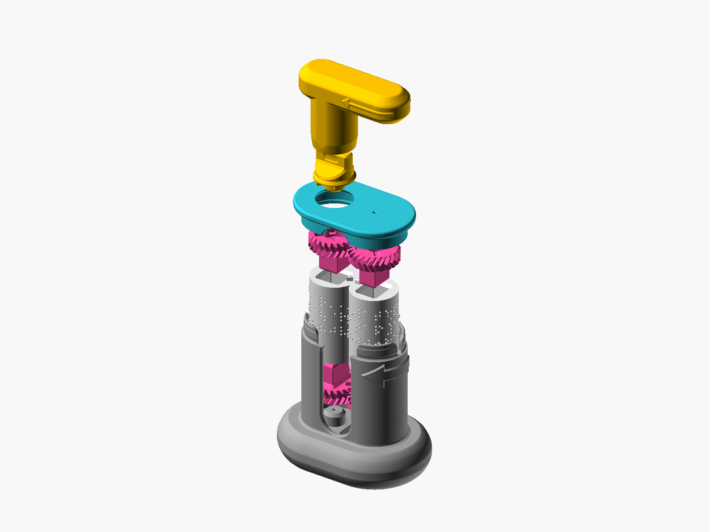

# Design Rationale

Why the Custom Braille Embosser, Version 2 is built the way it is: the problem it answers, the goals set for it, the reasons behind its keyed gears, its cylinder size, its tactile arrows and seam channel, its one-piece roller option and its Push-out Plate, what was tried and dropped on the way, and what is still open. Every dimension is in millimetres, and every date is the day the development record shows a decision or a print.

## 1. The problem

Braille is routine to read and expensive to make. A slate and stylus costs $10 to $30 but is slow and written in mirror image. A Perkins-style manual brailler costs $700 to $1,500 and weighs about 5 kg. An electronic embosser costs $2,000 to $5,000 or more. Version 1 of this embosser, released 2026-05-31, filled a fourth tier: under $10 of filament, any FDM printer, no fasteners or electronics, any text in Grade 1 or Grade 2 braille, every part reprintable.

Version 1 worked, and two early builders reported success. Its weak point was assembly. Each cylinder slid into a pair of snap-fit sleeves that had to be sorted by plus and minus marks, and the two cylinders had to be turned until their triangles pointed straight at each other: "even a little bit of misalignment can break the braille dots". The row markers were printed letters and triangles, read by eye, so a blind user could not check the alignment. The slicer's seam had to be painted by hand over the markers, print speeds halved, and support material printed and picked out. The optional grip extension came as two parts that could need a mallet.

On 2026-08-28, after print tests of rollers with their gears fused on, I set out Version 2: the gears are separate parts again, but each of the four carries a differently shaped peg, and each cylinder end gets a matching keyed hole, so a gear cannot be seated in the wrong place.

## 2. Design goals

- A blind user can assemble, load and work the embosser without sight. Every assembly step is also written for the hands.
- Every gear fits one place only, at every clearance the generator allows, and the part refuses a wrong fit before the builder has to judge it.
- Torque strength in PLA: the pegs carry the drive, so they must not shear or twist.
- The nine printed parts need only a printer's default 0.2 mm profile with supports off: no seam painting, no slower speeds, no support material.
- The cylinders stay 30.8 mm across and grow from 52 mm to 54 mm tall (section 4).
- Nothing that touches the finger moves: dot size, dot spacing and the arrow sizes stay at their tested values.
- Version 1 stays supported. The generator keeps a version switch that defaults to Version 1, and Version 1 output is byte for byte what it was.
- Any FDM printer whose bed takes the Base. No off-the-shelf parts, no circuit board, no glue.
- Walls at least 1.2 mm thick, and no dot taller than 1.0 mm, because 1.1 mm dots scraped the housing in testing on 2026-08-20.
- Documentation and licensing follow the Makers Making Change OpenAT template, as Version 1 did.

Computer rendering. Every part lifted apart along the axis the parts go together on, the Base at the bottom.

## 3. Why keyed pegs

### The four shapes

The requirement was four pegs that each fit one of four holes. The first set, drawn on 2026-08-27 and 2026-08-28, used a six-point star, a hexagon, a 15 x 15 rounded square and a 15 x 15 sharp square. A fit check of every peg against every hole found that the hexagon entered every hole and that Top Gear B's square entered Bottom Gear B's hole. I called it a design error and retired the set the same day.

The answer, signed 2026-08-28, is a family of four rounded rectangles with 0.5 mm corners: 14 x 14 on Top Gear A, 18 x 10 on Bottom Gear A, 16 x 12 on Top Gear B and 20 x 8 on Bottom Gear B. From one to the next the length grows by 2 mm and the width shrinks by 2 mm, so every wrong peg is too long or too wide in at least one direction at every rotation. The nearest wrong pair is still 1.0 mm minus the clearance from fitting: 0.925 mm at the final 0.075 mm clearance. Each peg is stiffer in twist than the hexagon it replaced (an index of 574 to 647 against 457). Regular polygons cannot do this job: a key's symmetry must be a multiple of the 24-tooth gear's 15-degree pitch, and no set of four regular shapes under that rule excludes each other.

Every peg is 15 mm long with a 1 mm flare at its root, and every keyhole mouth has a 2.0 mm chamfer at 45 degrees, so a peg finds its hole by feel. The long side of every keyhole lies across the arrow column, so a flat always faces the arrows. The two keyholes of a cylinder meet at its middle as one through-hole; the barrel is solid.

### Rotation: bump, dent, notch and stud

A peg fixes which gear goes on which end, but a rectangle fits two ways round. The first design put a 3.0 mm triangle bump on Cylinder A's top face, mating with a notch under Top Gear A. After the second print round, on 2026-08-29, I judged that notch a real gain in rotational stability and gave every gear one. Now both top gears carry a notch and both bottom gears a stud; each cylinder has a bump on its top face and a dent in its bottom face, a triangle on A and a 3.0 x 3.0 mm square on B. A gear in the wrong turn stands proud and rocks. The dents are 3.15 mm deep, the stud plus one clearance, after the first cut at 3.00 mm left zero clearance along the axis (2026-08-30). The dent's corners are rounded arcs, never sharp, because a sharp internal corner in a barrel printed standing up is where it would crack.

### Left and right, up and down

Two more layers catch the pair as a whole. The Base's floor has two posts of different diameters, the fatter one on the left, where Cylinder A goes. The B gears' pockets are too small for that post, so a pair put in back to front will not seat and the Lid cannot reach the lip it snaps onto. The teeth are herringbone, a V shape: a roller put in with its bottom gear up does not mesh, and the builder feels it. And both top gears carry a cross on their hub face, a plus sign: plus means up, the way the plus end of a battery is its top. Each gear's hub face also carries a small sunk triangle on the side its notch or stud faces, a mark for the eye: once the pair stands in the Base, the two top gears' triangles point at the join and show that the arrow columns face each other. It is about 3 mm on a side and under a millimetre deep, so the guides describe it as hard to feel and never rely on it.

### What the parts do not catch

Two mistakes pass the keys, so the guides warn about them. The pair can go into the Base upside down, top gears at the bottom; it seats and rolls, but the Knob then finds nothing to key into, which stops the builder. And the Lid will go on before the Knob; the Knob's head then does not fit through the Lid's hole, so the Lid has to come off again. Finally, the keys cannot check that the two cylinders' triangles are nested when the pair is put in. The check comes after assembly: the Knob's keyed seat in Top Gear A and the Handle's cup are both symmetrical, so when the Handle's grip lies level along the Base, pointing right and the same distance from the front as from the back, the triangles are nested. A blind user finds that home position by returning the Handle to it.

## 4. The cylinder barrel

### Diameter: 30.8 mm, found by printing

The Version 2 prototype of 2026-08-28 was drawn at 30.1 mm across. The first print round, on 2026-08-29, embossed with noticeably less pressure than Version 1, so the barrel went to 30.5 mm, half way back. On 2026-08-30 a 30.5 mm double-sided pair felt loose and printed shallow, uneven dots, the same symptom weaker, and the barrel went to 30.8 mm, the size Version 1 has always printed at. The search stopped there because both symptoms have one cause, too little interference between the pair, and the diameter is the only dial that sets it. No gear had to be recut, because every key and every bump sits at a fixed radius; the larger barrel only thickened the wall beside Cylinder A's dent from 1.25 mm to 1.40 mm. The 30.8 x 54 mm pair passed its print test on 2026-09-01.

### Height: 54 mm, a card shelf

The card is 52 mm wide. On 2026-08-31 the Version 2 cylinder grew to 54 mm so that 1 mm of plain barrel stands past each edge of the card: a card rolled in slightly off-axis rides the shelf instead of ruffling over the cylinder's end. The same day the generator's project-wide default went back to 52 mm, the Version 1 standard, and 54 mm became Version 2's alone. The generator holds the Version 2 size at 30.8 x 54.0 mm to within 0.001 mm: a warning for a keyed cylinder, a refusal for a one-piece roller, whose gears are fixed in place and would come loose from a shorter barrel.

### Key clearance

The keyhole is the peg grown outward by one clearance on every side. The clearance moved with every print round, and the dates show why.

| Date | Clearance | What the print showed |
|---|---|---|
| 2026-08-28 | 0.15 mm | the first figure, before any print |
| 2026-08-29 | 0.075 mm | all four holes too loose at 0.15 mm, with the pegs measured exactly nominal |
| 2026-08-30 | 0.110 mm | too tight at 0.075 mm; set on the dial's 0.005 mm step |
| 2026-09-25 | 0.095 mm, one dial per gear | at 0.110 mm, cylinders on 0.12 mm layers, "just a bit too loose" |
| 2026-09-25 | 0.075 mm top gears, 0.085 mm bottom gears | 0.095 mm fitted the bottom gears; the top gears wanted less |
| 2026-09-26 | 0.075 mm on all four | one more round settled the bottom gears too |

The number moved because the layer height moved. Thinner layers put less material into each perimeter pass, so a hole prints closer to its modelled size; the rounds from 2026-09-24 on printed the cylinders at 0.12 mm and the gears at 0.2 mm, and that is the pairing the final value is tuned for. Since 2026-09-25 each gear has its own clearance dial in the generator, so one print round can move one gear without the other three. The A gears have about 0.02 mm more rotational play than the B gears, from the inclined flanks of the triangle; equalising it would mean tightening a clearance against gears already cut, so it was left alone.

### The bump and the dent

The bump's clearance does not follow the dial. Tightening the keyholes under the old shared dial grew the bump into a notch already cut in Top Gear A, so on 2026-08-30 the two were decoupled. The bump clearance is 0.30 mm, derived and never retyped: 0.15 mm measured off the gear's notch plus 0.15 mm of fit. At the old 0.15 mm the bump was line to line in the notch, with 0.005 mm of interference at its base. The same day the bump's base flare went from 0.5 mm to 0.10 mm: the notch has no relief at its mouth, so the old flare stood 0.49 mm proud on each side and Top Gear A cannot have seated flush across two printed rounds. That was found by measurement, never reported by a print.

## 5. Tactile row arrows and the seam channel

### The arrows

Each cylinder carries one arrow per row of text, raised on Cylinder A and sunk on Cylinder B, with the 0.4 mm card setting; the 0.3 mm setting carries three arrows, at the middle and 15 mm above and below it. The arrows are how a user tells the cylinders apart, never dots against dimples, because a double-sided pair has dots and dimples on both. They are also the loading mark: the card's leading edge rests against them.

The arrow sits at the midpoint of the gap between the last cell and the first, on both cylinders, with equal room either side (2026-09-21). On 2026-09-21 a printed 14-cell tactile card ran out of paper at the end of every row while its start lay blank, and the arithmetic showed why: with the card's edge at the arrow, 13 cells need 89.5 mm of a 90 mm card and 14 need 92.8 mm. The generator now recommends 13 cells in tactile mode and warns above it; a 13-cell print passed the same day. In Version 2 with the tactile style the generator also slides the text 2 mm toward the arrow by default (2026-09-28), after a print showed the first cell sitting too far from it.

### The seam channel

A slicer starts each layer somewhere on the outline, and by default it lines those starts up into one seam. On a cylinder covered in dots the seam lands in a dot and can ruin it, which is why the Version 1 tutorial had the user paint the seam by hand. Version 2 cylinders carry a groove instead: a V 1.0 mm wide and 0.5 mm deep, the full height of the outer surface, in the seam gap beside the arrows. The slicer's default Aligned seam mode hides each layer's seam in it. A slicing study on 2026-09-20 (PrusaSlicer, 0.2 mm layers, 260 layers per cylinder) put 100 % of the seams in the groove on both cylinders with the visual row markers, and on Cylinder A with the tactile arrows 90.8 % (93.1 % with three arrows) with every escape on an arrow's own tip, never a dot. Without the groove, 18 % to 24 % of layers seamed in a dot. The "rear" seam mode was tried and dropped on 2026-09-20: it leaves 71 % to 77 % in the groove on the visual cylinder and 28 % to 32 % on the tactile one.

In tactile mode the groove runs down the arrow column itself. Two prints shaped its path. The first, on 2026-09-21, had the groove in two stretches that stopped short of the arrows, and wherever it stopped the slicer chose a dot: a groove at every layer is what matters. The second cut the groove straight through the raised arrows, and I found that each arrow lost its point and was harder to tell by touch. Since 2026-09-22 the groove steps round each raised arrow on the first-cell side, keeping 0.25 mm of flat between arrow and groove and slanting at most 45 degrees off the axis, so the arrows stay whole. The seams that land on the arrow tips were judged acceptable in print on 2026-09-23. When the gap is too narrow for the groove, as with 15 tactile cells on a 30.8 mm barrel, the generator leaves it out of both cylinders and says so; 14 cells keep it.

## 6. One-piece rollers

The generators can also make each cylinder with its two gears already part of it, as one solid. The idea dates from 2026-08-24: fewer separate objects means fewer assembly steps, and meshed gears are what hold the pair in step. The trade-off was signed on 2026-09-21: fixed gears save assembly time and parts, but each cylinder prints much longer and dots fail more often. The Version 2 one-piece roller, since 2026-09-21, has a solid barrel with no keyholes, bump or dent, since a peg buried in solid material needs no key; the two top-gear notches are filled, so no void is sealed inside. Hidden rings 0.1 mm thick, from 8.0 mm to 13.0 mm out from the axis, weld each gear to the barrel.

Three changes on 2026-09-24 made the roller print bottom gear down with supports off. The barrel's bottom edge is chamfered 0.65 mm at 45 degrees, because the gear face it stands on reaches only 14.61 mm from the axis and the 15.4 mm barrel overhung it by 0.79 mm; 0.65 mm leaves the 0.14 mm ledge my own print had, and 0.35 mm of flat shelf for the card. A 2 mm vent runs the whole axis, so no cavity is sealed; the separate gears already carry that hole down each peg. And the flat ceiling of each bottom gear's pocket became a 45-degree cone: of four support shapes sliced, only the cone gave zero overhang and zero bridging, where the flat ceiling had 36.1 mm of perimeter over air and 265 mm of bridge. The top gear's pocket floor got the mirror cone on 2026-09-25, so both ends match. My one-piece Version 2 roller passed its print check on 2026-09-24.

## 7. The Push-out Plate

New prints fit the Base tightly, and the cylinders can be hard to pull out by hand. The Push-out Plate (described in the Assembly Guide By Touch) answers that: the Base is set down onto its three pegs, which rise through a slot and two holes in the floor and push the rollers up and out. It is optional.

## 8. Materials and printing choices

The nine parts print in PLA or PETG, in any rigid filament and any colour; PETG is a little tougher, and either works. They print with a printer's default 0.2 mm profile, 3 walls, 15 % infill, supports off and seam Aligned. The seam channel, the keyhole shapes and the dot shapes do what supports, seam painting and slower speeds used to. A sliced Bambu Lab X1C project puts all nine on one plate, with 5 top and 3 bottom layers and brim ears, on a textured PEI sheet.

The cylinders are the exception. They print standing on end at 0.12 mm layers or finer, with at least 3 walls and 15 % infill, and with the Arachne wall generator rather than Classic, which I found gives the dots a cleaner shape. Thin layers also matter to the fit: the key clearance is tuned for these layers (section 4).

## 9. What was tried and dropped

| What | When | Why it was dropped |
|---|---|---|
| Star, hexagon and two 15 x 15 square pegs | 2026-08-28 | the hexagon entered every hole; a square entered the wrong hole |
| A bump on Cylinder A only | 2026-08-29 | the notch proved so good that every gear got one |
| A 0.5 mm flare at the bump's base | 2026-08-30 | it stood 0.49 mm proud per side and the gear could not seat flush |
| One shared clearance dial for all four keys | 2026-09-25 | a print round could not move one gear without the others |
| A "rear" seam export, the cylinder rotated | 2026-09-20 | dots within 20 degrees of the seam side reached outside the groove |
| A fixed lead-in before the first cell | 2026-09-21 | the print showed the groove beside the arrows and a blank run after the last cell |
| A groove in two stretches, stopping short of the arrows | 2026-09-21 | wherever the groove stopped, the slicer put the seam in a dot |
| A groove cut straight through the raised arrows | 2026-09-22 | each arrow lost its point and was harder to tell by touch |
| A premade support plug in the roller's gear pocket | 2026-09-24 | the 45-degree cone needs no support at all |
| The 2026-08-24 gear samples for the Version 1 one-piece roller | 2026-09-28 | their B hub bore was 9 mm where the Version 1 housing needed 14 mm |

The gear samples of 2026-08-24 belonged to the new design's lineage, and their teeth are identical to Version 1's; the Version 1 one-piece roller was rebuilt from the Version 1 parts the same day the mismatch was found.

## 10. Known limits and open items

- Printed mass, print time and filament cost are measured on a Bambu Lab X1C only (Device Summary, section 6).
- No CAD source is published for Version 2: STL files only. Version 1's Fusion 360 archive and STEP files are in the Version 1 repository.
- The card-fit rule and the generator's layout assume a 90 x 52 mm card, the figure every page carries; a US business card, 3.5 by 2 inches or 88.9 x 50.8 mm, is a little narrower, and at that width the generator warns at 13 tactile cells (12 fit).
- The generator's stored Version 1 default diameter is 30.75 mm, while its live page and every print use 30.8 mm. Every "Version 1 is 30.8 mm" statement here means the printed size.
- The Version 1 README puts the filament at $3 to $6 per device, while the Version 1 Summary's measured figure is $6.72 at $25 per kg. Version 2 is costed at $15.99 per kg (Device Summary, section 6), so the two versions are compared by mass and time, not by cost.
- The assembled reference file carries an older Lid, 80.8 x 50.8 mm against the released 80.35 x 50.35 mm, and 30.5 x 57 mm sample cylinders; it is for pictures, not for printing.
- Whether a 3 mm triangle bump can be told from a 3 mm square bump by touch varies from person to person: some can, some cannot, and no step in the guides depends on it; the keyholes, not the bumps, settle which gear goes where.
- Text room per row on a 30.8 mm barrel is limited; an email address can be too long for one row.
- Only the 0.3 mm and 0.4 mm settings are tuned; card between them is embossed at 0.4 mm, which presses a little deep rather than too shallow.
- I recorded the Version 2 assembly on 2026-10-01; the video is not published until it is edited.
- No independent builder has yet built Version 2 from these guides alone.

## 11. Sources

- My dated development record: the research folders from 2026-08-16 to 2026-10-02, kept outside this repository.
- The specifications of the cylinder generator, in the [braille-cylinder-stl-generator](https://github.com/BrennenJohnston/braille-cylinder-stl-generator) repository under `docs/specifications/`: the Embosser Version 2 keyed cutouts, gear-integrated rollers, surface dimensions, recess indicator and interpoint double-sided specifications.
- The Version 1 Design Rationale and Summary, in the [Version 1 repository](https://github.com/BrennenJohnston/custom-braille-embosser-3d-printing-project).
- The OpenSCAD generator, [braille-cylinder-stl-generator-openscad](https://github.com/BrennenJohnston/braille-cylinder-stl-generator-openscad), whose Version 2 file is vendored in this repository.
- Braille Authority of North America, Guidelines for Brailling Business Cards, for the text that fits a card.
- US Patent 5,527,117, for the half-pitch diagonal offset, 1.25 x 1.25 mm, between the two faces of a double-sided card.
- Makers Making Change, OpenAT Template v1.2, for the shape of this document set.
