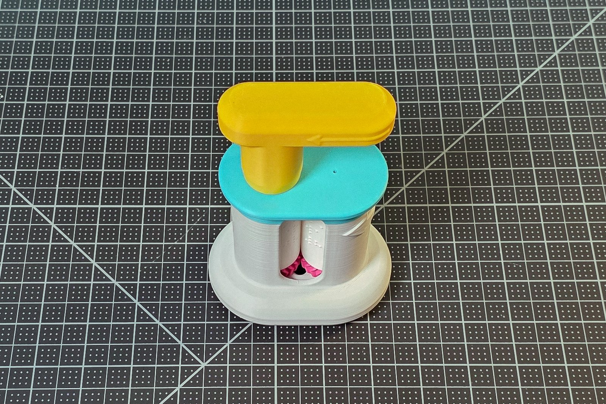
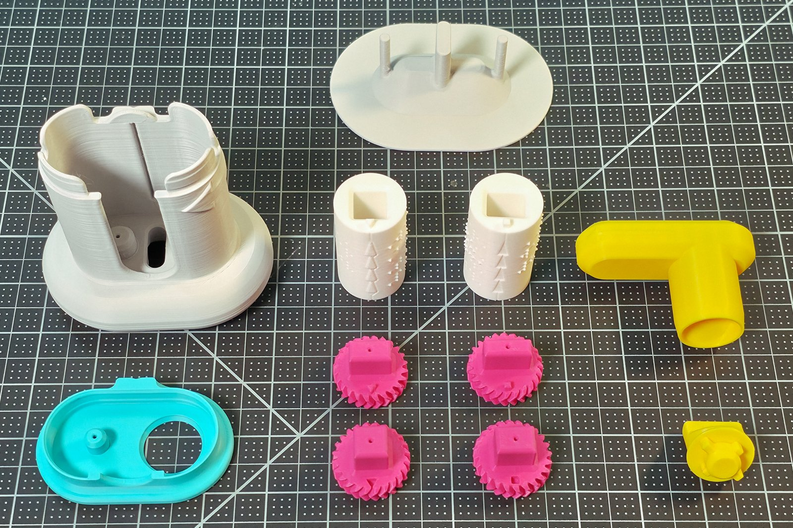

# Device Summary

The Custom Braille Embosser, Version 2 is a hand-turned press that embosses permanent raised braille onto business-card stock. It is nine 3D-printed parts plus two cylinders generated from typed text, with no fasteners, springs, glue or electronics, and it can be assembled, loaded and worked by touch as well as by sight.

## 1. What it is and who it is for

The finished embosser from the front, with the two cylinders showing through the window.

The embosser is for a blind or low-vision person who wants braille business cards, labels and short messages, and for anyone who supports them: a sighted helper, a teacher, a parent or a caregiver who needs a few lines of braille without a commercial brailler. Device category: communication, in writing, by braille. Disability types served: vision impairment and blindness.

Version 2 keeps Version 1's press and adds three things for a user who cannot see it: keyed gear pegs, tactile row arrows on the cylinders, and raised direction arrows on the Base. Section 5 sets them against Version 1.

The message is not on the device. It is on a pair of cylinders generated from typed text in a browser at <https://braille-cylinder-stl-generator.vercel.app> (more than fifty languages; the STL is built in the browser and nothing typed leaves it) or with the OpenSCAD file in this repository. Changing the message means printing one new pair. A double-sided pair embosses both faces of a card in one pass.

## 2. How it works

Two cylinders stand side by side inside the Base with their gears meshed. A card goes in at the slit in the back, passes between the two cylinders when the Handle is turned, and comes out of the window at the front with the braille pressed into it. Cylinder A carries the raised dots and Cylinder B the matching dimples, so the card takes its shape between them. In use the embosser lies on its side, slit up, so the card drops onto the cylinders; it is then turned over to watch the dots through the window and, still held in the cylinders, rolled back and forward over the rows until every dot is formed.

## 3. What is in the kit

Every part before assembly: the Base top left, the Push-out Plate top centre, the two cylinders top right, the Handle at the right, the Lid bottom left, the four gears bottom centre and the Knob bottom right.

| Part | How many | Where it comes from |
|---|---|---|
| Base | 1 | printed from this repository |
| Lid | 1 | printed from this repository |
| Top Gear A, Bottom Gear A, Top Gear B, Bottom Gear B | 1 each | printed from this repository |
| Knob | 1 | printed from this repository |
| Handle | 1 | printed from this repository |
| Push-out Plate (optional) | 1 | printed from this repository |
| Cylinder A and Cylinder B | 1 each | generated for your text, then printed |
| Card stock, 0.3 to 0.4 mm | a few cards | any office-supply or craft store |

The Base is one part with the grip built in. The Lid snaps onto it, the Knob keys into Top Gear A, and the Handle snaps onto the Knob. The Push-out Plate is a tool: the Base is set down onto its three pegs to lift the cylinders out.

## 4. Specifications

| Item | Value |
|---|---|
| Base | 100.3 x 70.3 mm footprint, 96.3 mm tall; the Lid, Knob and Handle stand above it |
| Cylinders | 30.8 mm across, 54.0 mm tall, keyed at both ends; Version 1 cylinders do not fit |
| Gears | 24 herringbone teeth, 32.2 mm across, 10 mm body with a 15 mm peg |
| Pegs | 14 x 14, 18 x 10, 16 x 12 and 20 x 8 mm, corners rounded to 0.5 mm |
| Card | business-card stock, about 0.4 mm thick, most cards; 0.3 mm as a fallback; text laid out for 90 x 52 mm |
| Text | up to 4 rows per face; 13 cells per row recommended in tactile mode |
| Braille spacing | dot 2.5 mm, cell 6.5 mm, line 10.0 mm |
| Fasteners, springs, glue, electronics | none |
| Assembly | by hand, no tools; a first assembly in five minutes or less, my estimate |
| Print settings, nine parts | 0.2 mm default profile, 3 walls, 15 % infill, supports off, seam Aligned; PLA or PETG |
| Print settings, cylinders | 0.12 mm or finer, at least 3 walls, 15 % infill, Arachne walls, standing on end; PLA |
| Printer | any FDM printer whose bed takes the Base; the X1C project uses about 188 x 184 mm |

## 5. What changed from Version 1

| Version 1 | Version 2 |
|---|---|
| Each cylinder slid into a pair of snap-fit sleeves, sorted by plus and minus marks | Each gear's peg fits one keyhole only, and the notch or stud beside it fixes the turn |
| Row markers were printed letters and triangles, read by eye | A column of arrows on each cylinder, raised on A and sunk on B, read by touch |
| Cylinders 52 mm tall | Cylinders 54 mm tall: a 1 mm shelf past each edge of the card |
| A two-part grip extension, sometimes a tight fit | A one-piece Base with the grip built in |
| The slicer seam had to be painted by hand over the markers | A seam channel on every cylinder; no painting |
| Halved print speeds and support material for the device | A default 0.2 mm profile with supports off |
| Cylinders pulled out by hand | An optional Push-out Plate |
| No set order for the last parts | Knob first, then Lid, then Handle; both top gears carry a cross meaning up |

## 6. Cost and print time

Measured in Bambu Studio from the sliced Bambu Lab X1C projects in this repository, in Bambu PLA Basic with a 0.4 mm nozzle:

| What | Filament | Print time | Filament cost at $15.99 per kg |
|---|---|---|---|
| The nine parts, one plate | 188.22 g, 62.11 m | 6 h 11 min | $3.01 |
| One cylinder pair, the Washington example | 36.96 g, 12.20 m | 2 h 46 min | $0.59 |
| The tactile assembly map, six plates on three beds | 172.87 g, 57.04 m | 4 h 25 min | $2.76 |

An embosser with one message, the nine parts and one pair, is 225 g of PLA, about $3.60, in just under 9 hours of printing; the map is optional. Each part's own mass is in the bill of materials. The price is a Bambu Lab replacement spool of PLA in October 2026. Card stock costs about $0.15 a card at 0.3 mm or $0.20 at 0.4 mm. There are no other costs.

For scale, Version 1 measured on the same printer: 268.81 g of PLA for the device in 8 h 44 min at 0.2 mm, and 24.68 g for one cylinder pair in 3 h 5 min at 0.12 mm.

## 7. Licenses

- Hardware: CERN-OHL-W v2 or later.
- Documentation, photographs and videos: CC BY-SA 4.0.
- Software, the scripts and tests in this repository: GPL-3.0-or-later.
- The cylinder generators, the web app and the OpenSCAD file, are separate projects under PolyForm Noncommercial 1.0.0: free for personal, educational and non-commercial use.

The device was designed and tested by Brennen Johnston. The documentation template is the Makers Making Change / Neil Squire Society OpenAT template, used under CC BY-SA 4.0. The web app's translation is by the open-source Liblouis library.

## 8. Where the files are

| What | Where |
|---|---|
| The nine printed parts | [`Build_Files/3D_Printing_Files/STL/`](../Build_Files/3D_Printing_Files/STL) |
| The sliced Bambu Lab X1C projects: the nine parts, the example pair, the map | [`Build_Files/3D_Printing_Files/Print_Profiles/X1C/`](../Build_Files/3D_Printing_Files/Print_Profiles/X1C) |
| How to generate cylinders: the web app and the OpenSCAD copy | [`Build_Files/3D_Printing_Files/Embossing_Plates_Customizer/`](../Build_Files/3D_Printing_Files/Embossing_Plates_Customizer) |
| A ready-made pair that says "Washington", for 0.4 mm card | [`Build_Files/3D_Printing_Files/Embossing_Plates_Examples/`](../Build_Files/3D_Printing_Files/Embossing_Plates_Examples) |
| Every part in its assembled position, one file, for reference | [`Build_Files/3D_Printing_Files/Assembly_Reference/`](../Build_Files/3D_Printing_Files/Assembly_Reference) |
| Build it in a few pages | [Maker Guide](Step_2_Guide_Option_3_Custom_Braille_Embosser_V2_Maker_Guide.md) |
| Build it without sight | [Assembly Guide By Touch](Step_2_Guide_Option_2_Custom_Braille_Embosser_V2_Assembly_Guide_By_Touch.md) |
| Build it from pictures alone | [Visual Assembly Guide](Step_2_Guide_Option_1_Custom_Braille_Embosser_V2_Visual_Assembly_Guide.md) |
| Use it | [User Guide](Step_3_Guide_Custom_Braille_Embosser_V2_User_Guide.md) |
| Why it is built this way | [Design Rationale](Custom_Braille_Embosser_V2_Design_Rationale.md) |
| Bill of materials | [`Custom_Braille_Embosser_V2_BOM.csv`](Custom_Braille_Embosser_V2_BOM.csv) |
| Version 1 | <https://github.com/BrennenJohnston/custom-braille-embosser-3d-printing-project> |
