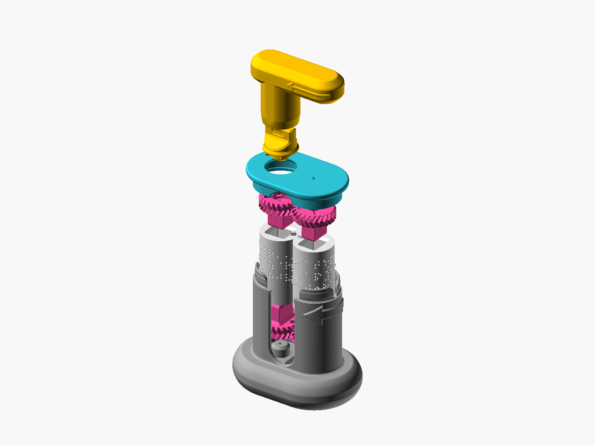
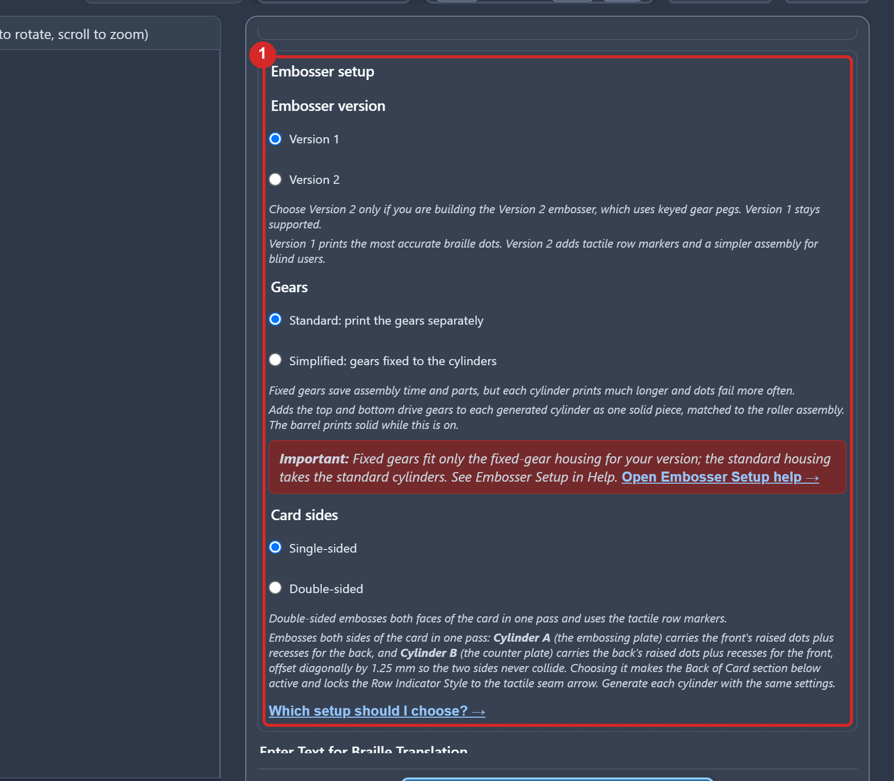
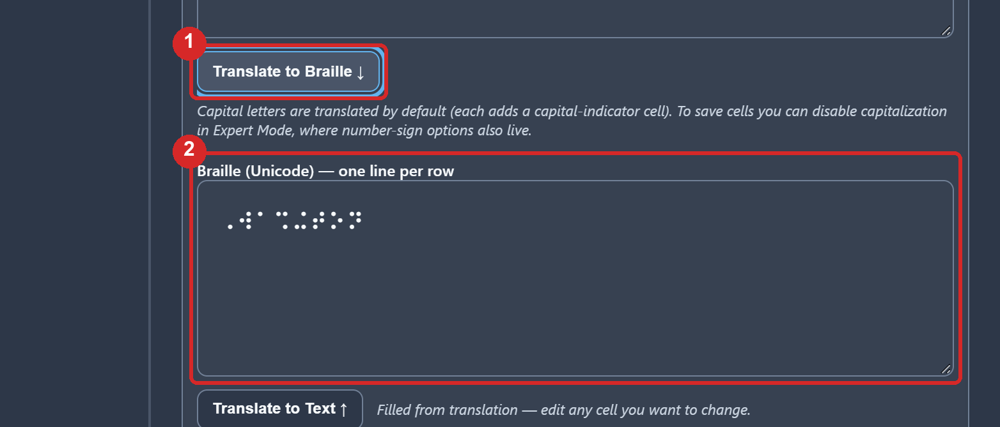
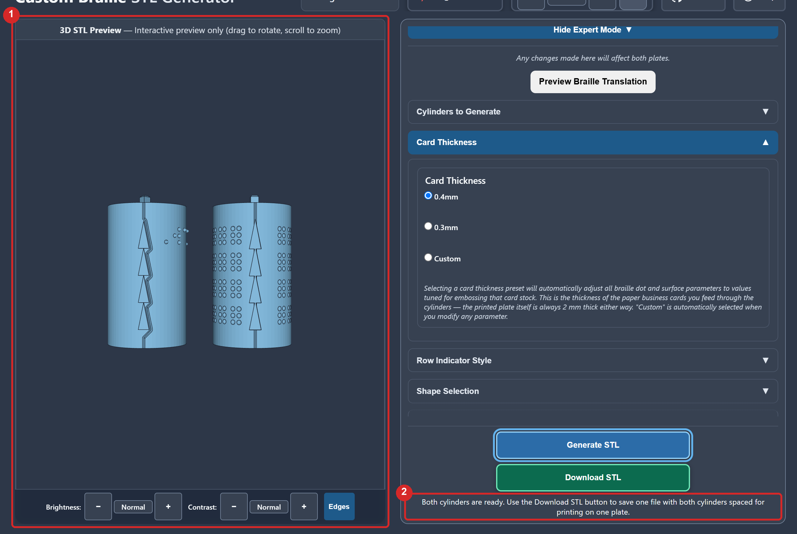
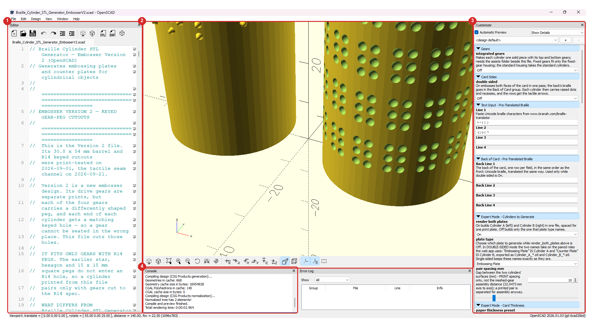
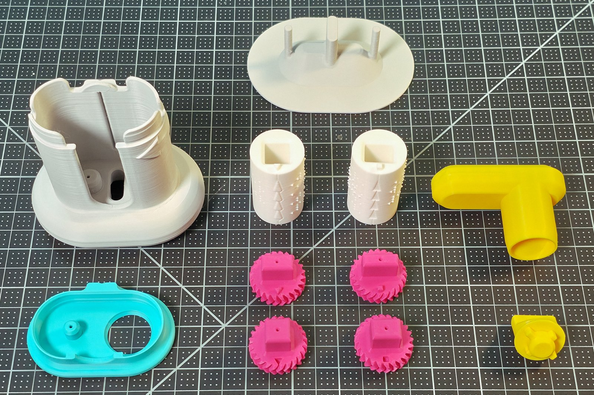
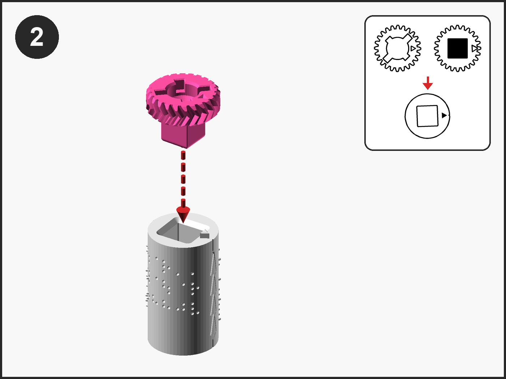
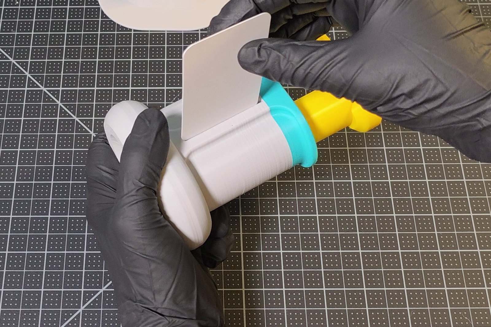
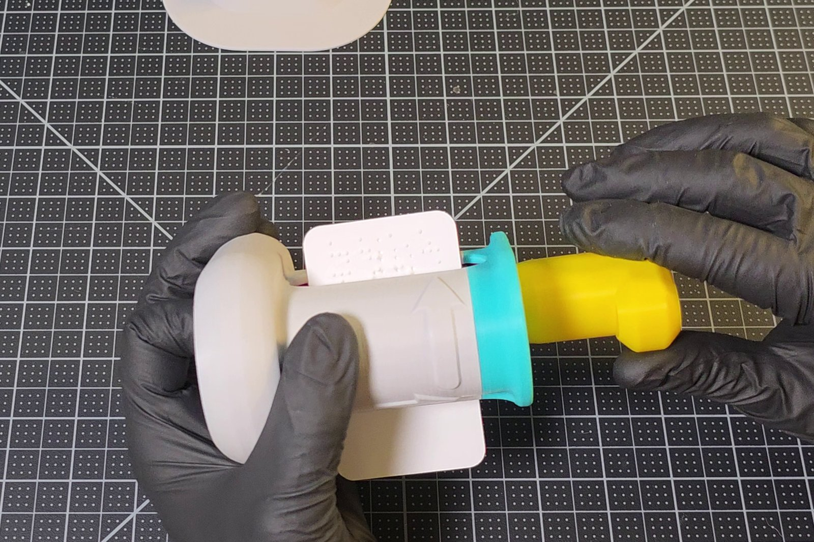

# MakerWorld Listing

The text and pictures of the Custom Braille Embosser, Version 2, listing on MakerWorld, laid out field by field in the order the upload form asks for them, so each block can be pasted straight in. The Word copy of this page, `Custom_Braille_Embosser_V2_MakerWorld_Listing.docx`, is the one to work from; under every picture it names the file to upload.

## 1. Model title

Custom Braille Embosser V2 — Hand-Operated Braille Card Embosser, Keyed Gears, Built for Blind Makers

## 2. Summary

A fully 3D-printed, hand-turned embosser that presses braille into business cards. Nine snap-together parts, no fasteners, and a web app that translates your text and generates the braille cylinders in your browser.

## 3. Description

### Custom Braille Embosser V2 - Tactile Friendly

I started this project about a year ago because I couldn't find a quick and affordable way to make custom braille business cards. The tools that exist are a slate and stylus, a Perkins-style brailler, or an electronic embosser that costs more than most people will spend on a few cards. None are a simple way to make a small batch of cards with your own text. Version 1 of this embosser fixed that for me. However, many people who printed that version were kind enough to guide me on what needed to be changed to make it more accessible. Version 2 is the result of those experts' feedback.

### What's new in Version 2

- **A wrong assembly is nearly impossible.** Each of the four gears has a differently shaped peg, and each end of each cylinder has a hole that takes one peg only. A wrong gear will not go in, so trying is a fair way to find the right one.
- **Built to be assembled by touch.** Every cylinder carries a column of tactile triangles, raised on one cylinder and sunk on the other, that nest when the pair is lined up. Both top gears carry a cross shape, which means that side faces up. Every step was designed for tactile-only assembly, and a printed tactile assembly map lets you learn every keyhole, peg and notch by touch before you start.
- **One-piece Base.** This version has the grip extension built in, with the addition of raised arrows on its side that show which way the card travels and which way the card's information should face.
- **An optional Push-out Plate tool.** This extra part helps lift the cylinders out of the Base when you want to make a change.
- **A seam channel on the cylinders.** A built-in design that gives your slicer somewhere to hide its layer seam, so it never lands on a braille dot.

### Step 1: make your cylinders with the web app

The embosser files don't include ready-to-print cylinders with your message on them. Customizing the message on the cylinders, generating the STL and downloading that file is the first step of the project you need to complete. There are two ways to make the custom braille cylinders, and the one I would start with is the web app I built for this project because it translates the text for you:

**<https://braille-cylinder-stl-generator.vercel.app>**

Select Version 2, type your text, press Generate, and download one file with both cylinders spaced for printing on one plate. Translation is done for you by **Liblouis**, the open-source braille translation engine used by screen readers and braille displays worldwide. It comes with more than fifty language tables and both contracted (grade 2) and uncontracted (grade 1) braille. If you read braille yourself, the translation lands in an editable field first, so you can change any cell before you generate.

Everything runs in your browser and your text never leaves your computer. The app is built for screen readers and keyboard use, and it has a help page of its own if you need it.

The step-by-step **Web Generator Guide** in the download walks through every control with a marked screenshot.

### Optional path 2: the MakerWorld customizer

The same generator exists as an OpenSCAD model, and a copy of it is this listing's customizer: **Braille_Cylinder_STL_Generator_MakerWorld_v2.scad** among the model files. It makes the same standard cylinders with the same dials (the one-piece rollers with fixed gears come from the web app or the offline copy). There is an **OpenSCAD Generator Guide** in the download files that walks through it, including the offline copy for your own computer.

The largest difference for path 2: **the customizer does not translate.** It takes braille characters only, so you must turn your text into Unicode braille yourself with a translator of your choice (the guide shows one) and paste it in, one row at a time. The translation is then entirely yours to be responsible for, with no Liblouis behind it; that's why I would start with the web app.

### Printing

**The main assembly parts.** For the main assembly parts you can use your printer's default 0.2 mm profile: 3 walls, 15 % infill, supports off. Nothing needs supports, seam painting or slow speeds.

**Two customized cylinders.** The customized cylinders do better at 0.12 mm layers or finer, at least 3 walls, 15 % infill, with the **Arachne** wall generator rather than Classic, supports off. An example STL pair is included with slicer settings for the X1C.

**The tactile assembly map (optional).** This tactile assembly reference is six flat plates, one line of shapes each, with the number of each shape in braille, that print best at 0.2 mm, no supports, also sliced for the X1C.

**Print times and filament.** From the sliced X1C projects, the nine parts take 6 h 11 min and 188 g of PLA on one plate; a cylinder pair 2 h 46 min and 37 g; the map's six plates 4 h 25 min and 173 g over three beds.

### Assembly

There are twelve assembly steps. The first step is to build Roller A (a cylinder with its two gears), then build Roller B, pair them so the triangles nest, drop the pair into the Base, then the Knob, the Lid and the Handle.

The download files have three editions of the assembly guide, all built from the same steps:

- the **Maker Guide**, the short edition;
- the **Assembly Guide By Touch**, which describes every step for tactile users, with a Check and a By touch block in each section, so the embosser can be built without sight;
- the **Visual Assembly Guide**, pictures only, with the part to find sketched beside each step.

### Using it

Turn the Handle to home (grip level along the Base, pointing right), lay the embosser on its side with the slit up, drop a card in, turn about half a turn, turn the embosser over and keep turning until the last row has come out. With the card still held in the cylinders, roll back and forward over the rows twice more, then let it out: a card that has left the cylinders can't go back in the same place. The **User Guide** covers it with a picture for every step, including changing the message. The pair is made for 0.4 mm card, which is most business cards; if a pair punches holes through your card instead of leaving rounded dots, the guide says when to generate one at 0.3 mm.

### If something doesn't fit

- A gear's peg won't enter: wrong gear for that end; only one fits.
- The pair won't drop fully into the Base: it's in back to front; Cylinder A, with the raised triangles, goes on the left.
- The Knob finds no pocket: the pair is upside down; the crosses on the top gears face up.
- The Handle catches: the triangles aren't nested; lift the Lid and pair the rollers again.
- Holes instead of dots: the card is thinner than the pair is made for; generate a pair at 0.3 mm or use thicker card.

### What's in the download

STL files for the nine printed parts (the Push-out Plate among them), the example cylinder pair, the tactile assembly map's six plates and its OpenSCAD files, the three sliced X1C projects, an assembled reference STL, the offline OpenSCAD generator, and seven guides as tagged PDFs with every picture described, numbered by the step they belong to: Step 1, the Web Generator Guide and the OpenSCAD Generator Guide; Step 2, the Visual Assembly Guide, the Assembly Guide By Touch, the Maker Guide and the Tactile Assembly Map Key; Step 3, the User Guide.

### Open hardware

- Hardware: CERN-OHL-W v2
- Documentation, photos and renders: CC BY-SA 4.0
- Project scripts: GPL-3.0-or-later
- The cylinder generator (web app and OpenSCAD copy): PolyForm Noncommercial 1.0.0, free for personal, educational and other non-commercial use

MakerWorld allows one license per listing; CC BY-NC-SA 4.0 is the closest single match, and the lines above are the authoritative split.

### Credits

Designed and tested by Brennen Johnston. Braille translation by the open-source Liblouis library. Documentation in the Makers Making Change Open AT template. Source and every file: [GitHub, custom-braille-embosser-v2](https://github.com/BrennenJohnston/custom-braille-embosser-v2).

If you build one, please post a make or a comment, and tell me what confused you: that is the most useful thing I can hear.

## 4. Category

Education, other education models (as Version 1)

## 5. License

CC BY-NC-SA 4.0, with the four-way split stated in the description

## 6. Tags

braille, accessibility, assistive-technology, embosser, braille-embosser, blind, vision-impairment, business-card, tactile, openscad, customizable, hand-operated, no-fasteners, educational, openat, makers-making-change

## 7. External links

- <https://braille-cylinder-stl-generator.vercel.app> (the web app)
- <https://github.com/BrennenJohnston/custom-braille-embosser-v2> (source)

The two customizers, the cylinder generator and the tactile assembly map, are the `.scad` files among this listing's own model files (MakerWorld's Parametric Model Maker), so they have no address of their own to link. The listing itself is <https://makerworld.com/en/models/3405044-custom-braille-card-embosser-v2-tactile-friendly>.

## 8. Print profiles

| Profile | File | Settings | Description to paste |
|---|---|---|---|
| Bambu X1C, all nine parts | `Print_Profiles/X1C/Custom_Braille_Embosser_V2_Assembly_X1C.3mf` | 0.2 mm, 3 walls, 15 %, supports off | All nine printed parts on one plate. The cylinders are generated for your text and printed separately: see the description. |
| Bambu X1C, example cylinder pair | `Print_Profiles/X1C/Custom_Braille_Embosser_V2_Cylinders_X1C.3mf` | 0.12 mm, 3 walls, 15 %, Arachne, supports off | The ready-made "Washington" pair for 0.4 mm card: a first test of your printer before you generate your own. |
| Bambu X1C, tactile assembly map | `Print_Profiles/X1C/Custom_Braille_Embosser_V2_Tactile_Assembly_Map_X1C.3mf` | 0.2 mm, 2 walls, 15 %, supports off | The six plates of the tactile assembly map, flat on the bed; the key document in the download names every number. |

Every profile needs one real photo of the printed result on MakerWorld: in `MakerWorld_Photos/Real_Photos/`, the finished embosser (01 to 05) serves the nine parts, the cylinders with their gears (07 and 08) the cylinder pair, and the printed plates (13 to 17) the tactile assembly map.

## 9. Cover picture

`MakerWorld_Photos/Cover/1_desktop_4x3.jpg` for the desktop site and `2_mobile_3x4.jpg` for the app; `MakerWorld_Photos/README.md` says how the pictures are framed.

## 10. Videos

MakerWorld takes a video under 30 seconds: upload `Video_Tutorials/Custom_Braille_Embosser_V2_Assembly_Animation_Short.mp4`, the rendered build in 28 seconds; `..._Short.gif` beside it is the same for a picture slot. The full 48-second animation can be posted to YouTube and linked here; the Version 1 tutorials show the web app and the embossing technique, which have not changed.

## 11. Files to upload

MakerWorld's model-file slot takes 3D and CAD files only (stl, 3mf, step, scad, zip and the like) and refuses a PDF or a Markdown page, so the documents travel in a ZIP, made by `python scripts/makerworld_bundle.py` into `build/makerworld/`. The Device Summary, the Design Rationale and the bill of materials wait for a later release.

| Slot | Files |
|---|---|
| Model files | The nine STL files in `Build_Files/3D_Printing_Files/STL/`; the two example pairs in `Embossing_Plates_Examples/`; the six plates in `Tactile_Assembly_Map/STL/`; `Assembly_Reference/Braille_Embosser_V2_Assembled_Example.stl` |
| Model files, ZIPs | `Custom_Braille_Embosser_V2_Guides.zip` (the seven step-numbered guide PDFs); `Custom_Braille_Embosser_V2_OpenSCAD_Generator.zip` (the offline generator with its assets) |
| Print profiles | The three X1C projects in `Print_Profiles/X1C/` (field 8) |
| Parametric Model Maker | `MakerWorld_Customizer/Braille_Cylinder_STL_Generator_MakerWorld_v2.scad` and `Tactile_Assembly_Map/Custom_Braille_Embosser_V2_Tactile_Assembly_Map_MakerWorld.scad`, each on its own |
| Video | The 28-second MP4 (field 10) |
| Pictures | `MakerWorld_Photos/`: the cover (field 9), the real photos in the order of their numbers, and the renders |
