# Web Generator Guide

How to make the two braille cylinders for the Custom Braille Embosser, Version 2, with the web generator at <https://braille-cylinder-stl-generator.vercel.app>: open the page, choose Version 2, type your text, check the braille, generate, download and print.

## 1. Before you start

You need a web browser on a computer, tablet or phone, and the text you want on the card. The generator runs entirely in your browser: your text is never sent to a server.

Every control on the page has a name a screen reader announces, and the Tab key moves through them in the order this guide follows.

## 2. Open the generator

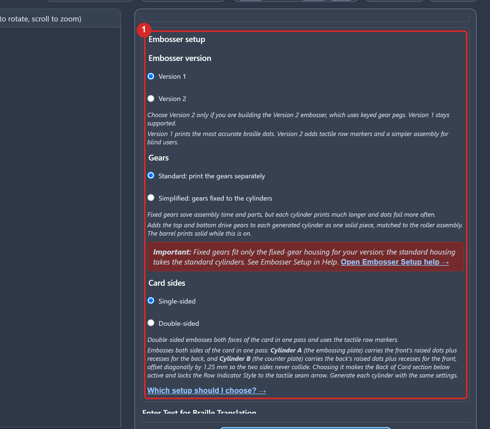

The page as it opens. The 3D preview on the left is empty until you generate. The form on the right starts with Embosser setup (1), the three choices this guide takes you through first. Below it come the text boxes, the language list, Expert Mode and the Generate STL button.

1. Open <https://braille-cylinder-stl-generator.vercel.app>.
2. Find the heading Embosser setup at the top of the form.

## 3. Choose Version 2

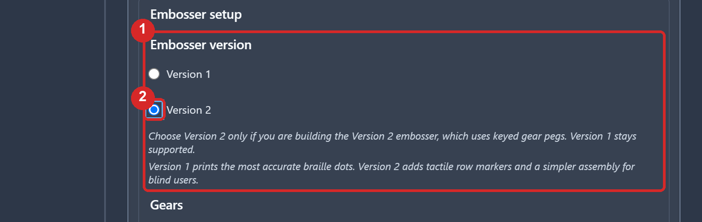

The Embosser version choice (1) with Version 2 (2) selected. The note under it says Version 2 uses keyed gear pegs.

1. Under Embosser version, choose Version 2.

Version 1 and Version 2 parts do not mix: the Version 2 Base is a different part from the Version 1 housing, and nothing printed for Version 1 fits it, even where the parts look alike. If you do not own a Version 1 embosser, Version 2 is the one to choose, the current and simplest version. If you own a Version 1 embosser, the Version 1 choice here makes cylinders for it, and the upgrades Version 2 brought are there for Version 1 too, as options under that choice: the seam channel, the double-sided pair and the one-piece rollers with fixed gears, all of which fit Version 1 parts.

## 4. Card sides and gears

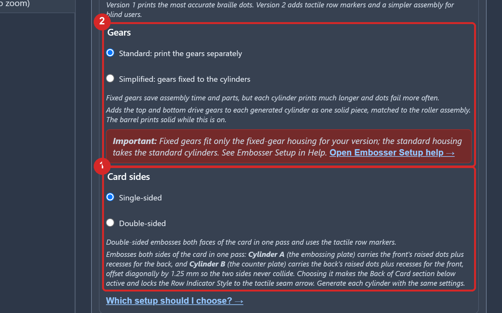

The Card sides (1) and Gears (2) choices, both at their defaults, Single-sided and Standard.

Card sides: Single-sided puts your message on one face of the card. Double-sided is for when you have more to say than fits on one side: it opens a second text box for the back of the card, and one pass embosses both faces.

Gears: Standard makes the two cylinders on their own, with the four gears printed as separate parts, so a cylinder is easy to swap out after a printing error or when the message changes. Simplified makes each cylinder with its two gears already part of it: fewer parts to assemble and a tighter fit between gear and cylinder for embossing, but a cylinder that misprints or needs updating is reprinted together with its gears. A suggestion: start with Standard until you have a known working print, then try Simplified if you would rather have fewer parts or that tighter fit.

1. Choose Card sides and Gears for the pair you are making.

Section 13 shows what changes on the page with Double-sided or Simplified.

## 5. Type your text

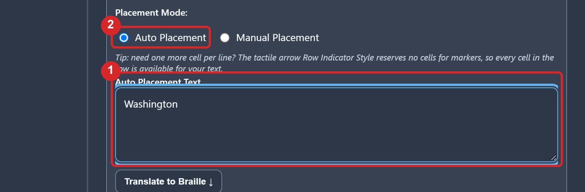

The text box (1) with Washington typed in, and Auto Placement (2) chosen above it.

Placement Mode: Auto Placement takes one block of text and wraps your words over the braille rows, keeping each word whole. Manual Placement gives you one box per row, each with its own language choice, so you decide exactly what goes on each row: a name on one, a phone number on the next. Auto suits most text; Manual is there when the row breaks or the languages matter to you.

1. Choose a placement mode.
2. Type your text. In Auto Placement, press Enter where you want a new row to start; in Manual Placement, each box is one row.

A row holds thirteen braille cells, and a cylinder holds four rows. A capital letter costs an extra cell, and a contracted word takes fewer cells than its letters: the next step shows you exactly what fits.

## 6. Language and grade

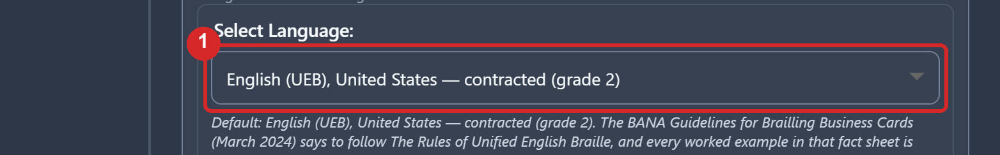

The language list (1) at its default, English (UEB), United States, contracted (grade 2).

1. Choose your language and grade. The page opens at English (UEB) grade 2.

Grade 2 is contracted braille, the braille most readers know; grade 1 spells every letter and suits names and addresses.

## 7. Translate and check

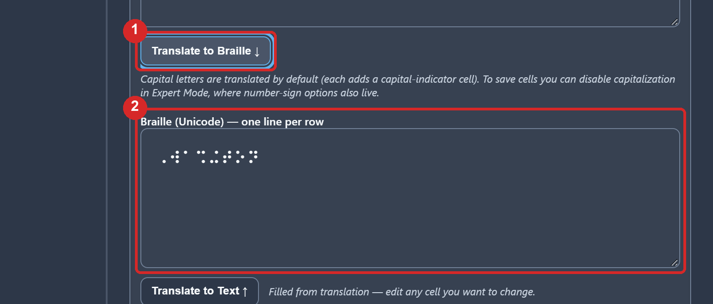

The Translate to Braille button (1) and the braille field (2) it fills, here with the eight cells of Washington in grade 2.

1. Press Translate to Braille.
2. Read the braille field. Each line is one row of the cylinder. If a row was too long, the generator says so under the field.
3. To read the braille back in print, press Translate to Text under the field.

Whatever stands in the braille field is what gets embossed, exactly as written, so you can edit a cell here. Clear the field to go back to translating the text above. Generate fills it for you if you skip this step.

## 8. Card thickness stays at 0.4 mm

The page makes the pair for 0.4 mm card, which is most business cards, and nothing in this guide's path changes that. The setting lives under Expert Mode, and you go there only if a printed pair punches holes through your card instead of leaving rounded, intact dots: then the card is thinner than 0.4 mm and the pair is generated again at 0.3mm.

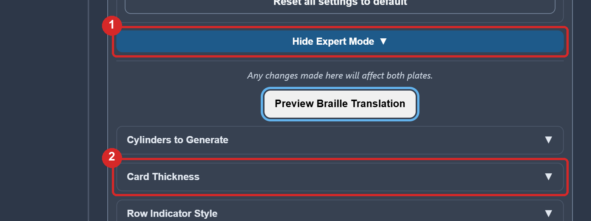

The Show Expert Mode button (1), opened, and the Card Thickness submenu (2) below it.

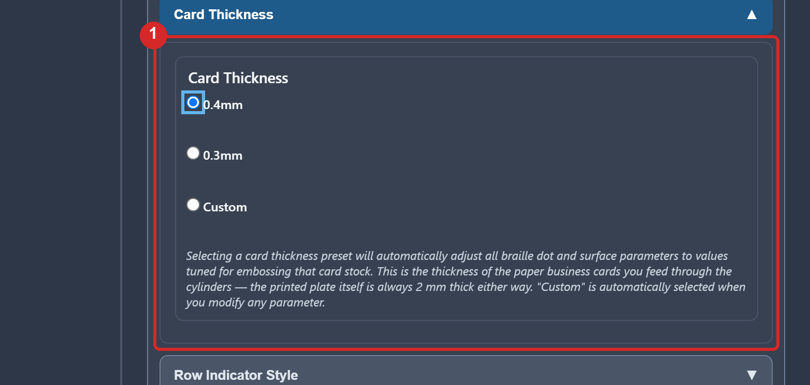

The Card Thickness choices (1): 0.4mm, which is chosen when the page opens, 0.3mm, and Custom.

1. Press Show Expert Mode.
2. Press Card Thickness to open it.
3. Choose 0.3mm, then generate the pair again. The number is the card the dots are made for, not the cylinder, and both cylinders of a pair are made at the same setting.

## 9. Generate

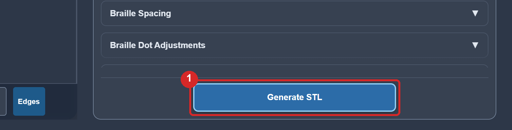

The Generate STL button (1), at the foot of the form.

1. Press Generate STL.
2. Wait. Both cylinders are built in your browser, one after the other; it takes up to a minute, and the button says what it is doing.

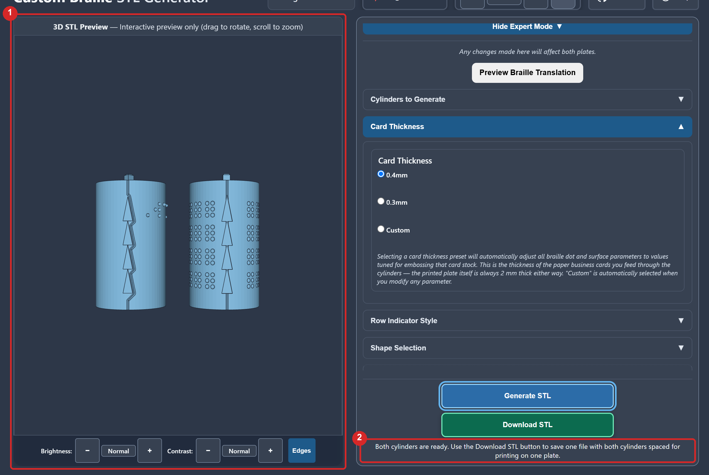

The preview (1) with the finished pair, Cylinder A on the left with its raised dots and raised triangles, Cylinder B on the right with its dimples, and the status line (2): Both cylinders are ready.

3. Look at the preview: drag to turn the pair, scroll to zoom. Check that the rows read as you expect and that the triangles run down the side of each cylinder.

## 10. Download

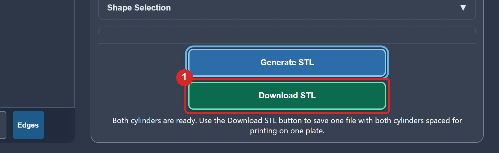

The Download STL button (1), which appears under Generate STL when the pair is ready.

1. Press Download STL.
2. Find the file in your browser's downloads. It is named Cylinder_Pair_V2_0.4_ and your text, with .stl at the end; one file holds both cylinders, spaced apart for printing on one plate.

## 11. Print

Open the file in your slicer. The cylinders were tested standing as they come in the file, at 0.12 mm layers or finer, at least 3 walls, 15 % infill, the Arachne wall generator and supports off. Any rigid filament works, and a light colour makes the dots easier to check by eye. A ready-made pair that says Washington, for a first test, is `Cylinder_Pair_V2_0.4_Washington.stl` in `Build_Files/3D_Printing_Files/Embossing_Plates_Examples/` (the `Geared` file beside it is the one-piece pair), sliced for the Bambu Lab X1C under `Build_Files/3D_Printing_Files/Print_Profiles/X1C/`.

## 12. If something goes wrong

| What you see | What to do |
|---|---|
| A red note under the text box says a row is too long | Shorten the text, break it into more rows with Enter, or use grade 2 |

## 13. Choices you can make

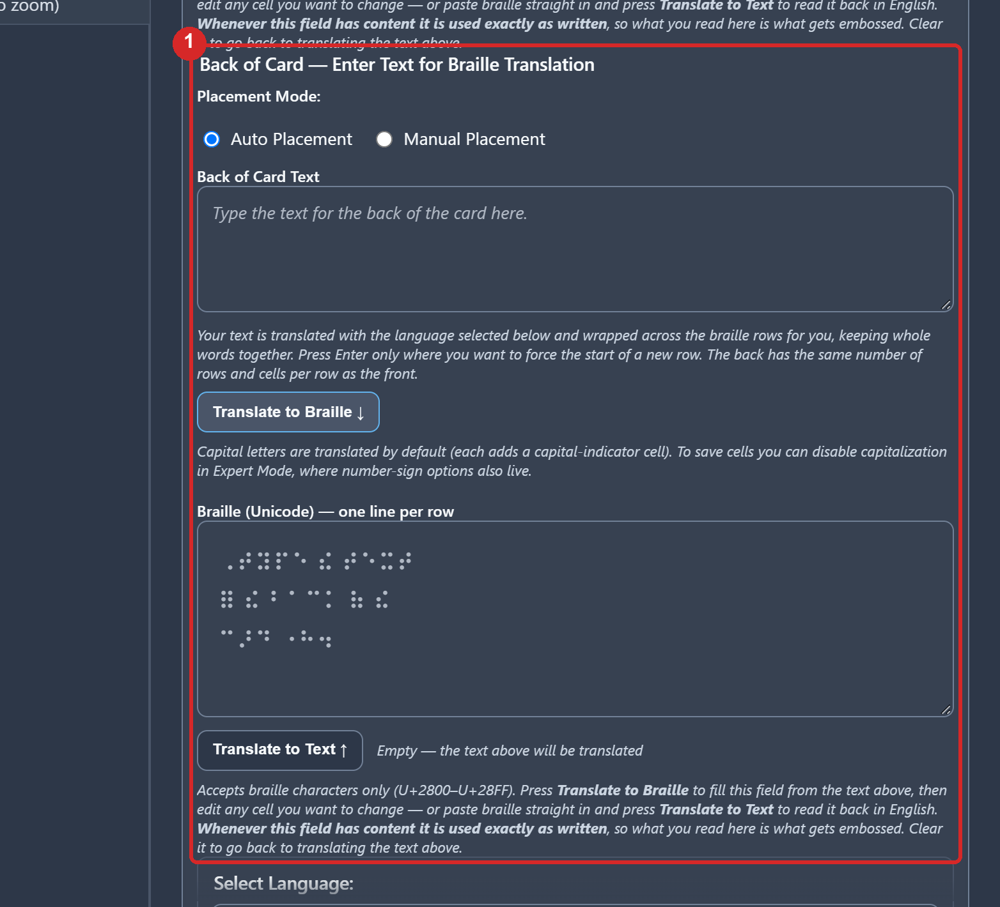

With Double-sided chosen, a second text box (1), Back of Card, appears under the first and is filled the same way. Cylinder A then carries the front's dots and the back's dimples, Cylinder B the other way round.

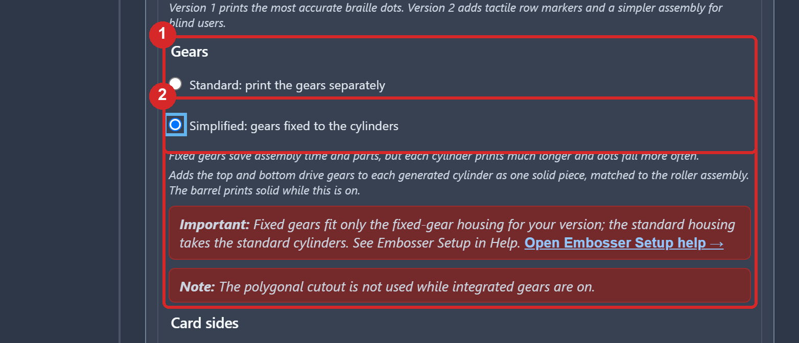

Simplified (2) chosen under Gears (1). The pair generates and downloads the same way; the two one-piece rollers skip steps 1 to 6 of the assembly, and the Maker Guide says where to start with them.

Both choices are made under Embosser setup before you press Generate STL; everything else in this guide is the same.
