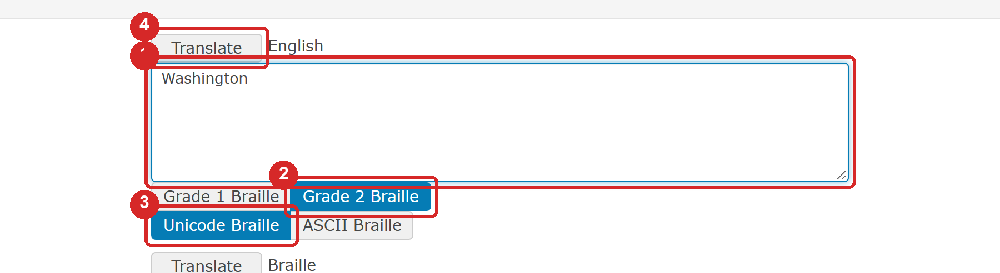
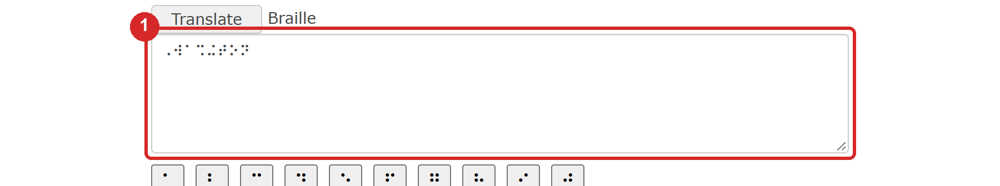
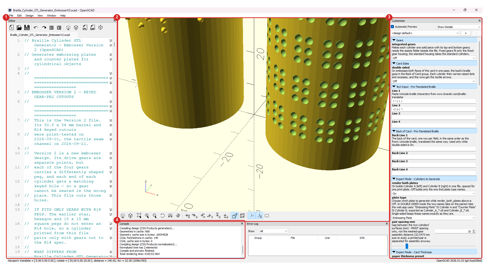
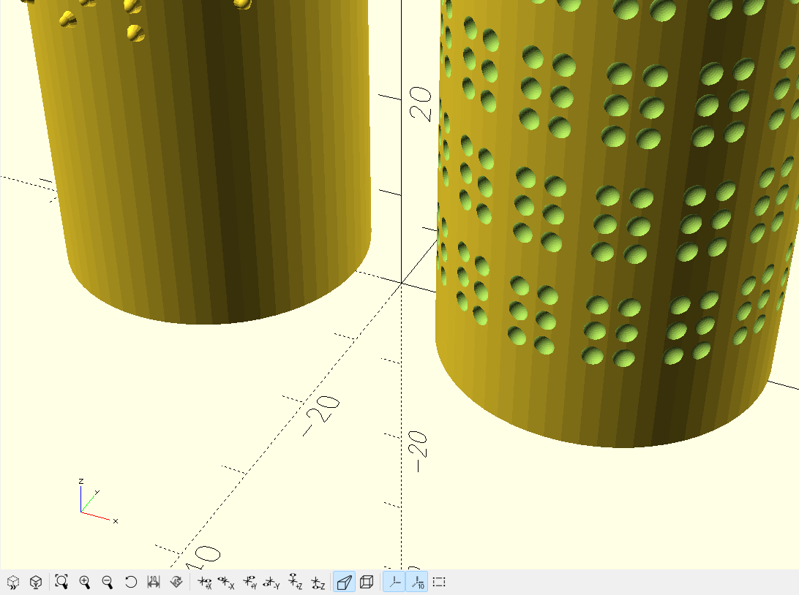
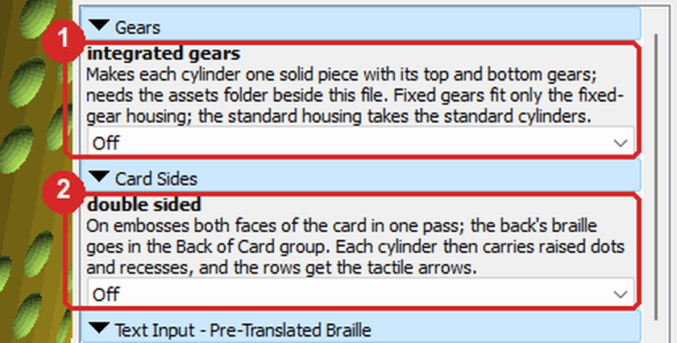
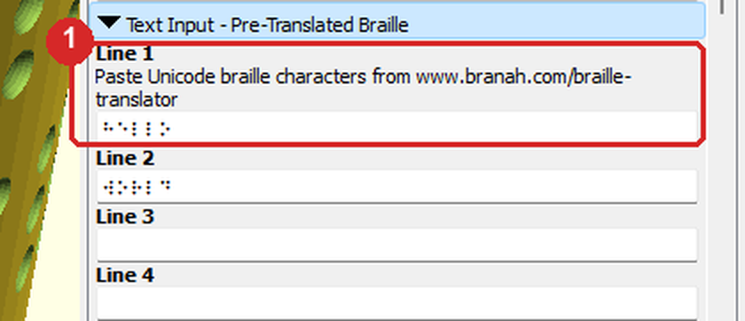
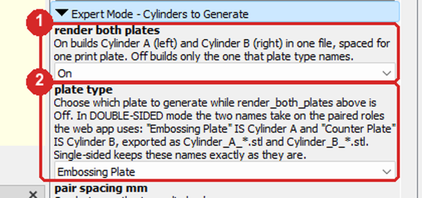
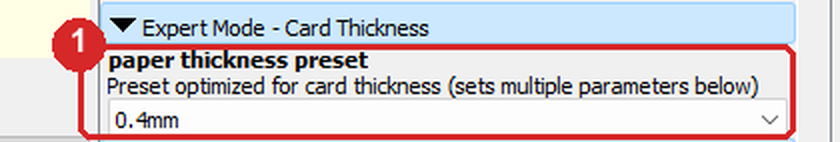
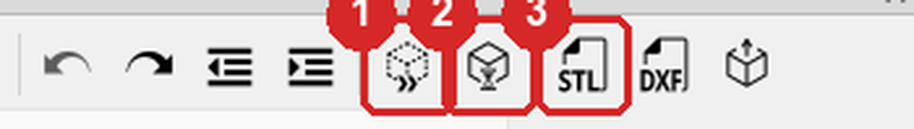
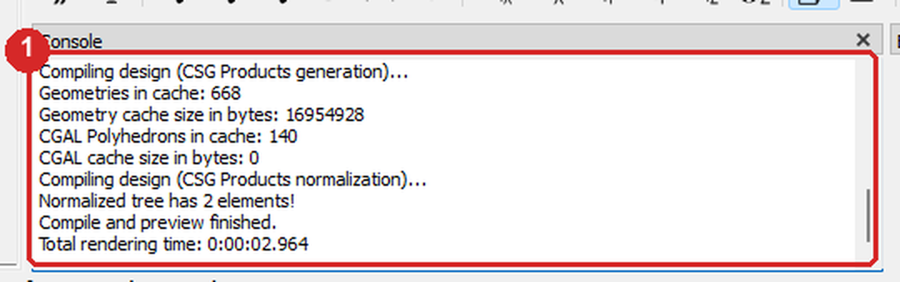

# OpenSCAD Generator Guide

How to make the two braille cylinders for the Custom Braille Embosser, Version 2, without the web generator: a copy of the generator for OpenSCAD is in this repository, and it works with no internet connection. It does not translate text, so you first turn your words into braille with a translator and paste the braille in. The same generator also runs on MakerWorld as a customizer; section 10 says what differs there.

## 1. Before you start

You need OpenSCAD, free from <https://openscad.org> (version 2021.01 or newer), the folder `Build_Files/3D_Printing_Files/Embossing_Plates_Customizer/OpenSCAD_Offline_Alternative/` from this repository with its `assets` folder beside the file, and your text already translated to braille (section 2).

The web generator at <https://braille-cylinder-stl-generator.vercel.app> does all of this in a browser and translates for you; use this guide when you want to work offline.

## 2. Translate your text to braille

The generator takes braille, not print. Any translator that gives Unicode braille will do; this guide shows the one named in the generator's own hint, at <https://www.branah.com/braille-translator>. It is a website run by someone else, and the text you type there goes to its server.

The translator with Washington typed in the English box (1). Below it, Grade 2 Braille (2) and Unicode Braille (3) are the choices to make, and Translate (4) does the work.

1. Open the translator and type one row of your text in the English box. A row of the cylinder holds thirteen braille cells; a capital letter costs an extra cell.
2. Choose Grade 2 Braille (contracted) or Grade 1 Braille (every letter spelled out, often chosen for names and addresses).
3. Choose Unicode Braille, the form the generator reads; ASCII Braille is letters and signs, which it cannot use.
4. Press Translate.

The Braille box (1) with the result: the eight cells of Washington in grade 2.

5. Select everything in the Braille box and copy it.
6. Do the same for each row of your text, one row at a time, and keep the rows in order; a cylinder holds four.

## 3. Open the generator

The OpenSCAD window with the generator open: the Editor (1) shows the file's text, the preview (2) the cylinders, the Customizer (3) every setting as a form, and the Console (4) the messages. This guide works in the Customizer.

1. Start OpenSCAD and open `Braille_Cylinder_STL_Generator_EmbosserV2.scad` from the folder named above (File, then Open).
2. If there is no Customizer panel on the right, show it: Window, then Customizer.
3. Press F5 to preview. The two sample cylinders appear in the middle, and the Customizer fills with the settings.

The preview after F5 with the file's two sample cylinders.

The Customizer lists the settings in the web generator's order: Gears and Card Sides first, then the braille for the front and for the back of the card, then the groups whose names begin Expert Mode, which hold what the web generator keeps under its Expert Mode. Sections 4 to 7 go down the list in that order.

## 4. Gears and card sides

The first two groups of the Customizer: Gears with integrated gears (1) and Card Sides with double sided (2), both Off as the file opens, for a standard single-sided pair.

These are the choices the web generator offers under Embosser setup, and section 4 of the Web Generator Guide says what each is for and which I would start with. This file makes Version 2 cylinders only; Version 1 and Version 2 parts do not mix, and a Version 1 owner uses the web app's Version 1 choice, which carries the same upgrades for Version 1 parts. Here they are lists:

- integrated gears On makes each cylinder with its two gears already part of it, for the one-piece rollers that skip steps 1 to 6 of the assembly.
- double sided On puts a second message on the back of the card and pairs the two cylinders for it; the braille for the back goes in its own group (section 5).

1. Choose integrated gears and double sided for the pair you are making.

## 5. Paste your braille

The Text Input group, under Card Sides, with Line 1 (1) holding the sample braille and, above it, the hint that names the translator.

1. Click in Line 1, delete the sample braille, and paste your first row.
2. Paste the next rows into Line 2, Line 3 and Line 4. Leave a line empty for an empty row.
3. For a double-sided card, paste the rows for the back into Back Line 1 to Back Line 4, in the Back of Card group under Line 4, the same way.

## 6. Both cylinders, or one at a time

As the file opens, render both plates is On: Cylinder A and Cylinder B come out together, side by side, the way the web generator makes them, and plate type is ignored. Off makes one cylinder, the one plate type names (Embossing Plate is Cylinder A, Counter Plate is Cylinder B), for printing them one at a time; make the second with every other setting unchanged.

The Expert Mode - Cylinders to Generate group: render both plates (1) and plate type (2).

## 7. Card thickness stays at 0.4mm

The file makes the pair for 0.4 mm card, which is most business cards, and nothing in this guide's path changes that. You go to the Expert Mode - Card Thickness group only if a printed pair punches holes through your card instead of leaving rounded, intact dots: then the card is thinner than 0.4 mm and the pair is made again at 0.3mm.

The Expert Mode - Card Thickness group, under Cylinders to Generate, and its paper thickness preset list (1) at 0.4mm.

1. Scroll the Customizer down to Expert Mode - Card Thickness.
2. Set paper thickness preset to 0.3mm and export the pair again; both cylinders of a pair are made at the same setting.

## 8. Render and export

The Editor's toolbar: Preview (1) is F5, Render (2) is F6, and Export as STL (3) writes the file.

1. Press F6, or the Render button, and wait for the Console to say Rendering finished. The preview turns yellow.
2. Press the Export as STL button, or File, then Export, then Export as STL, and save the file where you will find it. Name it after your text; the generator suggests Cylinder_Pair_ and your text.

The Console (1) after a preview. Rendering and exporting report here too; a warning about fonts at start-up is harmless.

## 9. Print

Print the pair standing as it comes in the file, at 0.12 mm layers or finer, at least 3 walls, 15 % infill, the Arachne wall generator and supports off, in any rigid filament. A one-piece pair (integrated gears On) prints bottom gear down, supports off.

## 10. On MakerWorld

The generator also runs on MakerWorld as a customizer, inside the embosser's own listing: among the listing's model files, under Braille Embosser V2 - OpenSCAD, choose `Braille_Cylinder_STL_Generator_MakerWorld_v2.scad`. It makes the standard cylinders only, because MakerWorld cannot load the gear files the desktop copy reads; for one-piece rollers use this copy with integrated gears On. It lists the settings of sections 4 to 7 in the same order, without the Gears group, and like this copy it takes braille, not print (section 2). Press Generate, then download the result. MakerWorld has no Console, so a warning such as TEXT TOO LONG shows only as red text above the cylinders.

## 11. If something goes wrong

| What you see | What to do |
|---|---|
| Red text in the preview and TEXT TOO LONG in the Console | A row has too many cells: shorten it, or move words to the next line |
| The braille shows as boxes or question marks in a line | The paste was not Unicode braille; translate again with Unicode Braille chosen |
| Nothing changes after a paste | Press F5; or tick Automatic Preview at the top of the Customizer |
| An error names assets or a gear file | integrated gears is On and the `assets` folder is not beside the file; copy the whole folder, or turn integrated gears Off |
| The Customizer is empty | Press F5 once; it fills after the first preview |
| Render takes minutes | Normal on an older OpenSCAD; the 2026 snapshot renders the pair in seconds |
