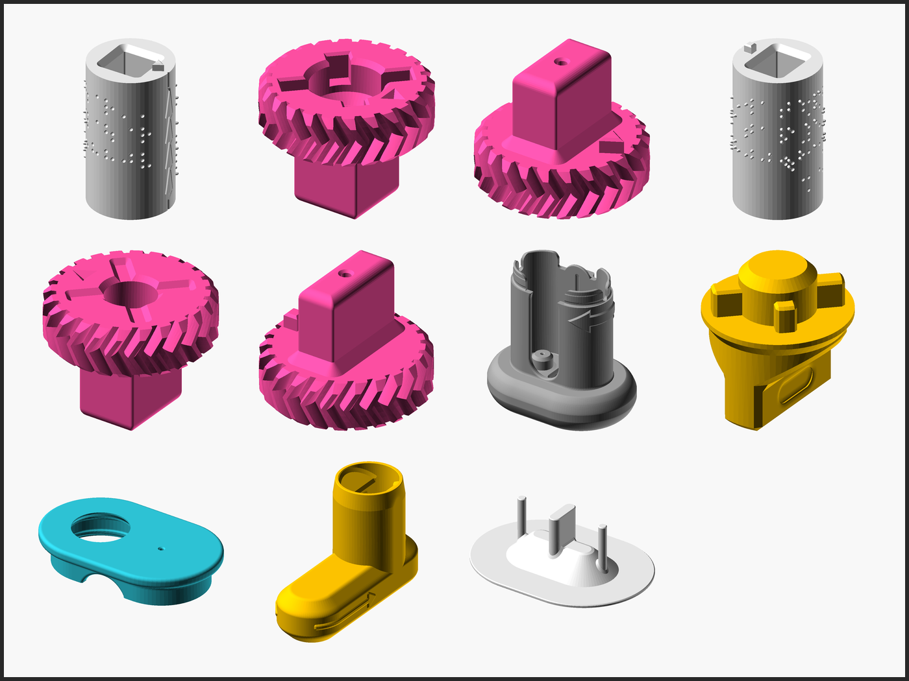
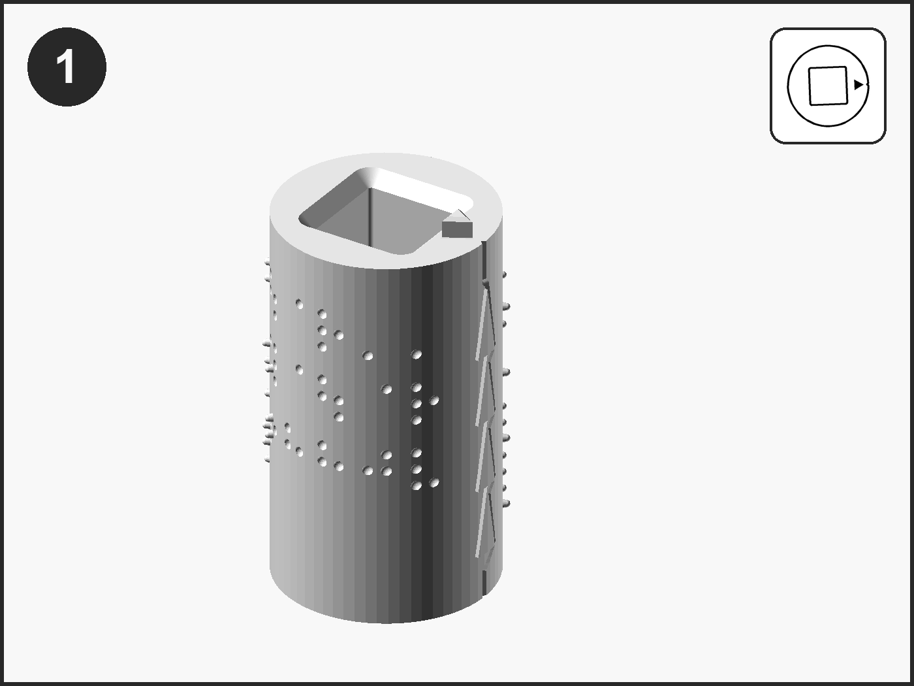
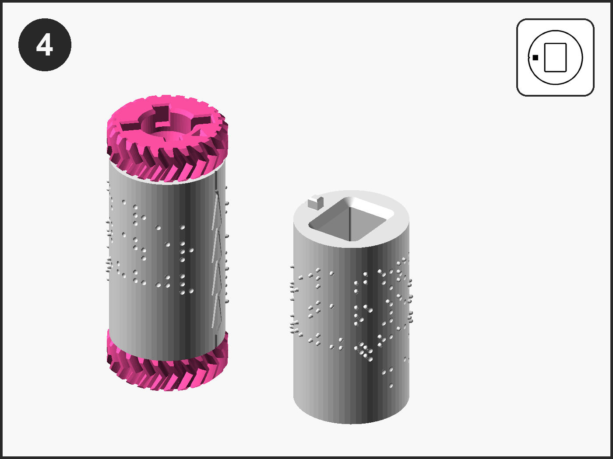
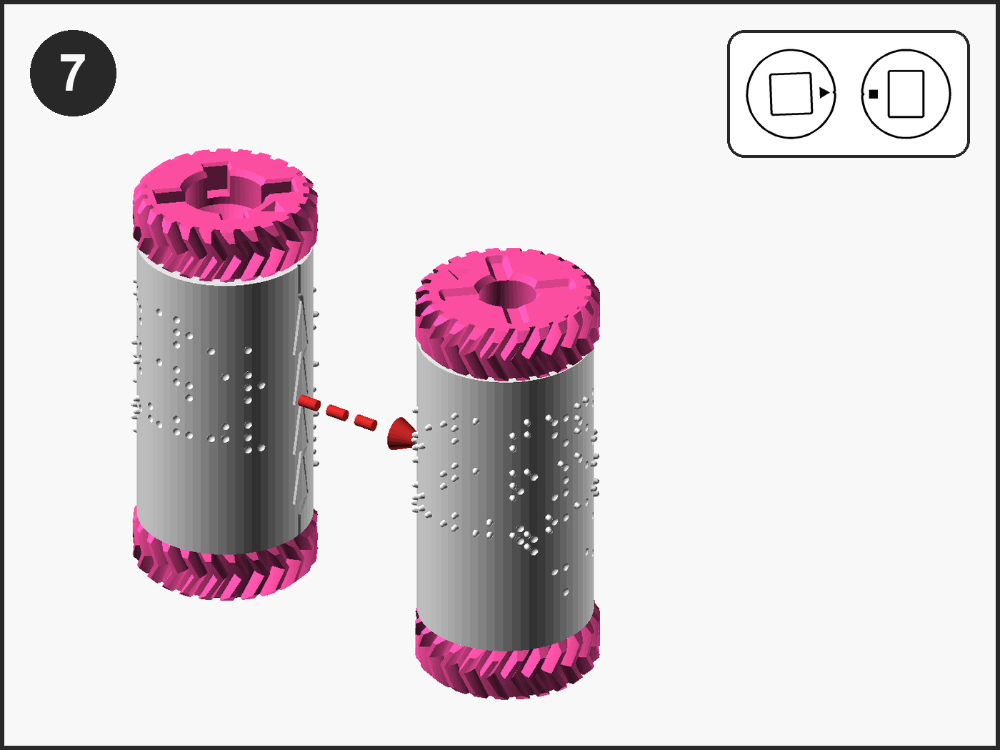
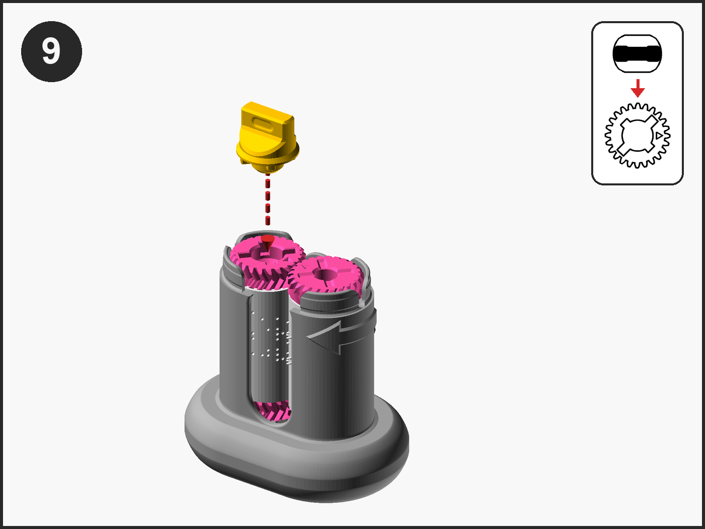
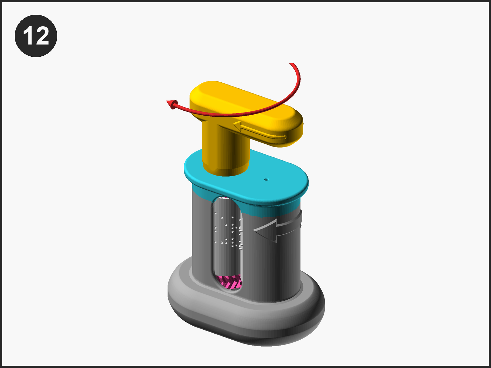

# Visual Assembly Guide

The build of the Custom Braille Embosser, Version 2, as pictures only, in the order of the Maker Guide's steps; the words are in the Maker Guide and the Assembly Guide By Touch.

## 1. Parts

The Push-out Plate, last in the row, is optional and is not used in the twelve steps: it lifts the rollers out when the message is changed.

## 2. Steps

