# Assembly Guide By Touch

The full edition of the assembly guide for the Custom Braille Embosser, Version 2: from a bag of nine printed parts and two generated braille cylinders to a working hand embosser and your first embossed card, with every step also said for the hands, so you can build the embosser without seeing it.

## 1. Before you start

### What you are building

The Custom Braille Embosser, Version 2, is a hand-turned press. Two cylinders stand side by side inside a Base; a card goes in at the slit in the back, between them, and when you turn the Handle the cylinders roll it through and out of the window at the front, pressing braille dots into it on the way. The message is on the cylinders, so to change the message you change the cylinders.

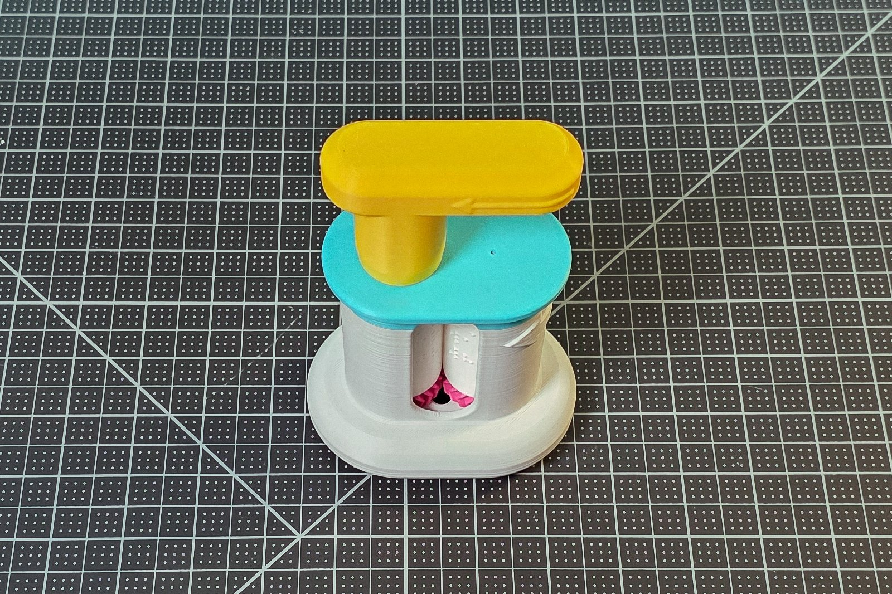

The finished embosser from the front. The grey Base stands on its flat oval foot. The cyan Lid sits on top of the Base's tower. The yellow Handle stands up from the left side of the Lid and its grip points away from you. The window is the tall opening in the front of the tower, and through it you can see the two white cylinders.

### What you need

| Item | How many | Where it comes from |
|---|---|---|
| Printed parts | 9 | `Build_Files/3D_Printing_Files/STL/` in this repository |
| Cylinder A and Cylinder B | 1 each | Generated for your text at the web app, with Version 2 chosen, or with the OpenSCAD file in this repository |
| Card stock | A few cards | Business cards, 0.3 to 0.4 mm thick, for the setting the cylinders were made at |

No tools, no glue, no screws, no springs.

Printing: the nine parts need only your printer's default 0.2 mm profile, with supports off; the shapes were drawn so nothing needs supports, seam painting or slow speeds. The two cylinders do better at 0.12 mm layers or finer, at least 3 walls and 15 % infill, and with the Arachne wall generator rather than Classic, which gives the dots a cleaner shape.

### Time and difficulty

### Safety

- The two cylinders pinch together where the card passes. Keep your fingers out of the slit and the window while you turn the Handle.
- The braille dots on Cylinder A are small and can be crushed: never force a cylinder.
- Small parts. Keep the gears away from small children.

### How this guide is written

Every direction in this guide uses one fixed viewpoint. You are sitting at a table. The Base stands in front of you with its window, the tall opening in the middle of the tower's front where the card comes out, facing you. Left means the side of your own left hand and right the side of your own right hand as you sit facing the window; front is the window side, nearest you, and back is the slit side, farthest from you. Up is away from the table. The top of a part is the end that points up when the embosser stands finished.

Each step has four parts. **You need** names the parts to pick up. The numbered lines are the actions, one action each. **Check** says what you see, feel or hear when the step is right. **By touch** says the same step with your hands: where to hold, what to feel for, and what tells you it is done.

## 2. Know your parts

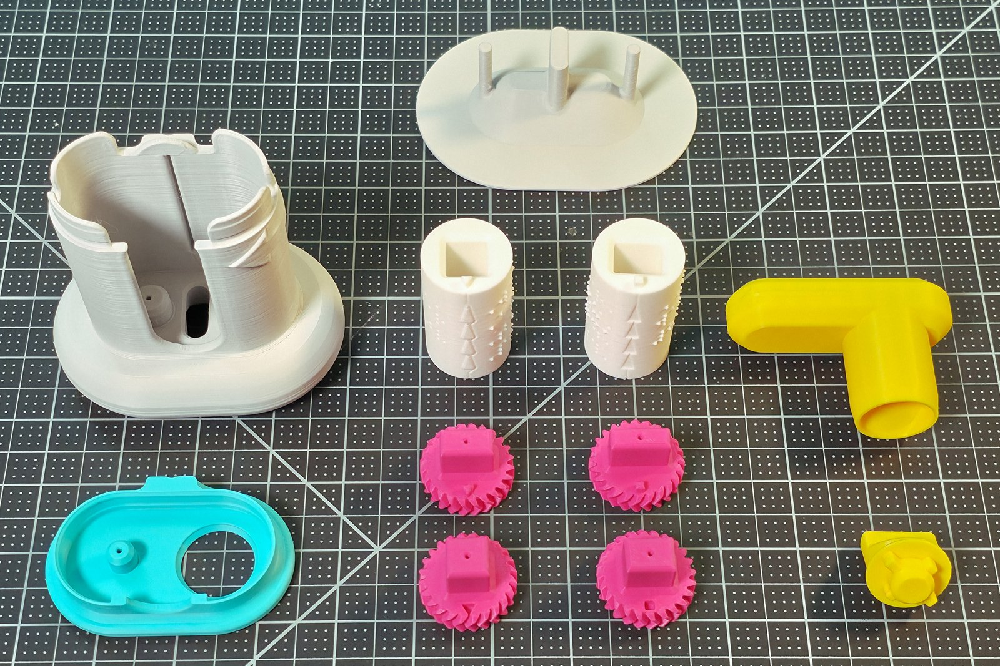

Every part before assembly, on the grid mat. Top left, the grey Base standing with its window toward you. Top centre, the white Push-out Plate lying flat, its pegs up. Top right, the two white cylinders standing on end. Right, the yellow Handle, an L shape. Bottom left, the cyan Lid. Bottom centre, the four pink gears, pegs up. Bottom right, the yellow Knob.

<!-- parts-table -->
| Part | File |
|---|---|
| Base | `Base.stl` |
| Lid | `Lid.stl` |
| Cylinder A | generated for your text |
| Cylinder B | generated for your text |
| Top Gear A | `Top_Gear_A.stl` |
| Bottom Gear A | `Bottom_Gear_A.stl` |
| Top Gear B | `Top_Gear_B.stl` |
| Bottom Gear B | `Bottom_Gear_B.stl` |
| Knob | `Knob.stl` |
| Handle | `Handle.stl` |
| Push-out Plate (optional) | `Push-out_Plate_(optional).stl` |
<!-- /parts-table -->

### Base

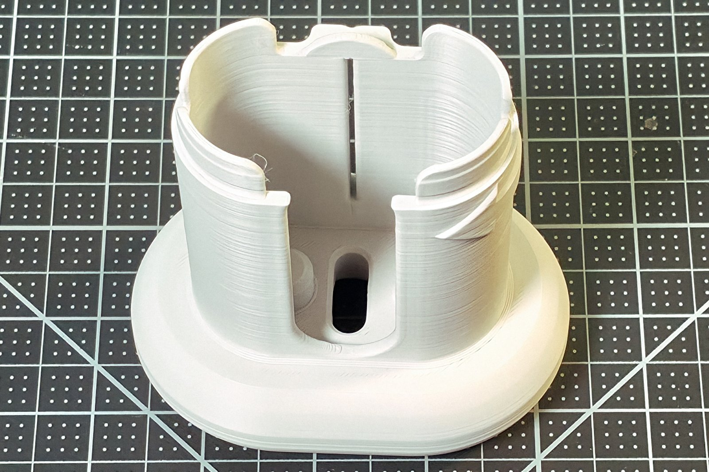

The Base from the front: a flat oval foot with an open oval tower on it, open at the top. The tall window takes up the middle of the tower's front and runs from near the top down to the foot. Through the window you can see the floor inside, with the floor slot between two floor holes, and the narrow slit in the back wall.

What it does: the Base holds the two rollers upright and side by side, so their gears mesh and the card can pass between the cylinders.

Find it by touch: the biggest and heaviest part. A flat oval you can wrap one hand around, with a taller oval tower standing on it. The front of the tower has a tall opening, the window, two fingers wide, from near the top almost to the foot; the back has a narrow slit the width of a card, running down the middle of the back wall. With the window toward you, on the right-hand side between the window and the slit are two raised arrows: a long one with a curved shaft pointing round the tower toward the window, and nearer the slit a large one pointing up toward the open top. The left-hand side is smooth. Reach into the top and you find two short posts standing up from the floor, the fatter one on your left and the thinner on your right, the long floor slot between them, and a round floor hole on the outer side of each post.

Which way round: the window faces you and the slit faces away; the arrows on the right-hand side tell you which way is front and which is up.

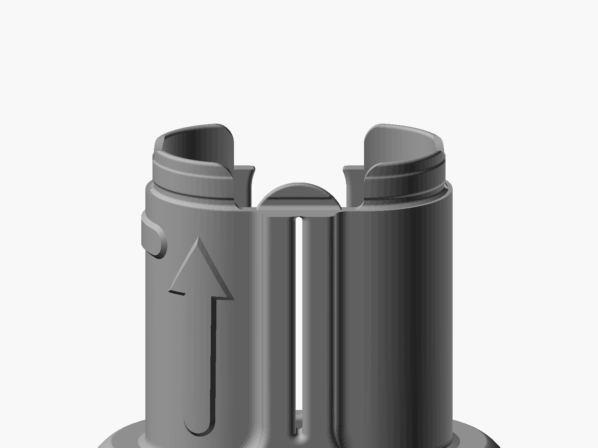

Computer rendering of the Base from behind. A narrow slit runs down the middle of the back wall from the rim almost to the foot; it is the width of a card. On the right-hand side of the tower, seen here at the left, a large raised arrow points up.

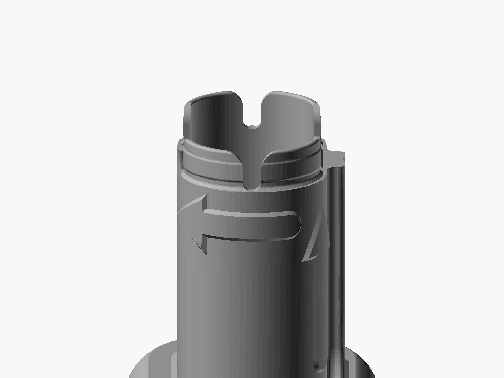

Computer rendering of the Base's right-hand side. The window is to the left and the slit to the right. Across the middle of the wall a long raised arrow with a curved shaft points left, toward the window: the way a card travels. Beside the slit a large raised arrow points up, toward the open top.

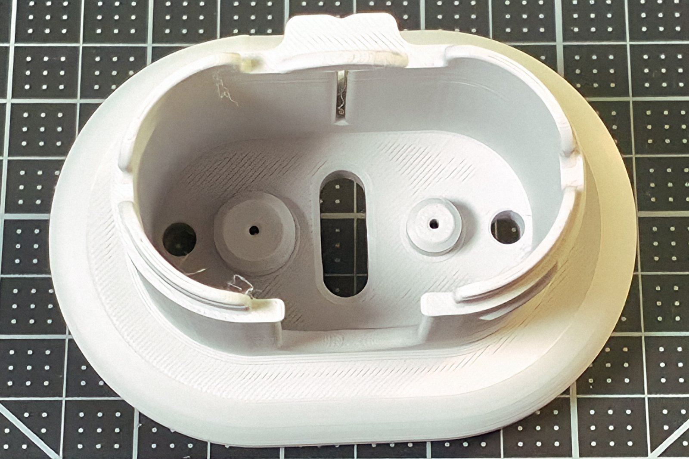

The inside of the Base from above. On the floor stand two posts: the fatter one on the left and a thinner one on the right. Between them is the floor slot, and beside each post, toward the outside, is a floor hole.

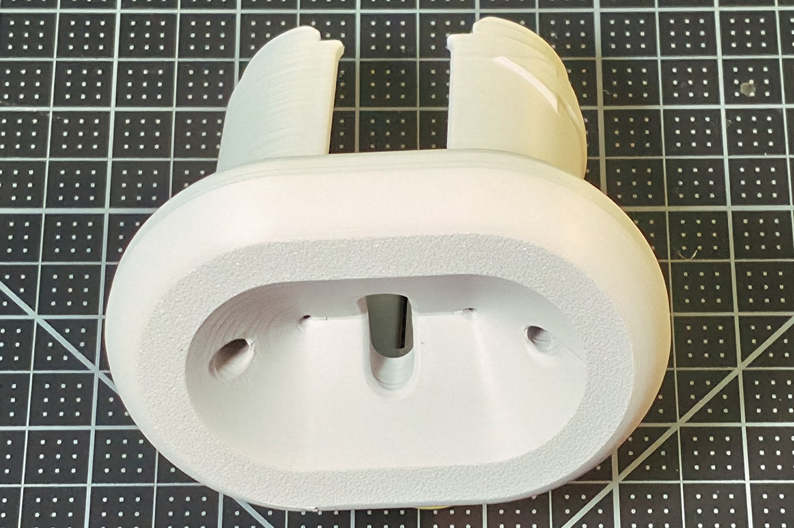

The underside of the Base. The foot has a shallow dip in its middle, and in that dip are the three floor openings seen from below: the floor slot in the centre and a floor hole on each side. The Push-out Plate's pegs come up through them.

### Lid

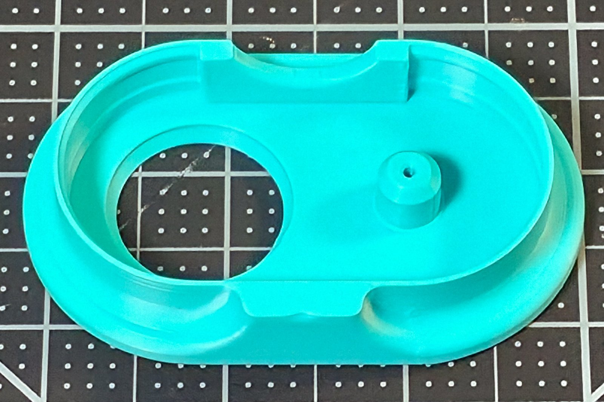

The Lid from above: a flat oval with the large Knob hole near the left end. Near the right end there is only the tiny vent hole, above the Lid's post.

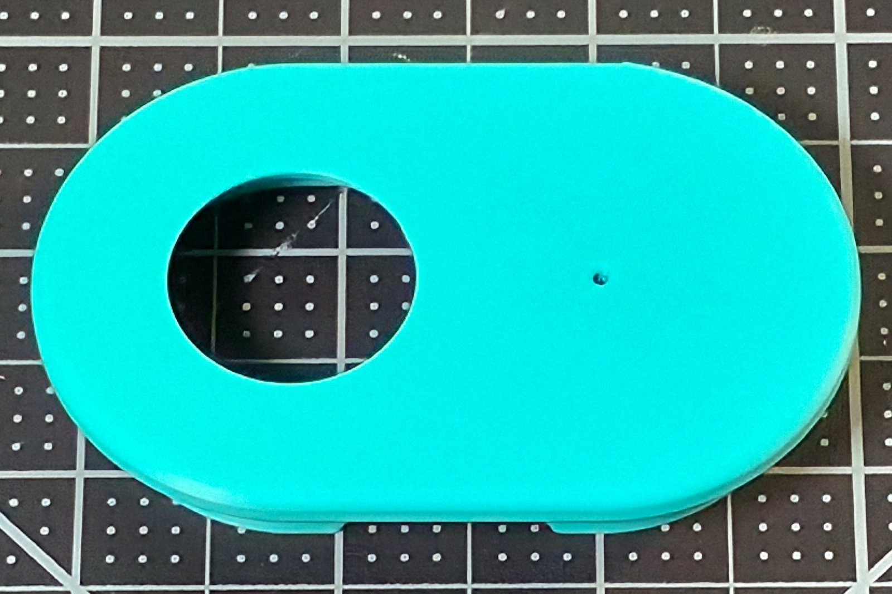

The underside of the Lid. A rim runs round the edge and fits down inside the top of the Base's tower. At one end is the large round opening; at the other a short round post stands up from the underside.

What it does: the Lid closes the top of the Base and holds the two rollers upright. Its post is the top axle of Roller B, and its Knob hole lets the Knob through to Roller A.

Find it by touch: a flat oval plate, wider than your palm, with one hole you can put a thumb through near one end. Turn it over and you find a raised rim round the edge and a short stubby post standing up near the end without the hole.

Which way round: the post goes down. The Knob hole goes over the Knob, on the left.

### Cylinder A, the raised-arrow cylinder

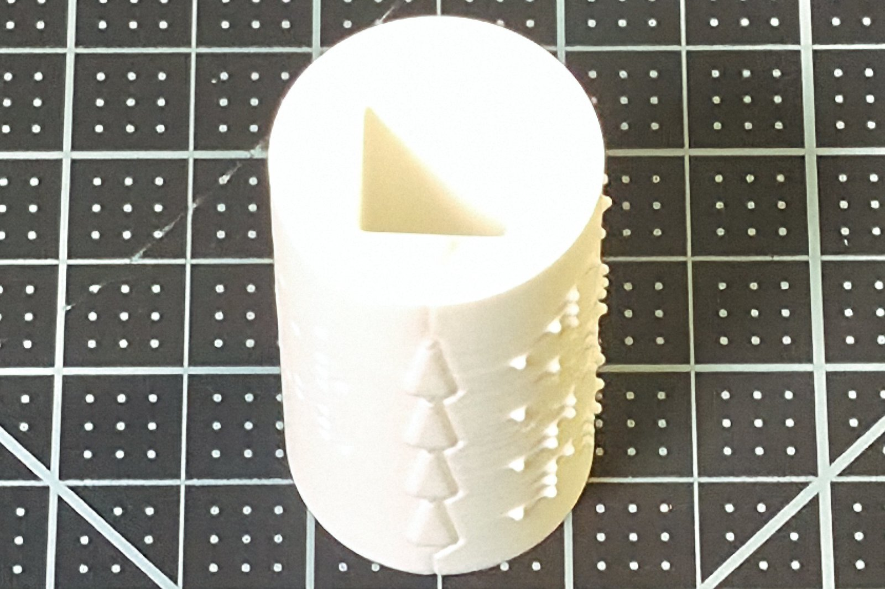

Cylinder A standing with its top up. Its side carries the raised braille dots of your text and a column of raised triangles, one per row of text, all pointing up. In the top end is a square hole, and beside the hole, on the same side as the column of triangles, a small raised triangle: the top-end bump.

What it does: Cylinder A carries your message. It presses the dots into the card. The column of triangles is where the card's leading edge goes, and it is how you line the two cylinders up.

Find it by touch: one of the two white tubes. Run a finger down its side and you feel a column of small raised triangles, like arrowheads, all pointing the same way. Feel the end they point to: that end has a square hole in it and a small raised triangle, the top-end bump, beside the hole. That end is the top.

(With the app's single-sided option Cylinder A carries raised dots and Cylinder B dimples; with the double-sided option both carry dots and dimples. The columns of triangles tell them apart every time.)

<!-- shot: parts-cylinder-a-top-close | angle: close | show: Cylinder A's top face, the square keyhole and the triangle bump beside it, the raised arrow column running down from them -->

<!-- shot: parts-cylinder-bottom-close | angle: close | show: a cylinder's bottom face, the keyhole and the dent beside it -->

### Cylinder B, the sunken-arrow cylinder

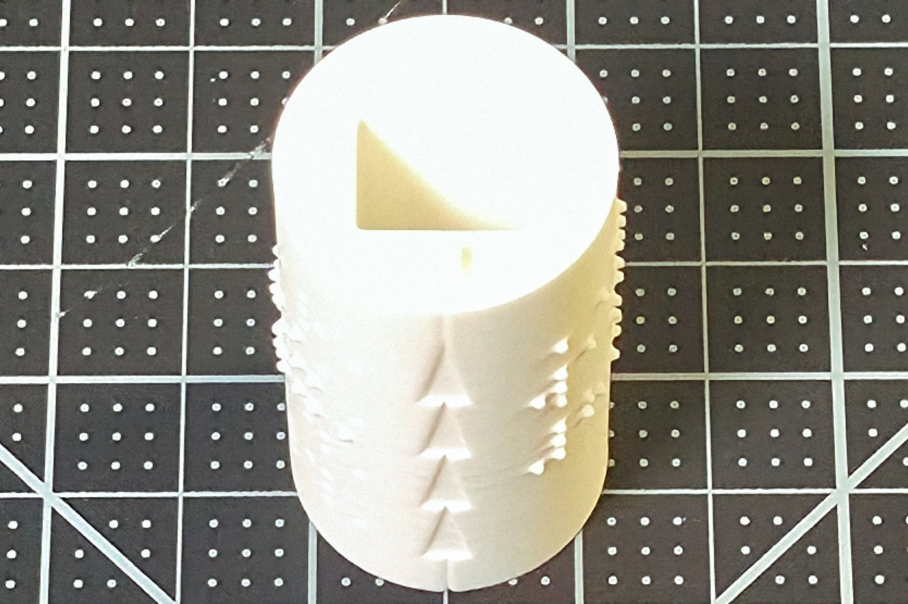

Cylinder B standing with its top up. The same size as Cylinder A. Its side carries a column of triangles sunk into the surface, one per row, all pointing up. In the top end is a rectangular hole, wider than it is tall, and beside it, on the same side as the column of triangles, a small raised square: the top-end bump.

What it does: Cylinder B is the other half of the press. Its sunken triangles nest over Cylinder A's raised ones when the two are lined up, and the card is pressed between the two cylinders.

Find it by touch: the other white tube. Run a finger down its side and you feel a column of small triangle-shaped hollows. Feel the end they point to: that end has a rectangular hole and a small raised square, the top-end bump, beside it. That end is the top.

<!-- shot: parts-cylinder-b-top-close | angle: close | show: Cylinder B's top face, the rectangular keyhole and the square bump, the sunken arrow column below -->

### The four gears

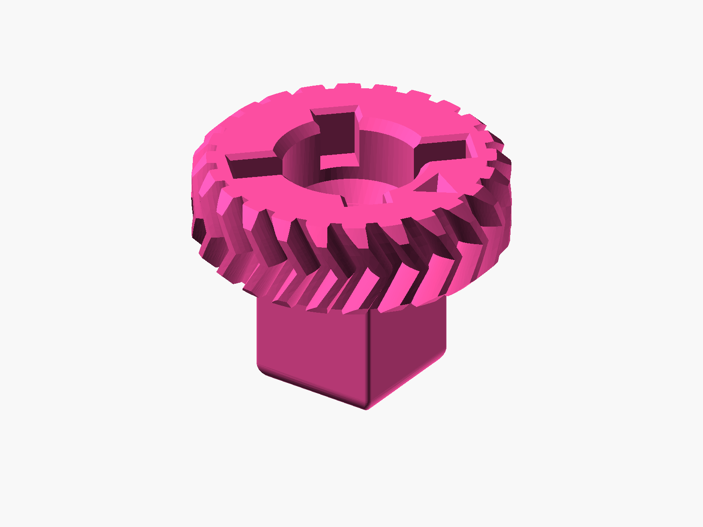

Computer rendering of Top Gear A: the peg standing up from one face, the keyed pocket in the other.

Each gear is a pink disc with 24 V-shaped teeth round its edge and a peg standing up from one face. The four pegs are four different shapes, and each cylinder end has a hole that takes one shape only, so a gear can go only where it belongs. The gears pair up: Top Gear A and Bottom Gear A go on Cylinder A; Top Gear B and Bottom Gear B go on Cylinder B.

Both top gears carry a cross on their hub face, and the bottom gears do not. Plus means up, the way the plus end of a battery is its top: once the gears are on, feel a roller's two ends for the cross and you have found its top. The two crosses are not the same: Top Gear A's is the four keyways of its keyed pocket, two long ones opposite each other and two short ones opposite each other, deep enough to take the Knob's shaft; Top Gear B's is four shallow grooves of equal length round a small pocket, a mark to feel and nothing more, too shallow and too narrow to take the Knob.

Every gear also has a hub-face triangle mark: a small triangle sunk into its hub face, about 3 mm on a side and under a millimetre deep, half way between the middle pocket and the teeth, directly behind the notch or stud on the peg face. It is a mark for the eye: when the rollers stand in the Base, the two top gears' hub-face triangle marks point at the join between the cylinders, so a glance from above shows that the columns of triangles face each other. By touch it is hard to find, a shallow three-cornered dip under a fingernail; the nested triangles on the cylinders themselves are the surer sign, and the steps use those.

<!-- shot: parts-four-gears-in-order | angle: top | show: the four gears in a row, pegs up, in the order Top A, Bottom A, Top B, Bottom B, labelled -->

<!-- shot: parts-top-gear-a-hub-face | angle: standard | show: Top Gear A alone, hub face up, the keyed pocket the Knob drops into -->

<!-- shot: parts-gear-peg-faces-close | angle: close | show: each gear's peg face from the side, the notch or the stud beside the peg -->

| Gear | Peg, in mm | Mark on the peg face | Hub face |
|---|---|---|---|
| Top Gear A | 14 by 14, square | a small triangle notch cut in beside the peg | a wide keyed pocket with four keyways in a cross, two long and two short, for the Knob |
| Bottom Gear A | 18 by 10 | a small raised triangle stud beside the peg | a wide round pocket with a cone in its floor |
| Top Gear B | 16 by 12 | a small square notch cut in beside the peg | a small round pocket with four shallow grooves of equal length in a cross, a mark only |
| Bottom Gear B | 20 by 8, a flat bar | a small raised square stud beside the peg | a plain small round pocket |

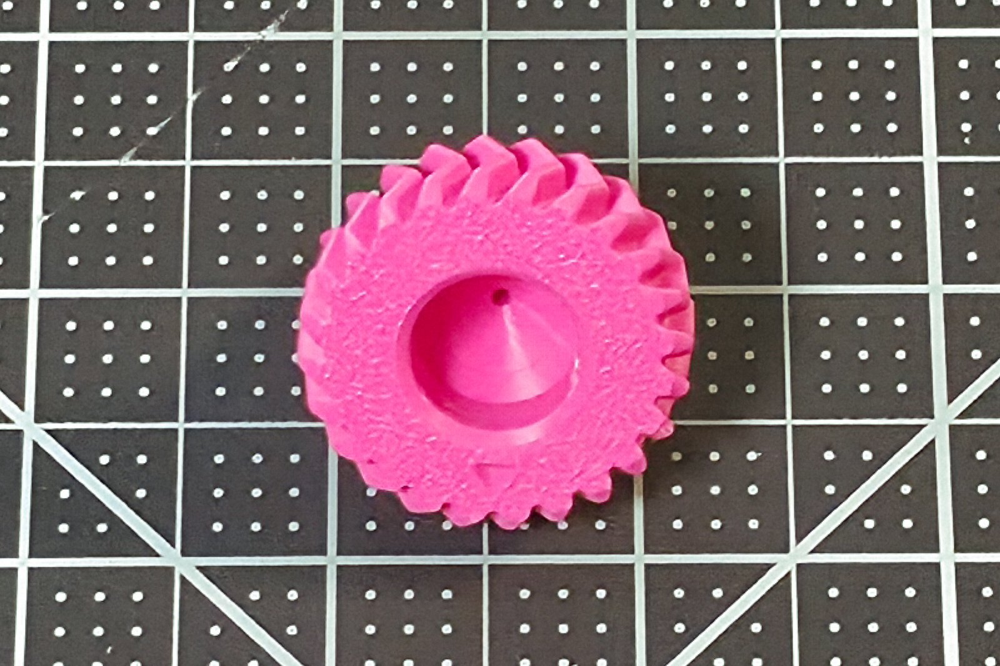

Bottom Gear A, hub face up: the wide pocket with a cone in its floor. This pocket sits down over the fatter post in the Base's floor.

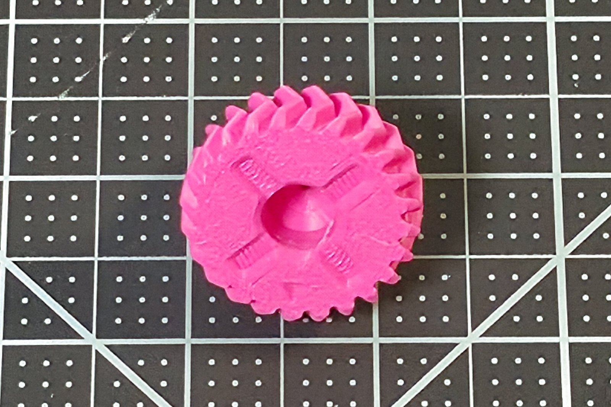

Top Gear B, hub face up: the small pocket with its cross of grooves. The Lid's post goes into this pocket.

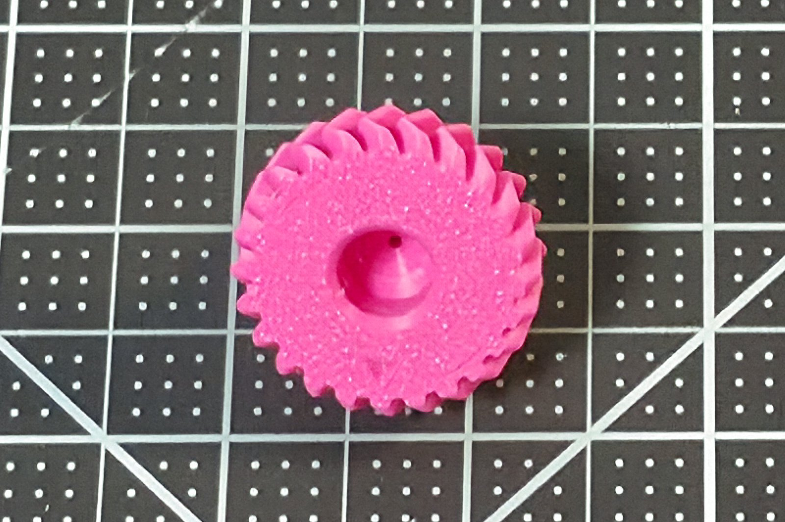

Bottom Gear B, hub face up: the plain small pocket. This pocket sits down over the thinner post in the Base's floor.

Find them by touch: four discs the size of a large coin, with teeth round the edge that slant in a V, and a stubby peg standing up from one face. Feel the pegs. One is square. One is a thin flat bar. The other two are rectangles close in size. Feel the face the peg stands on, right beside the peg: the two top gears have a small notch cut into that face, the two bottom gears a small stud standing up from it. Feel the other face: the A gears have a wide pocket (one keyed, one with a cone), the B gears a small one.

If you cannot tell two gears apart, let the cylinders decide: a wrong peg will not enter a hole. Try it, and if it will not go, it is the other one.

### Knob

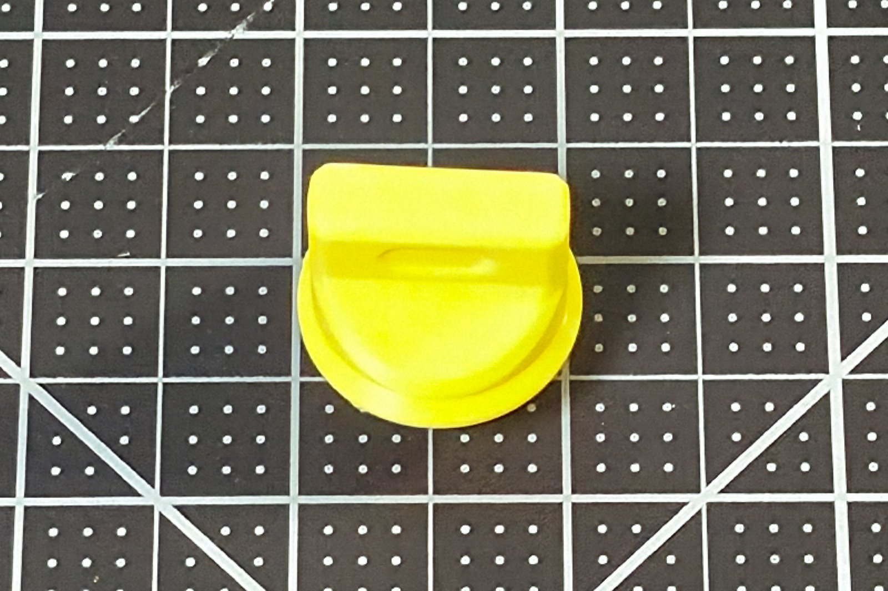

The Knob from above: a flat D-shaped top with a raised bar, the tab, standing across the flat side of the D.

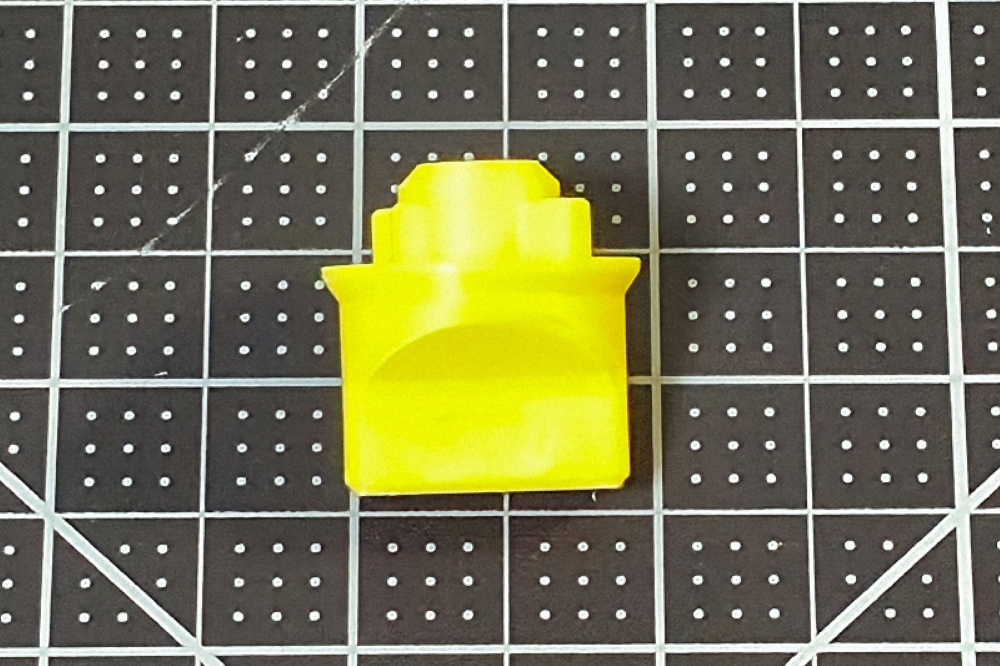

The Knob on its side, shaft toward you. Below the collar is the shaft: a round peg in the middle with an X of four ribs round it, two long ribs opposite each other and two short ribs opposite each other.

What it does: the Knob joins the Handle to Top Gear A. Turn the Knob and both rollers turn.

Find it by touch: a small yellow part you can close your hand round. One end is a flat D-shaped collar with a round head standing up from its middle and a bar, the tab, across the head; the other end is the shaft: a round peg in the middle with four ribs round it in an X, two long ones opposite each other and two short ones opposite each other, in line with the tab.

Which way round: shaft down, into Top Gear A; the tab up, for the Handle.

<!-- shot: parts-knob-shaft-end-close | angle: close | show: the end of the Knob's shaft, its flat and steps, the shape that keys into Top Gear A -->

### Handle

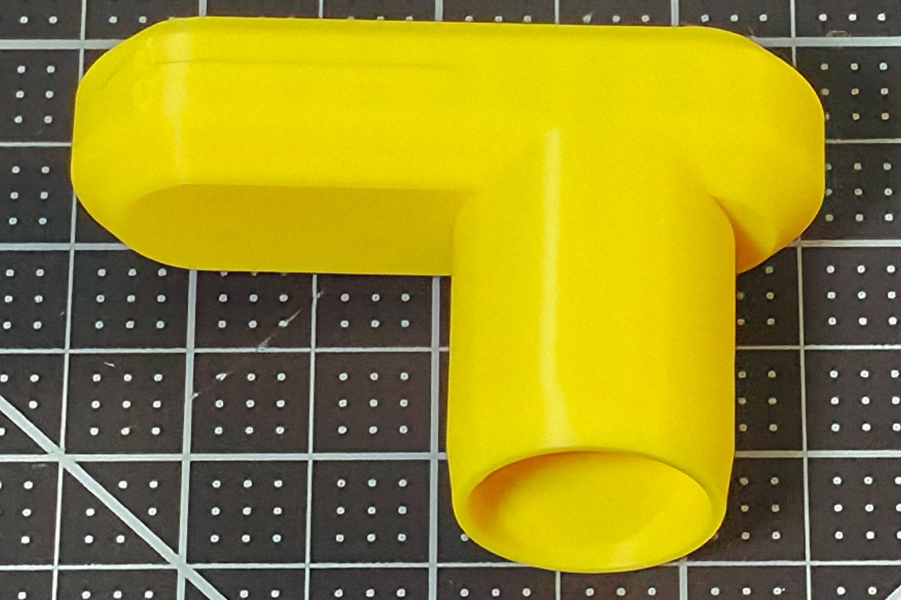

The Handle lying flat: an L shape. The long arm is the grip, a flat rounded bar. The short arm is a round cup, open at its end, that fits down over the Knob.

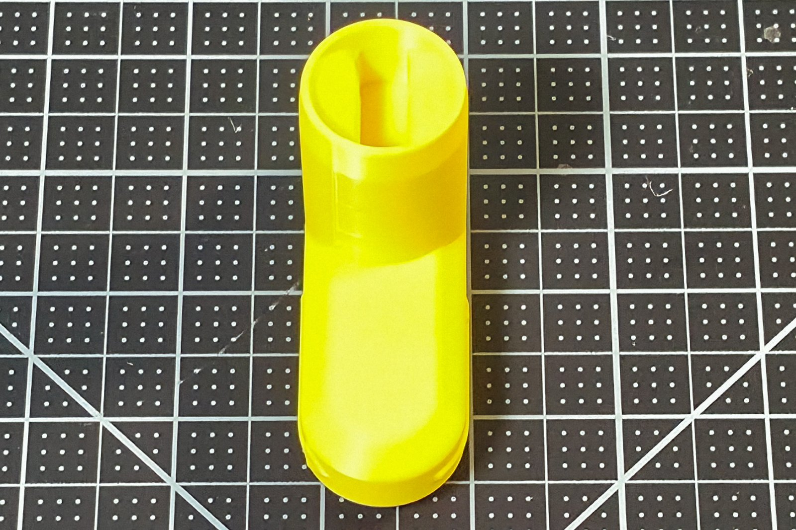

The Handle standing on the end of its grip, the cup up. The cup's opening is the exact shape of the Knob's head, a rounded rectangle, as if moulded round it; a small oval catch inside the cup snaps over the matching oval on the head, which is the click you feel as the Handle seats.

What it does: the crank you turn. A raised arrow on top of the grip shows which way to turn when you emboss.

Find it by touch: the L-shaped part. One arm is a long flat bar, the grip; the other is a short round cup, open at the end, with a flat inside the cup.

Which way round: the cup goes down over the Knob, with the grip to the right, over Roller B.

<!-- shot: parts-handle-cup-inside | angle: close | show: looking into the Handle's cup, the flat inside it that meets the Knob's tab -->

### Push-out Plate

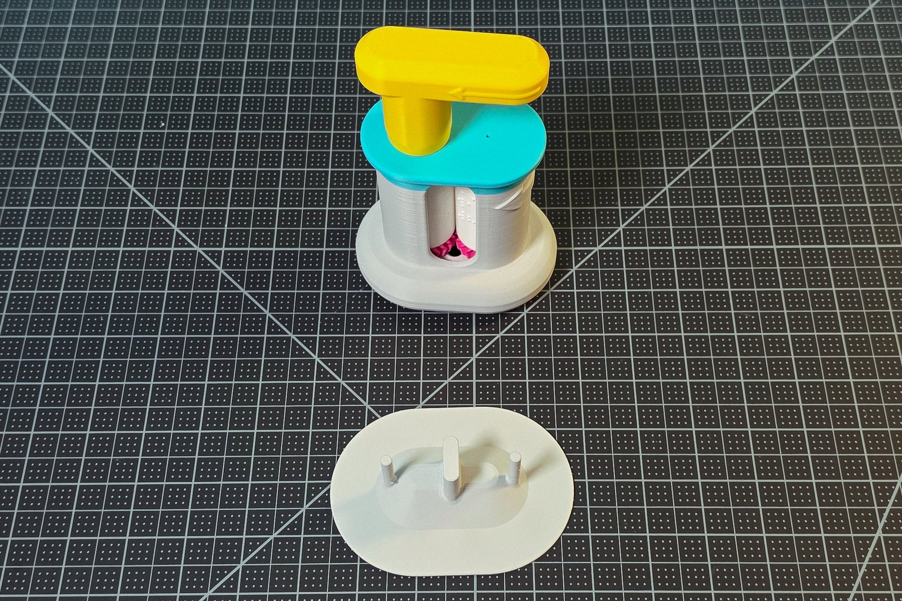

The finished embosser with the Push-out Plate lying in front of it: a flat oval with three pegs standing up from it in a row, a thin round peg at each end and a flat square post in the middle.

What it does: it lifts the rollers out of the Base (section 6). It is optional, for anyone who changes cylinders often.

Find it by touch: a flat oval plate, the largest flat part, with three pegs standing up in a line: round, square, round.

## 3. Explore by touch before you start

Building by touch goes more smoothly with the parts laid out in one line before you begin, each where your hand expects it. Know your parts says how to tell each one; the order below is the order you use them.

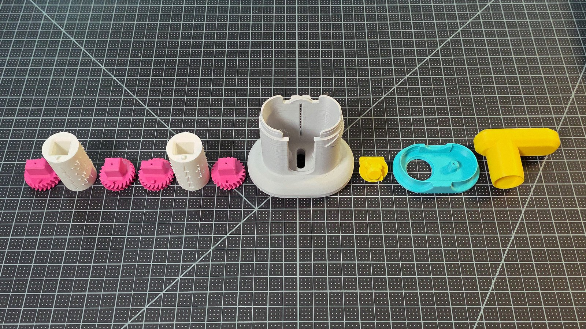

The parts in a line from left to right: a gear, Cylinder A, a gear, a gear, Cylinder B, a gear, then the Base, the Knob, the Lid and the Handle.

1. Put the Base in front of you, window toward you, its arrows on your right.
2. Stand the two cylinders top up, Cylinder A then Cylinder B.
3. Put the four gears in a row in the order you use them: Top Gear A, Bottom Gear A, Top Gear B, Bottom Gear B.
4. Then the Knob, the Lid and the Handle.
5. If you printed the Push-out Plate, put it aside; it is for later.

## 4. Assemble

You are going to build Roller A, then Roller B, then pair them, then put the pair in the Base, then add the Knob, the Lid and the Handle. A roller is a cylinder with both its gears on. When a Check fails, section 7 says what it usually means and what to do.

If you printed the one-piece rollers (the web app's Simplified gears or the OpenSCAD file's Gears tab), your cylinders already have their gears. Skip to [Step 7](#step-7-pair-the-two-rollers).

### Step 1: Stand Cylinder A top up

You need Cylinder A, the cylinder with the raised triangles.

1. Hold Cylinder A and find the column of raised triangles down its side.
2. Stand it on the table with the triangles pointing up.

**Check:** The end facing up has a square hole in it and a small raised triangle beside the hole, on the same side as the column of triangles.

**By touch:** Find the column of raised triangles as in Know your parts and follow it to the end it points to: a square hole in the middle and the top-end bump, a triangle, beside it. Stand the cylinder on the other end, bump up.

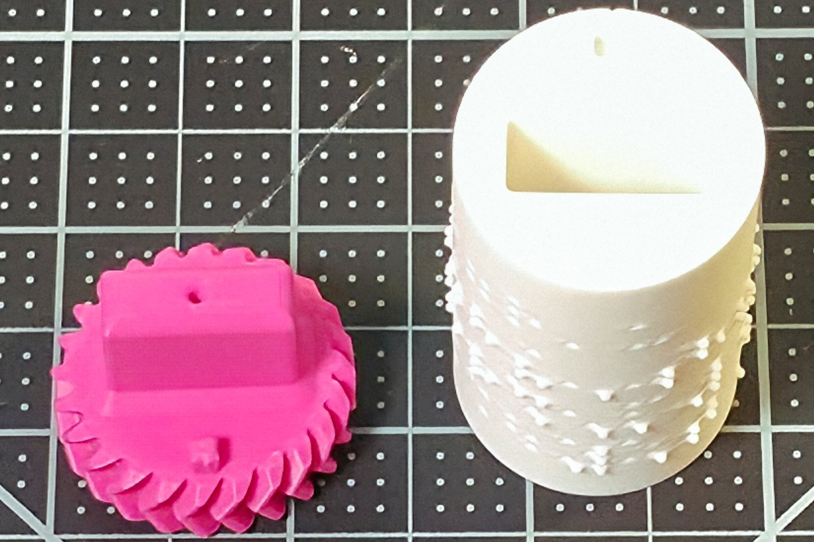

Cylinder A stands upright on the mat with its square keyhole up, and a gear lies beside it with its peg pointing up, ready for the next step.

### Step 2: Put Top Gear A on Cylinder A

You need Cylinder A standing top up, and Top Gear A: the gear whose peg is square, with a small triangle notch cut into the face beside the peg.

**Careful: this gear goes on one way.** The notch beside the gear's peg must sit over the cylinder's top-end bump.

1. Hold Top Gear A with its peg pointing down.
2. Turn the gear until its notch is on the same side as the cylinder's column of triangles.
3. Lower the square peg into the square hole.
4. Press the gear down until its face sits flat on the cylinder's end.

**Check:** The gear's face touches the cylinder's end all the way round, the gear does not rock, and you cannot turn the gear on the cylinder.

**By touch:** Keep one fingertip on the cylinder's top-end bump. With the other hand hold the gear peg down and feel its lower face for the small notch at the foot of the peg. Turn the gear until the notch is over your fingertip, then slide your finger away and lower the peg into the hole. Push down until it stops: the gear drops the last millimetre as the notch goes over the bump. Run a fingernail round the join between gear and cylinder. There is no gap, and the gear will not twist.

<!-- shot: step-2-notch-over-bump | angle: close, hands | show: Top Gear A held a finger's width above Cylinder A, peg down, the notch lined up over the triangle bump -->

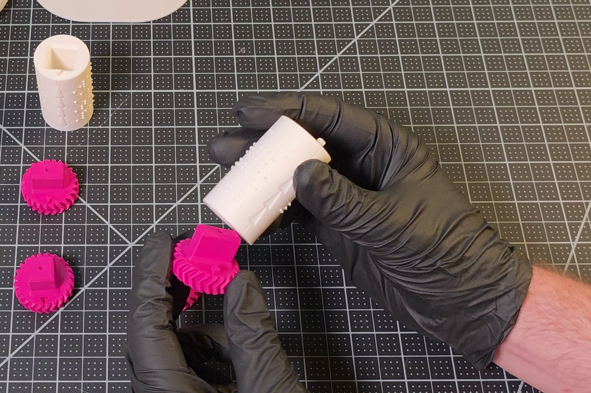

One hand holds the cylinder upright, its dots and raised triangles toward you, while the other presses a gear down onto the top end.

### Step 3: Put Bottom Gear A on the other end

You need Roller A so far, and Bottom Gear A: the gear whose peg is a rectangle 18 mm by 10 mm, with a small raised triangle stud on the face beside the peg.

**Careful: this gear goes on one way too.** The stud on the gear must drop into the dent in the cylinder's bottom end.

1. Turn the cylinder over so Top Gear A is on the table and the bottom end faces up.
2. Hold Bottom Gear A peg down and turn it until its stud is on the same side as the column of triangles.
3. Lower the peg into the hole.
4. Press the gear down until its face sits flat on the cylinder's end.

**Check:** Both gears sit flat and neither turns on the cylinder. Roller A is finished.

**By touch:** Feel the bottom end of the cylinder: a rectangular hole and, beside it on the same side as the column of triangles, a small sunk triangle, the dent. Hold the gear peg down and feel its lower face for the small stud at the foot of the peg. Turn the gear until the stud is over the dent, lower the peg in and push until it stops. Check the join with a fingernail: no gap.

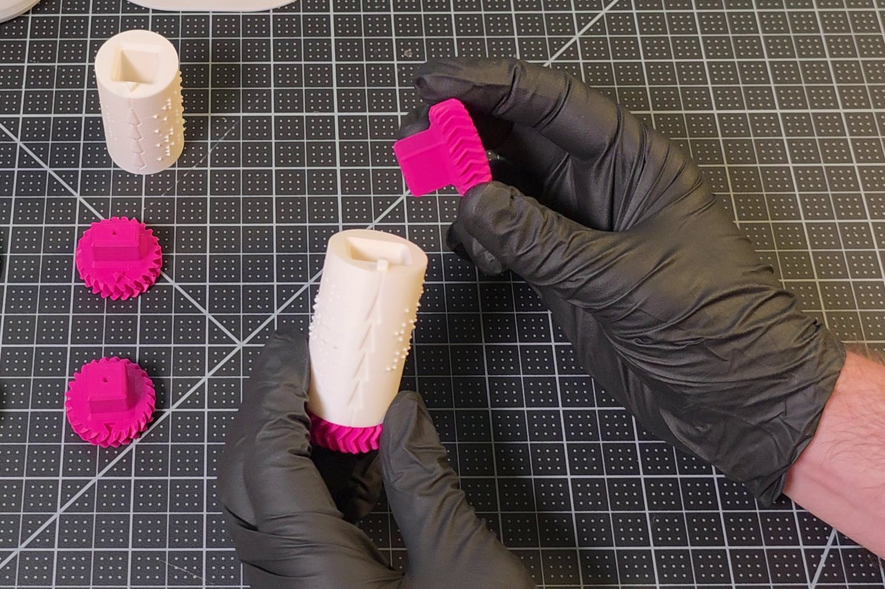

The cylinder turned over, the first gear now at the bottom, and the second gear pressed onto what was the bottom end.

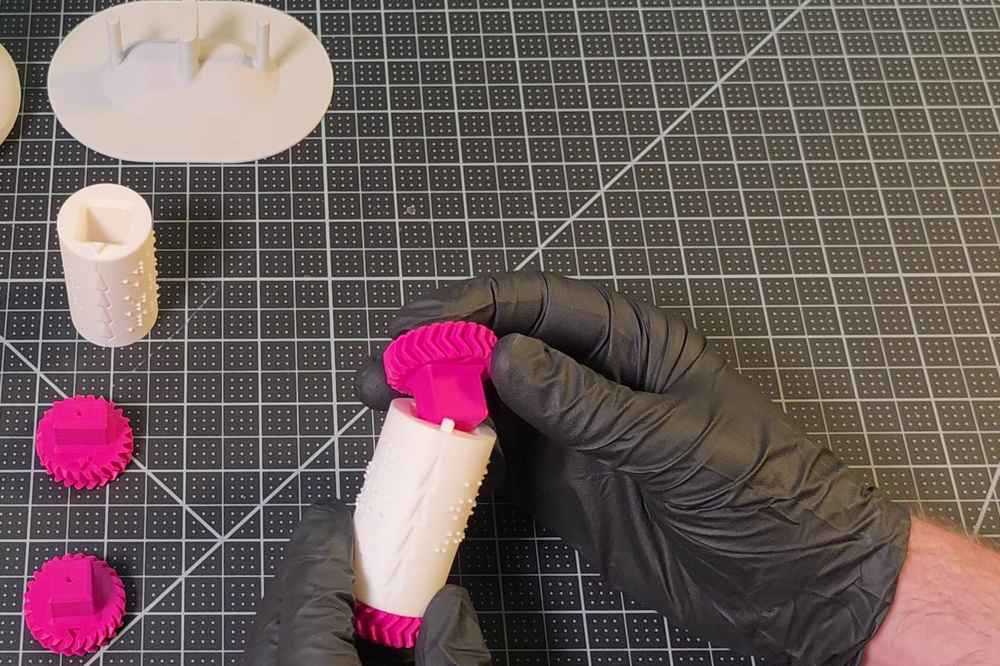

The first finished roller, held up in one hand: a gear at each end, their teeth standing out past the cylinder.

### Step 4: Stand Cylinder B top up

You need Cylinder B, the cylinder with the sunken triangles.

1. Hold Cylinder B and find the column of sunken triangles down its side.
2. Stand it on the table with the triangles pointing up.

**Check:** The end facing up has a rectangular hole and a small raised square beside it.

**By touch:** As in Step 1, but the column triangles are sunk, not raised, and the top-end bump beside the top hole is a square.

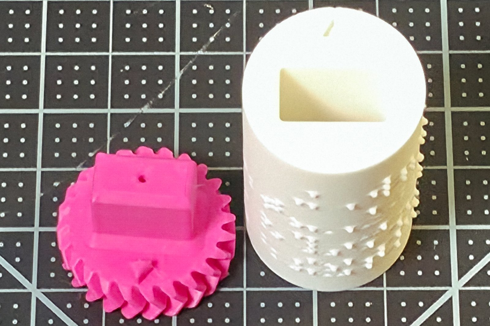

Cylinder B stands upright on the mat, its rectangular keyhole up, and a gear lies beside it ready to go on.

### Step 5: Put Top Gear B on Cylinder B

You need Cylinder B standing top up, and Top Gear B: the gear whose peg is a rectangle 16 mm by 12 mm, with a small square notch cut into the face beside the peg.

**Careful: this gear goes on one way.** The notch beside the gear's peg must sit over the square top-end bump.

1. Hold Top Gear B peg down and turn it until its notch is on the same side as the column of triangles.
2. Lower the peg into the hole.
3. Press the gear down until its face sits flat.

**Check:** The gear sits flat and will not turn on the cylinder.

**By touch:** As in Step 2: a fingertip on the cylinder's square top-end bump, find the notch beside the gear's peg, turn the notch over your finger, lower, push until it drops home. No gap at the join.

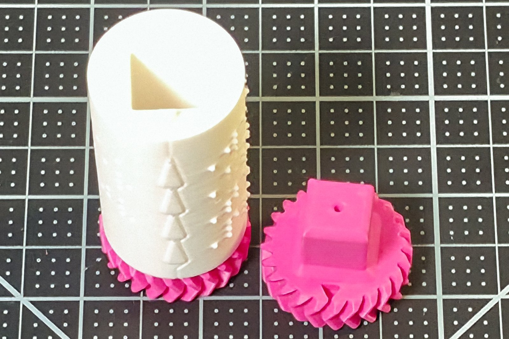

Cylinder B stands on its first gear, its free end up, with the last gear lying beside it.

### Step 6: Put Bottom Gear B on the other end

You need Roller B so far, and Bottom Gear B: the gear whose peg is a flat bar 20 mm by 8 mm, with a small raised square stud beside the peg.

1. Turn the cylinder over so Top Gear B is on the table.
2. Hold Bottom Gear B peg down and turn it until its stud is on the triangle side.
3. Lower the peg into the hole and press the gear down until it sits flat.

**Check:** Roller B is finished.

**By touch:** As in Step 3: find the dent beside the bottom hole, find the stud on the gear, stud over dent, lower, push home.

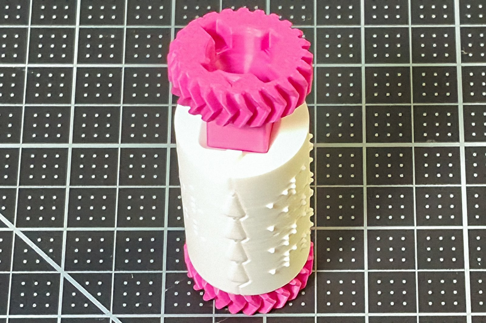

Roller B finished and standing on its bottom gear.

### Step 7: Pair the two rollers

You need Roller A and Roller B.

The two rollers stand side by side with their teeth meshed, and their columns of triangles face each other: Cylinder A's raised triangles nest into Cylinder B's sunken ones. This is the step that sets the braille rows level.

1. Stand both rollers on the table, top gears up.
2. Turn Roller A so its column of triangles faces Roller B, and Roller B so its column faces Roller A.
3. Slide the rollers together until their gears mesh and the two cylinders touch.
4. Turn the top gears a little until Cylinder A's triangles sit inside Cylinder B's hollows.
5. Pinch the two rollers together in one hand, like two batteries side by side, and keep them that way.

**Check:** Looking down, the two top gears mesh and the two cylinders touch along their whole height. Each top gear's hub-face triangle mark points across the join at the other gear's. Looking at the join between the cylinders, each raised triangle on A sits in a hollow on B, with none showing. Turn one top gear with a finger: both rollers turn together and the triangles stay nested.

**By touch:** Hold one roller in each hand, each by its top gear. Find each cylinder's column of triangles with a thumb and bring the two columns together so the thumbs meet. Push the rollers together until the teeth mesh (they click into each other) and the cylinders touch. Now feel along the join from top to bottom with a fingertip: the raised triangles of A should have disappeared into the hollows of B. If you feel a raised triangle standing proud, turn one top gear a tooth at a time until it drops in. When the join feels smooth from top to bottom, close one hand round both rollers and hold them together.

<!-- shot: step-7-arrows-nested | angle: close | show: the join between the paired cylinders from the front, Cylinder A's raised triangles sitting inside Cylinder B's hollows -->

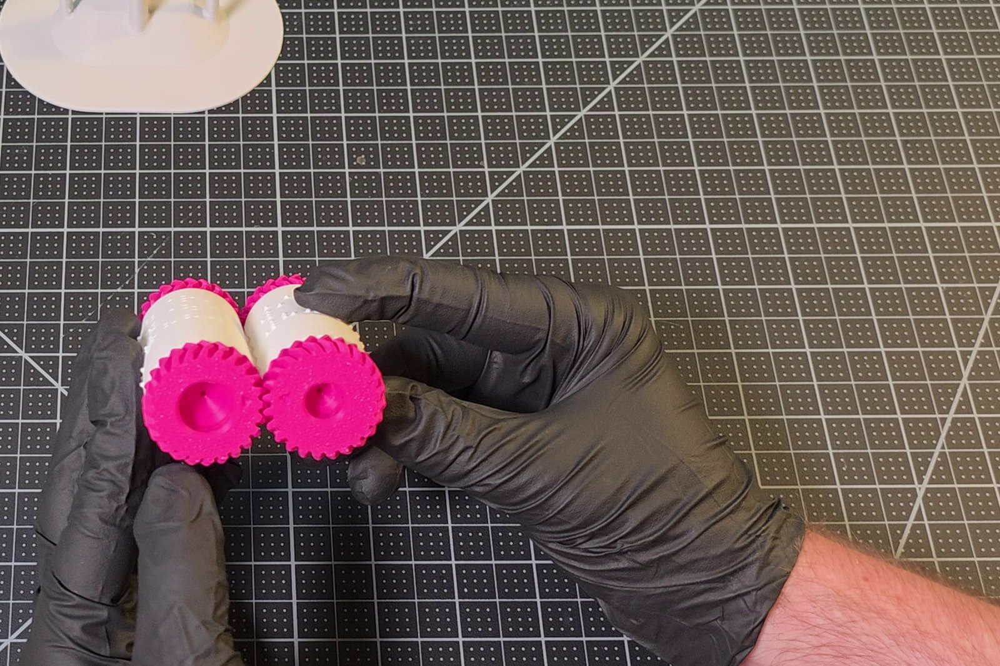

The two rollers held together, from above. The teeth of the two top gears interlock, and the two cylinders touch.

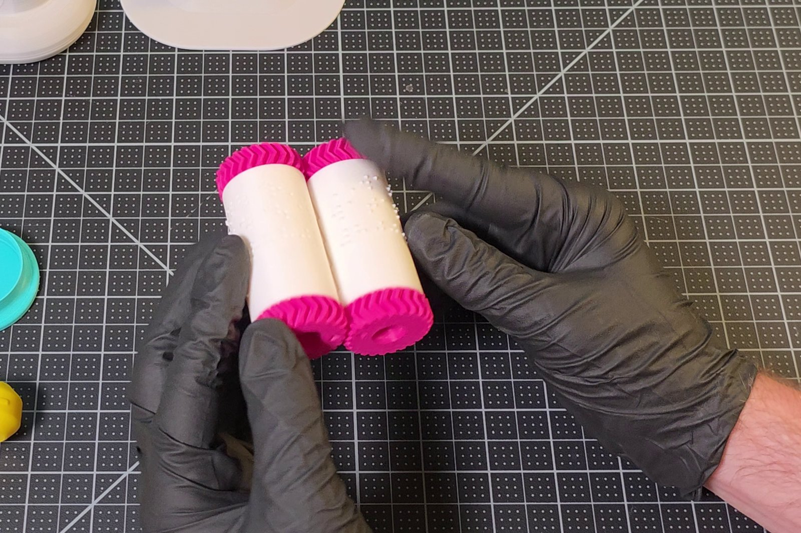

The pair turned to show the join between the two cylinders.

### Step 8: Put the roller pair in the Base

You need the paired rollers held together in one hand, and the Base.

**Careful: Roller A goes on the left.** With the window facing you, Roller A, the one with the raised triangles, is on the left, and Roller B on the right. The pair only drops fully home that way round, because the Base's two floor posts are different sizes.

1. Stand the Base on the table with its window toward you.
2. Hold the pair upright and together, bottom gears down, Roller A on your left and the join between the cylinders toward you.
3. Lower the pair into the Base's open top, and keep pushing down until the rollers stop on the floor.
4. Let go.

**Check:** Looking down into the Base, the two top gears sit level with each other and mesh, each with its cross facing up: the keyed pocket (Top Gear A) on the left and the small grooved pocket (Top Gear B) on the right. Through the window you can see both cylinders, and the join between them is in the middle of the window.

**By touch:** Stand the Base on the table and find the two arrows on its tower; turn the Base so they are on your right-hand side, which puts the window toward you. Keep the pair pinched in your other hand, bottom gears down, with the join toward you and Roller A under your left thumb. Lower the pair into the open top and push down until it stops. Reach into the top: two gear faces, level with each other, each with a cross you can feel. The left one has a wide pocket with four keyways; the right one a small pocket. Reach into the window: two cylinders side by side, the join in the middle.

<!-- shot: step-8-pair-half-in | angle: low, hands | show: the roller pair half way into the Base, the Base's arrow on the right, Roller A on the left -->

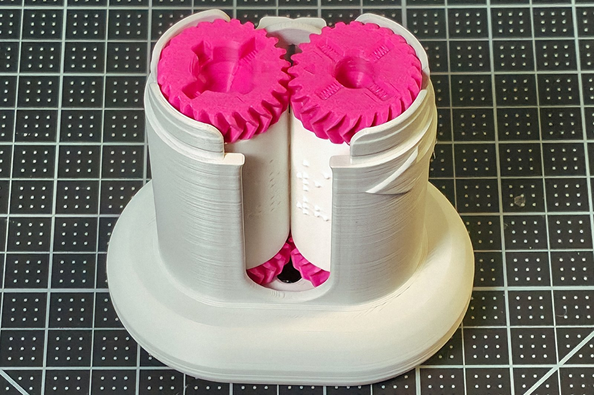

The Base from the front with the pair seated. The two top gears show above the rim, meshed; through the window both cylinders show, with the join in the middle.

### Step 9: Put the Knob on Top Gear A

You need the Base with the rollers in, and the Knob.

1. Hold the Knob with its tab up and its shaft down.
2. Lower the shaft into the keyed pocket of the left top gear, Top Gear A, and turn the Knob until the X of ribs finds the X of keyways and the shaft drops in.
3. Press the Knob down until it stops.

**Check:** The Knob's collar sits flush on the gear's hub face. There is no click and nothing to feel: it stops, and that is all. Turning the Knob turns both rollers. The Knob fits two ways, half a turn apart, because its two long ribs match the two long keyways either way round, and both are right: the tab ends up along the same line.

**By touch:** Find the left top gear's wide keyed pocket with a fingertip. Hold the Knob by its head, shaft down, and set the shaft in the pocket. Turn the Knob slowly until it drops into the pocket, then press down until it stops, flush with the gear. There is no click. Turn the Knob: both rollers turn with it, and you can feel the right top gear moving under your other finger.

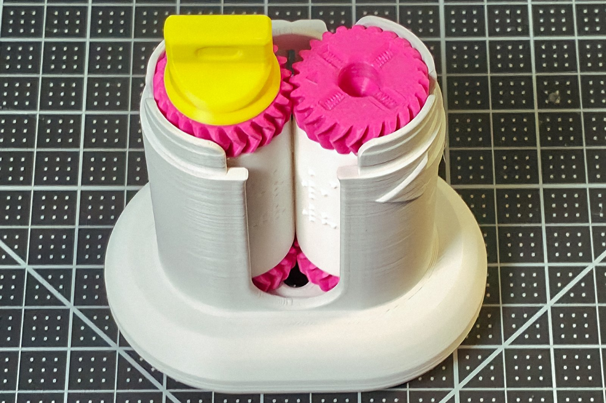

The Base from the front with the Knob seated on the left top gear. The right top gear is bare. The Lid is not on yet.

### Step 10: Put the Lid on

You need the Base with the Knob on, and the Lid.

1. Hold the Lid with its post down and its Knob hole over the Knob.
2. Lower the Lid onto the Base so the Lid's post goes into the small pocket of the right top gear and the Knob's head comes up through the Knob hole.
3. Press the Lid down firmly all the way round until it snaps onto the Base.

**Check:** It takes a fair push, and you feel or hear a snap as the Lid seats. The Lid sits flat with no gap, the Knob's head stands up through the Knob hole, and the Knob still turns freely. If you find the Knob is not on yet, stop: the Knob hole is too small for the Knob's collar, so lift the Lid off by its edge on the left and go back to Step 9.

**By touch:** Hold the Lid flat, post down, and find the Knob hole with a thumb. Set the Knob hole over the Knob's head, with the post toward the right-hand side of the Base. Lower the Lid and press down firmly round its edge until it snaps; it needs a fair push. Run a finger round the join between Lid and Base: no gap. Turn the Knob: it turns.

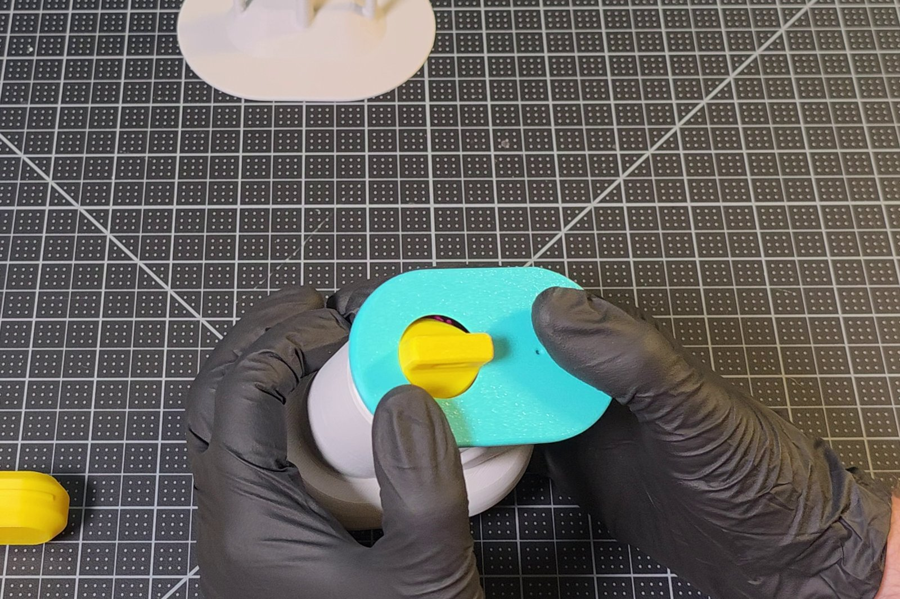

The Lid pressed down onto the Base with both hands, the Knob's head through its hole.

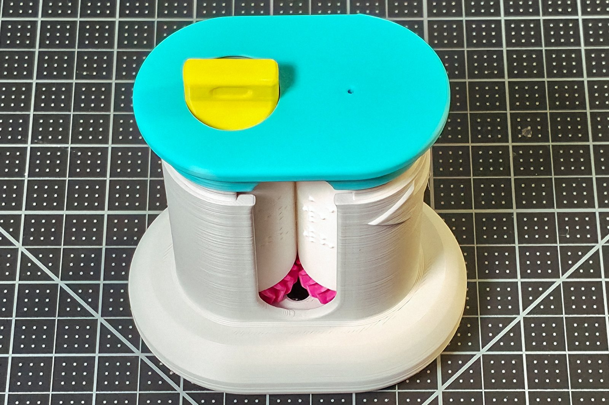

The Base from the front with the Lid pressed on. The Knob's head stands up through the Knob hole on the left, its tab across it.

### Step 11: Snap the Handle on

You need the embosser with the Lid on, and the Handle.

1. Hold the Handle by its grip, cup down, with the grip pointing to the right.
2. Set the cup over the Knob's head and turn the Handle a little until the cup's rounded-rectangle opening lines up with the head.
3. Press the Handle straight down, with a small push, until it snaps on.

**Check:** You feel or hear a snap, and the Handle does not lift off when you pull up gently. The grip points to the right, over Roller B. The embosser is complete.

**By touch:** Find the Knob's head with a fingertip, the rounded rectangle with the tab across it, and the same shape inside the Handle's cup with another. Hold the grip pointing to the right, over Roller B. Set the cup over the Knob and turn the Handle a little until the cup's opening sits over the head; the cup drops a little when it does. Press straight down with a small push: a snap. Pull up gently: it stays. Feel where the grip points: right, along the Base, over Roller B.

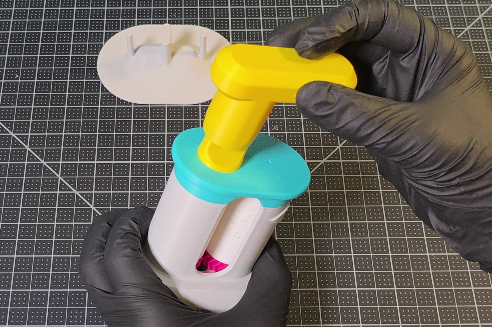

The Handle brought down over the Knob, cup first.

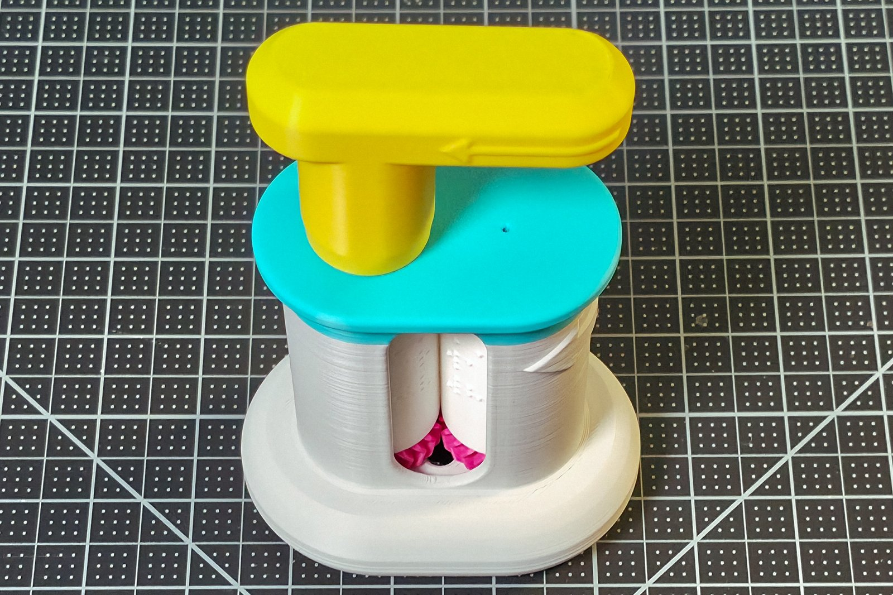

The complete embosser from the front: Base, Lid, Knob and Handle all in place, the cylinders showing through the window.

### Step 12: Turn it to test

1. Hold the Base down with one hand.
2. Turn the Handle a full turn each way.
3. Bring the Handle back to the home position: the grip level, pointing to the right over Roller B, the same distance from the front of the Base as from the back.

**Check:** The Handle turns with a little resistance but no catching, and both cylinders turn together. In the home position the triangles on the two cylinders are nested; look through the window to see it.

**By touch:** Hold the Base and turn the Handle a full turn. The motion is even. Bring the grip back to lie along the Base, pointing right, and feel that it is the same distance from the front edge as from the back: that is home, and home means the triangles are nested. Every card starts from home, so it is the position worth knowing by feel.

<!-- shot: step-12-turning-the-handle | angle: standard, hands | show: one hand holding the Base down, the other turning the Handle, the cylinders moving in the window -->

## 5. Emboss your first card

The User Guide's section 4 gives the seven steps with a picture each; this is the same test for the hands. The large arrow beside the slit points toward the Handle: the card's printed top edge goes that way.

**By touch:** Bring the Handle to home: grip level, pointing right. Lay the embosser down on its window side and feel for the slit along the face that is now on top; the foot is at your left and the Handle at your right. Hold the card upright by its top end, with its printed top edge toward the Handle, lower its bottom edge into the slit and let it settle on the cylinders. Turn the Handle until you feel the card gripped, about half a turn, then roll the embosser over along its length so the window faces up, the Handle still at your right. Keep turning: the card rises out of the window under your other hand, and you can feel the dots on it as it comes. When the last row is out and the card's trailing edge is still held in the cylinders, turn the other way until the first row is back inside, then forward again, twice more, the card never leaving the cylinders. Turn until the card is out, take it and read it.

**Check:** Every dot is raised, firm and the same height. If not, the User Guide's troubleshooting table says what to change.

## 6. Swap cylinders

To change the message you change both cylinders together: the two of a pair are made together and go in together.

1. Lift the Lid by its edge on the Knob side, the left, straight up. The Knob and Handle come off with it, as one piece. Lift from that edge only, so the Lid is not strained.
2. If you printed the Push-out Plate, set the Base down onto it so the Plate's three pegs go up through the slot and holes in the Base's floor. The rollers rise. Lift them out together.
3. If you have no Plate, grip both top gears and pull the pair straight up.
4. Pull the four gears off the old cylinders and push them onto the new ones, as in Steps 2 to 6.
5. Pair the rollers and put them back, as in Steps 7 to 11.

**By touch:** Feel for the Lid's edge on the left, under the Knob, and lift there; the whole top comes away. Feel for the Plate's three pegs and the three openings in the Base's underside, line them up, and lower the Base onto the Plate until the rollers lift under your fingers.

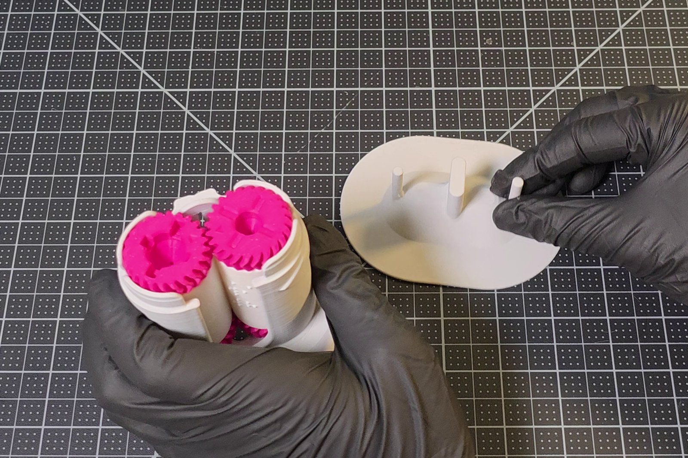

The Base lowered onto the Push-out Plate.

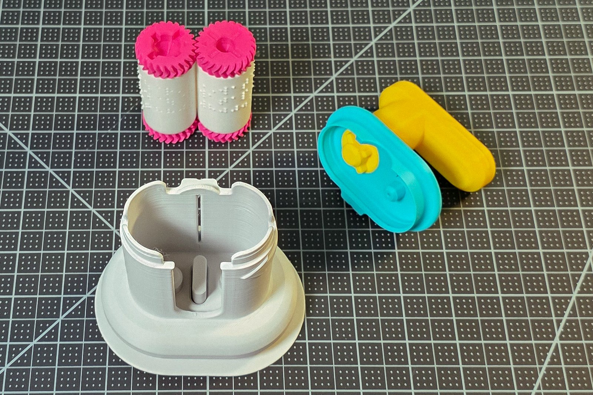

The two rollers standing beside the empty Base after the swap.

<!-- shot: lid-knob-handle-lifted-off | angle: standard, hands | show: the Lid lifted a hand's width above the Base with the Knob and Handle still attached, the top gears showing -->

### One-piece rollers

There is nothing to push on and nothing to come off: go straight to Step 7 with the two rollers, and swap them as whole rollers.

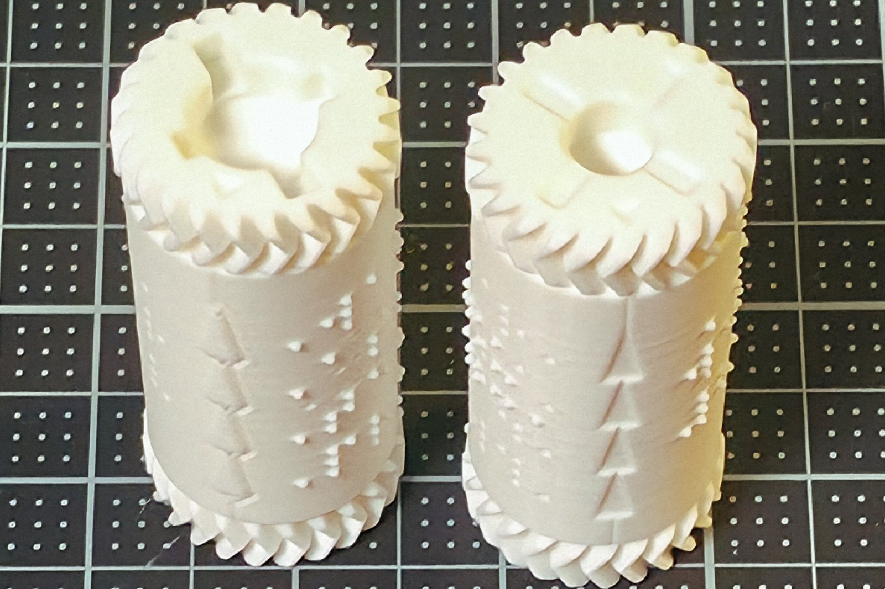

A pair of one-piece rollers: white from end to end, with the gear teeth printed as part of each cylinder.

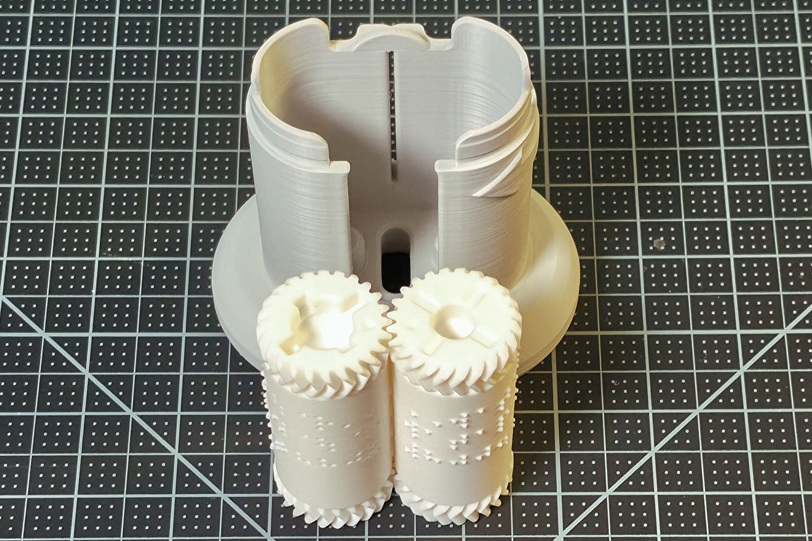

The one-piece pair in the Base, seen from the front, before the Knob, Lid and Handle go on.

## 7. If something does not fit

| What you see or feel | What it usually means | What to do |
|---|---|---|
| A gear's peg will not enter the hole | Wrong gear for that end | Try one of the other gears; only one fits |
| A gear goes in but stands proud and rocks | The peg-face notch or stud not over the top-end bump or the dent | Lift it, turn it until the notch or stud is on the side of the column of triangles, push again |
| The pair will not drop fully into the Base | Pair in back to front | Lift out, swap left for right, put back |
| The Handle turns stiffly or catches | Triangles not nested, or pair back to front | Lift the Lid, lift the rollers, go back to Step 7 |
| The Lid will not sit flat | Post not in its pocket, or Lid turned round | Lift, turn the Lid so the Knob hole is over the Knob, press firmly again |
| The Knob finds no pocket in the top gear | Pair in upside down, top gears at the bottom | Lift the pair out, turn it over so the crosses face up, put it back |
| The Knob's collar will not pass through the Knob hole | Lid went on before the Knob | Lift the Lid by its left edge, put the Knob on, then the Lid |
| The Handle's grip points left at home | Handle on the other way | Lift the Handle, turn it half a turn, press it on again |
