# Maker Guide

How to make the Custom Braille Embosser, Version 2: print nine parts, make two braille cylinders, and put them together in twelve steps. This is the short edition.

## 1. What you are making

A hand-turned press for business cards. Two cylinders stand side by side inside a Base; a card goes in at the slit in the back, between them, and when you turn the Handle the cylinders roll it through and out of the window at the front, pressing braille dots into it on the way. The message is on the cylinders, so to change the message you change the cylinders.

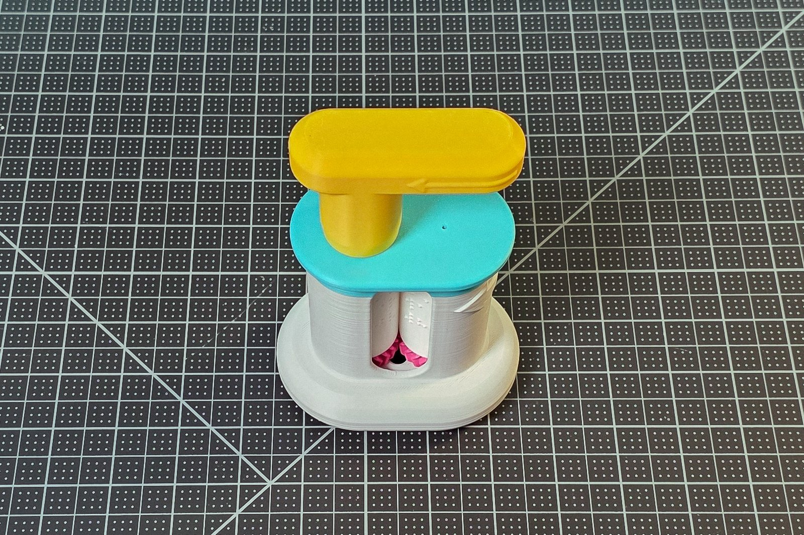

The finished embosser from the front, with the two cylinders showing through the window.

No tools, no glue, no screws, no springs: every part pushes or snaps together by hand.

## 2. Print the parts

| Part | File | How many |
|---|---|---|
| Base | `Base.stl` | 1 |
| Lid | `Lid.stl` | 1 |
| Top Gear A | `Top_Gear_A.stl` | 1 |
| Bottom Gear A | `Bottom_Gear_A.stl` | 1 |
| Top Gear B | `Top_Gear_B.stl` | 1 |
| Bottom Gear B | `Bottom_Gear_B.stl` | 1 |
| Knob | `Knob.stl` | 1 |
| Handle | `Handle.stl` | 1 |
| Push-out Plate | `Push-out_Plate_(optional).stl` | 1, optional |

The files are in `Build_Files/3D_Printing_Files/STL/`. The settings they were tested with: your printer's default 0.2 mm profile, supports off, 3 walls and 15 % infill, in any rigid filament and any colour. A sliced Bambu Studio project for the Bambu Lab X1C with every part on one plate is in `Build_Files/3D_Printing_Files/Print_Profiles/`. The Push-out Plate is a tool for lifting the cylinders out; it is optional, for anyone who changes cylinders often.

## 3. Make the cylinders

The cylinders are generated for your text rather than downloaded, and that is Step 1 of the project, with its own guide: the [Web Generator Guide](Step_1_Guide_Option_1_Custom_Braille_Embosser_V2_Web_Generator_Guide.md) takes you from the web app to the printed pair, and the [OpenSCAD Generator Guide](Step_1_Guide_Option_2_Custom_Braille_Embosser_V2_OpenSCAD_Generator_Guide.md) does the same for the offline file in `Build_Files/3D_Printing_Files/Embossing_Plates_Customizer/`. For a first test print before you generate your own, `Build_Files/3D_Printing_Files/Embossing_Plates_Examples/` holds a ready-made pair that says "Washington".

## 4. Assemble

Sit at a table with the Base in front of you, its window, the tall opening in the middle of the tower's front where the card comes out, facing you. Left means the side of your own left hand and right the side of your own right hand as you sit facing the window; front is the window side, nearest you, and back is the slit side, farthest from you. The top of a part is the end that points up when the embosser stands finished. A roller is a cylinder with both its gears on. One-piece rollers, cylinders printed with their gears already part of them (the web app's Simplified gears or the OpenSCAD file's Gears tab), are complete as printed: start at Step 7. Build Roller A, then Roller B, pair them, put the pair in the Base, then add the Knob, the Lid and the Handle, in that order. When something does not fit, section 7 says what to do.

### Step 1: Stand Cylinder A top up

Cylinder A has the column of raised triangles down its side. Stand it with the triangles pointing up: the top end has a square hole and, beside it, a small triangle, the top-end bump.

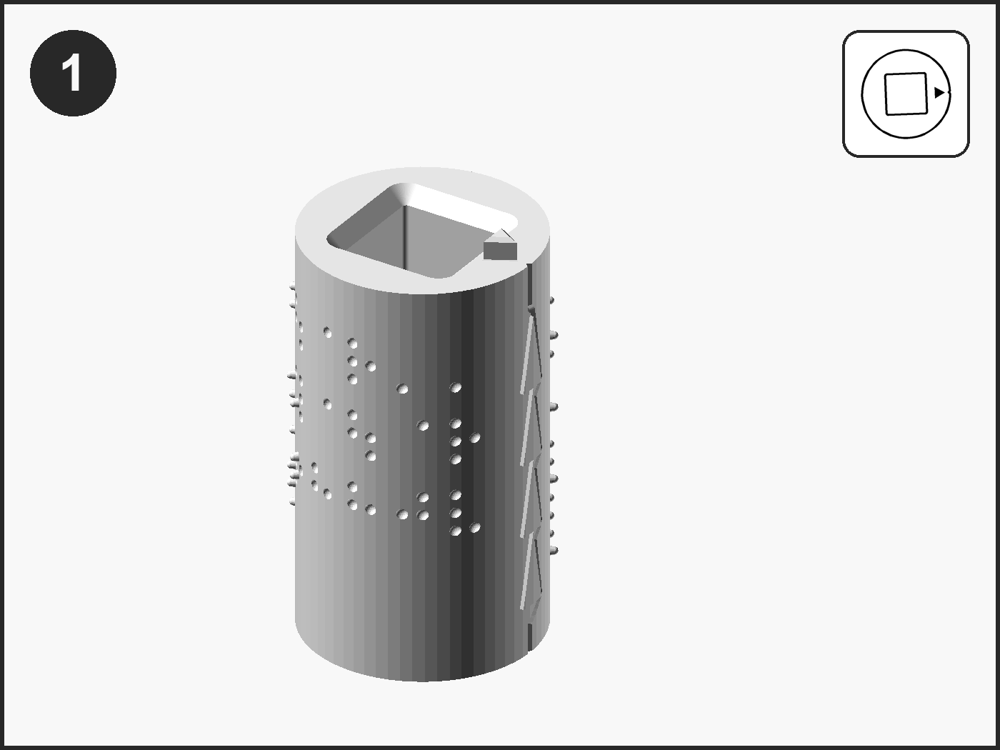

### Step 2: Put Top Gear A on

Top Gear A has the square peg. Hold it peg down, turn it so the small notch beside the peg is over the cylinder's bump, lower the peg into the hole and press the gear flat. It will not rock and will not turn on the cylinder.

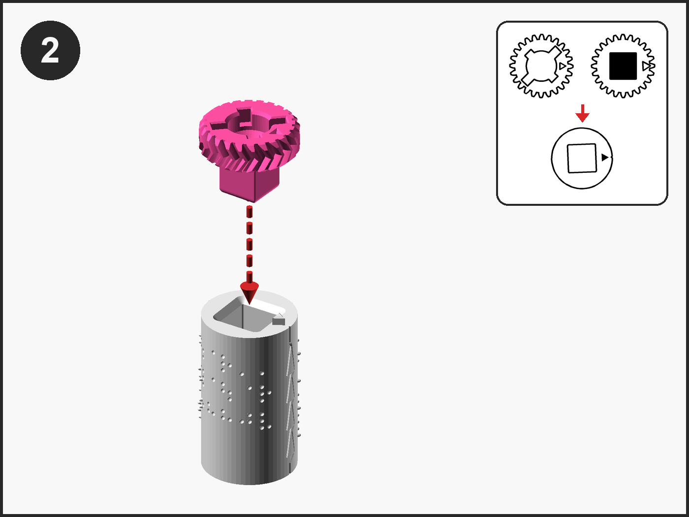

### Step 3: Put Bottom Gear A on the other end

Turn the cylinder over. Bottom Gear A has the 18 by 10 mm peg and a small stud beside it. Hold it peg down with the stud over the dent in the cylinder's end, lower it in and press it flat. Roller A is done.

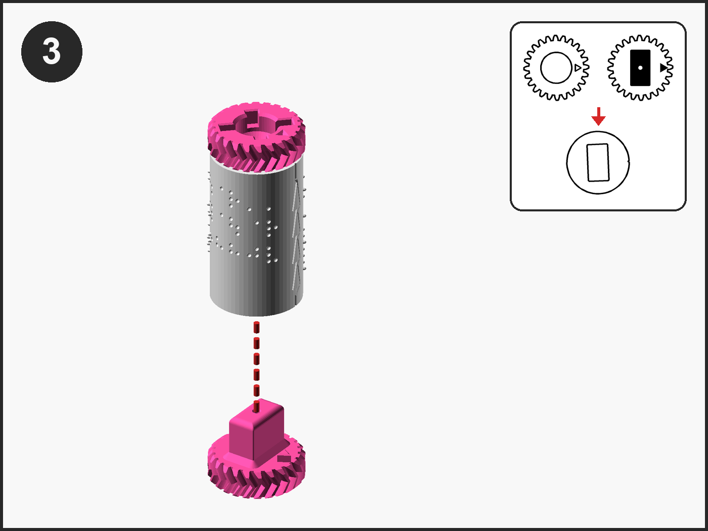

### Step 4: Stand Cylinder B top up

Cylinder B has the column of sunken triangles. Stand it triangles up: the top end has a rectangular hole and, beside it, a small square, the top-end bump.

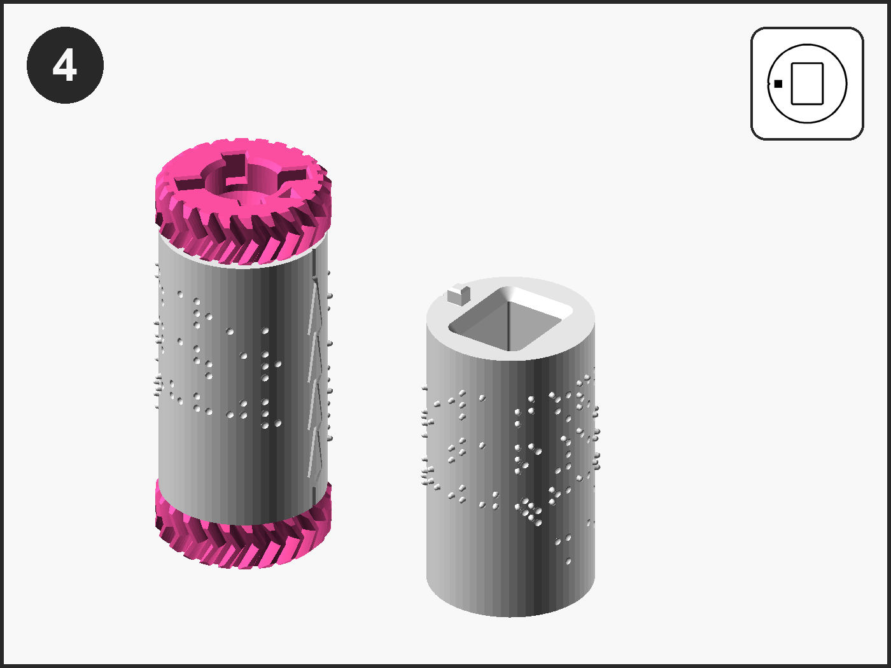

### Step 5: Put Top Gear B on

Top Gear B has the 16 by 12 mm peg. Notch over the top-end bump, peg into the hole, press flat.

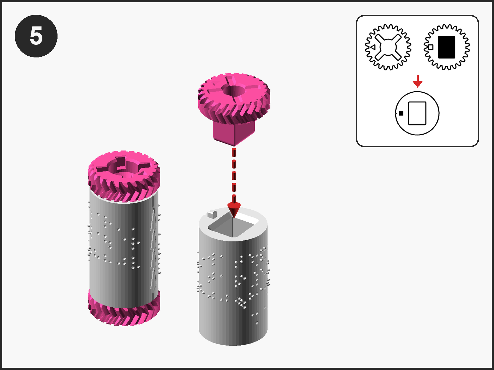

### Step 6: Put Bottom Gear B on the other end

Turn the cylinder over. Bottom Gear B has the flat 20 by 8 mm peg. Stud over the dent, peg in, press flat. Roller B is done.

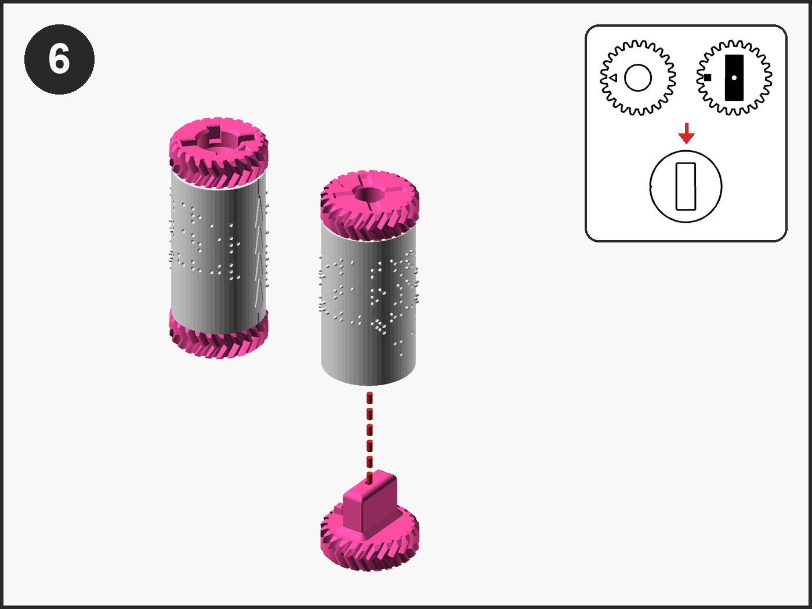

### Step 7: Pair the rollers

Stand both rollers top gears up, turn each so its column of triangles faces the other, and slide them together until the gears mesh and the cylinders touch. Turn a top gear a tooth at a time until every raised triangle on A sits inside a hollow on B. Pinch the pair together in one hand. Seen from above, each top gear's hub-face triangle mark then points at the other gear.

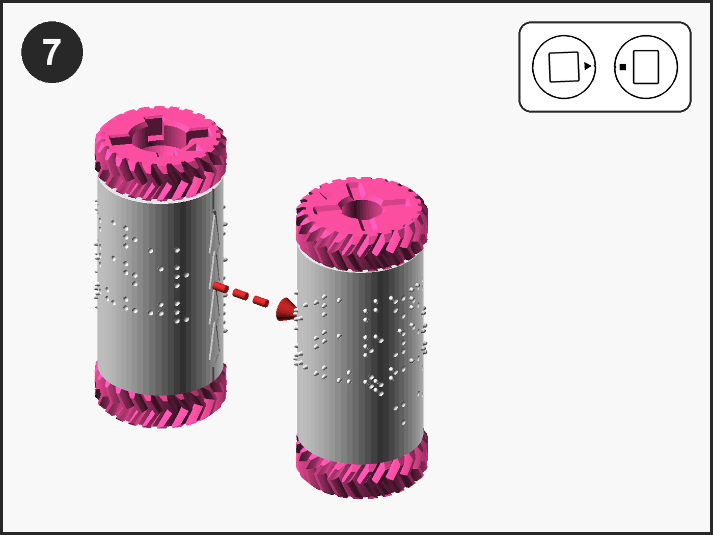

### Step 8: Put the pair in the Base

Stand the Base with its window toward you. Hold the pair bottom gears down, Roller A on your left and the join between the cylinders toward you, and lower it into the Base until the rollers stop on the floor.

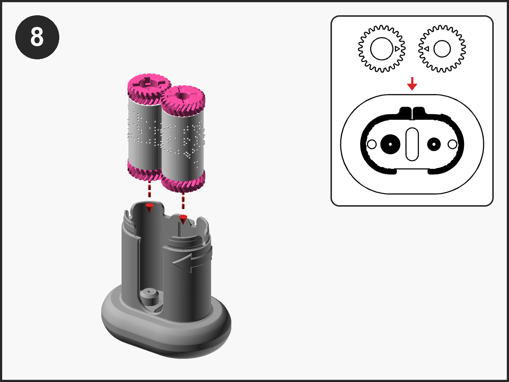

### Step 9: Put the Knob on

Shaft down, tab up, into the keyed pocket of the left top gear; turn until it drops, press until it stops. There is no click.

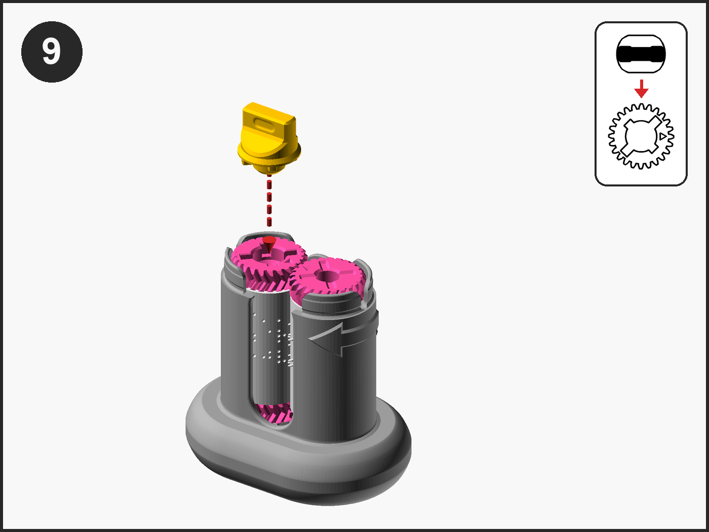

### Step 10: Put the Lid on

Post down, the Knob hole over the Knob. Lower the Lid so its post enters the right top gear's pocket, then press firmly all round until it snaps.

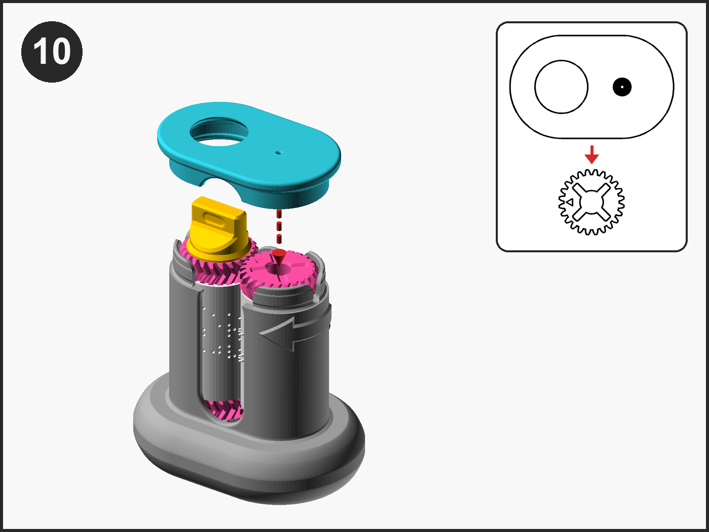

### Step 11: Snap the Handle on

Cup down, grip pointing to the right. Turn it a little until the keyhole in the cup sits over the Knob's tab, then press straight down until it snaps. If the grip points left at rest, lift it, turn it half a turn, and press again.

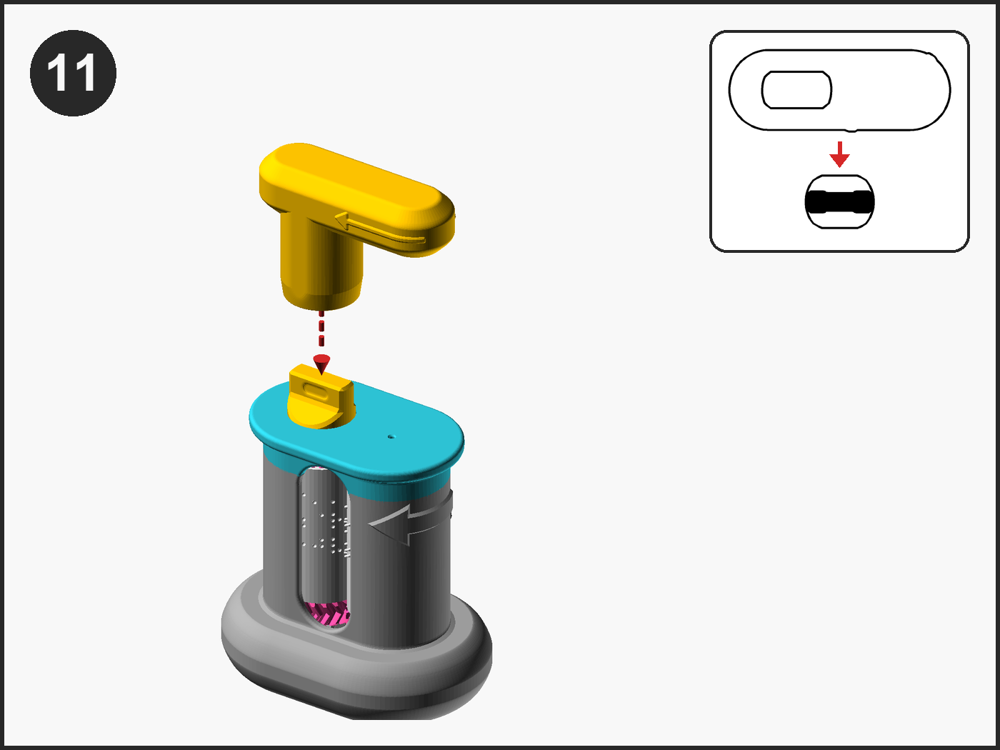

### Step 12: Turn it to test

Hold the Base and turn the Handle a full turn clockwise, seen from above. It turns with a little resistance and no catching, and both cylinders turn. Bring the grip back to lie level along the Base, pointing right, the same distance from the front as from the back: that is home, and at home the triangles on the two cylinders are nested.

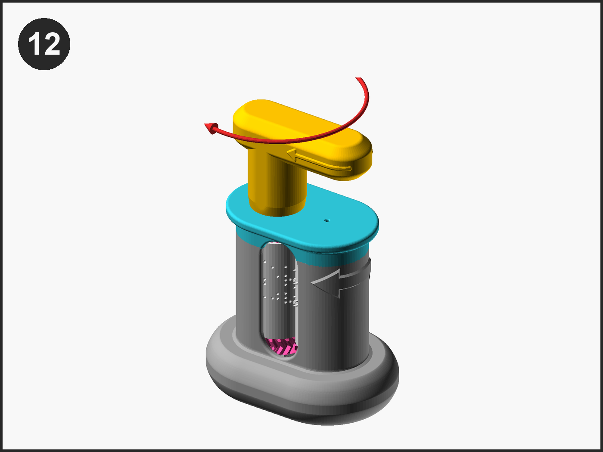

## 5. Emboss a card: the first test

Emboss one card by the User Guide's section 4, seven steps with a picture each. A card with every dot raised, firm and the same height means the build is right; if not, the User Guide's troubleshooting table says what to change.

## 6. Change the cylinders

The User Guide's section 5 says how to swap in a new pair. The gears move to the new cylinders by Steps 2 to 6 of this guide, and the pair goes back by Steps 7 to 11.

## 7. If something does not fit

| What you see or feel | What to do |
|---|---|
| A peg will not enter a hole | Wrong gear for that end; only one fits |
| A gear stands proud and rocks | Lift it and turn it so the notch or stud is on the triangle side |
| The pair will not drop fully into the Base | Lift it out and swap the rollers left for right |
| The Knob finds no pocket | The pair is upside down; turn it over so the crosses face up |
| The Knob's collar will not pass the Lid's hole | Lift the Lid by its left edge, put the Knob on first |
| The Handle turns stiffly or catches | Lift the Lid and the rollers, and pair the rollers again |
