# User Guide

This guide shows you how to emboss a braille card with the Custom Braille Embosser Version 2, how to change its message, and what to do when a card comes out wrong.

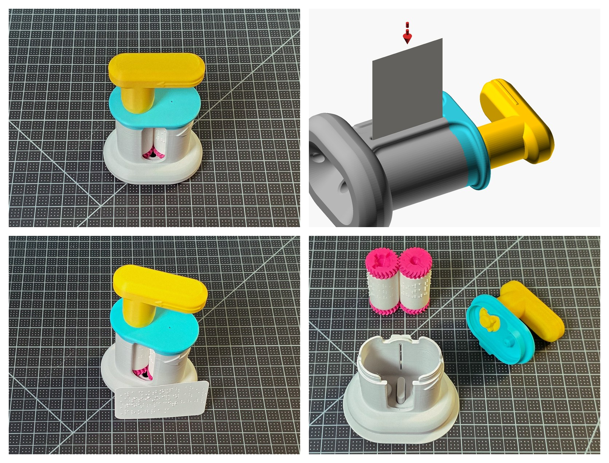

What this guide covers: the embosser, a card going in, the card that comes out, and the rollers out for a new message.

## 1. What is this embosser and what does it do?

The embosser is a hand-turned press for business cards. Two cylinders stand side by side inside a Base. One carries your message as raised braille dots and the other the matching dimples. A card dropped into the slit at the back passes between them when you turn the Handle, and comes out of the window at the front with the braille pressed into it.

The message is on the cylinders, not on the embosser. To emboss a different message you print a different pair of cylinders and swap them in. Section 5 says how.

## 2. How this guide names left, right, front and back

Every direction in this guide is given from one seated position, so first set the embosser up that way.

Sit at a table with the embosser standing on the table in front of you. The Base is the large part that stands on the table. It has an oval foot that sits flat on the table, and rising from the foot a hollow tower that holds the two cylinders. The top of the tower is open and the Lid sits on it. The tower has two openings in its wall. The window is the tall opening in the middle of the tower's front, running from just under the Lid almost down to the foot, about two fingers wide: the card comes out here, and you can watch the dots forming through it. The slit is the narrow opening running down the middle of the tower's back, just wide enough for the edge of a card: the card goes in here. Turn the embosser so the window faces you.

From here on, left means the side of your own left hand and right the side of your own right hand, as you sit facing the window. Front means the window side, nearest you. Back means the slit side, farthest from you. Up means away from the table.

These are the other parts and marks the directions name:

- The Handle: the crank that stands on top of the Lid, toward the left. It is a round cup, which sits over the Knob, with a flat grip as long as a finger reaching out sideways from the cup. A raised arrow runs along the top of the grip and shows which way to turn.
- The two arrows on the Base: both are raised on the right-hand side of the tower. A long arrow with a curved shaft runs from the back of the tower round toward the window, the way the card travels. A large straight arrow beside the slit points up toward the Handle: the card's printed top edge goes that way, so the braille is lined up with the print.
- The home position: the Handle's grip lying level along the top of the embosser, pointing to the right, the same distance from the front of the Base as from the back. In this position the two cylinders' indicator triangles are nested and the embosser is ready for a card. You find it by feel every time: the grip is level and points right.

## 3. Which card the cylinders are made for

The cylinders are laid out for a 90 by 52 mm business card about 0.4 mm thick, which is most business cards. A US card, 3.5 by 2 inches or about 89 by 51 mm, is a little narrower and fits 12 braille cells a row rather than 13. The card goes in short edge first, so the braille rows run along the card's length, the same way as printed text. If the dots on your cards come out wrong, section 7 says what to change.

## 4. Emboss a card

Seven steps. Each has a picture of the embosser as it should be at that step; a red arrow shows the move.

### Step 1: Bring the Handle to home

Turn the Handle until its grip lies level and points to the right (section 2).

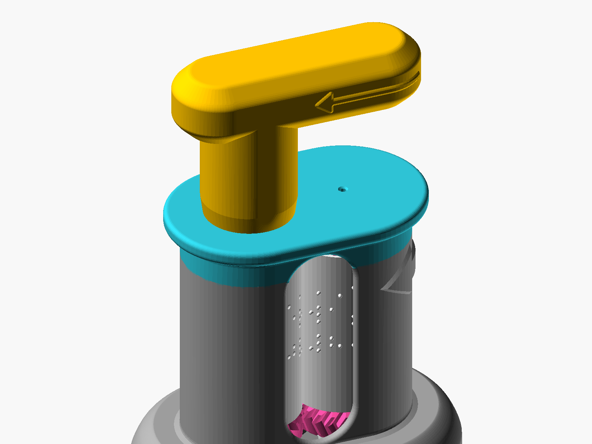

The Handle at home: grip level, pointing right.

### Step 2: Lay the embosser on its side, slit up

Lay the embosser down on the table on its window side, so the slit faces up, the foot is at your left and the Lid and Handle are at your right.

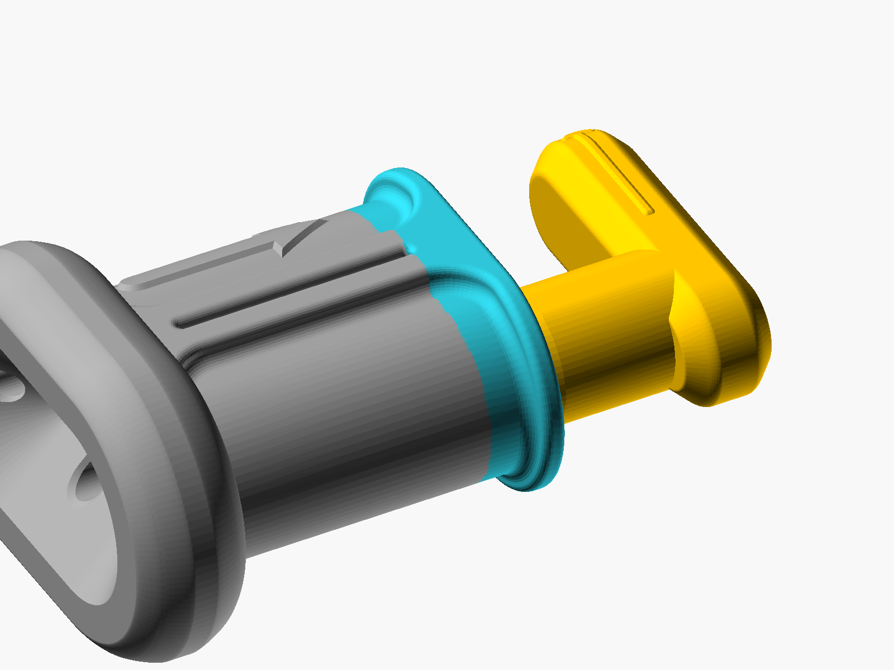

On its side: foot left, Handle right, slit on top.

### Step 3: Drop the card into the slit

Hold the card upright by its top end, with its printed top edge toward the Handle. Lower its bottom edge into the slit and let the card settle until it rests on the cylinders.

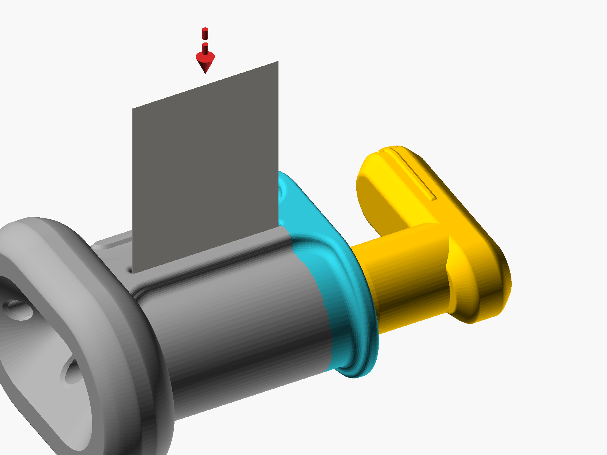

The card standing in the slit, printed top edge toward the Handle.

### Step 4: Turn half a turn

Turn the Handle the way the arrow on its grip points, about half a turn, until you feel the cylinders grip the card. The card stands about half way in.

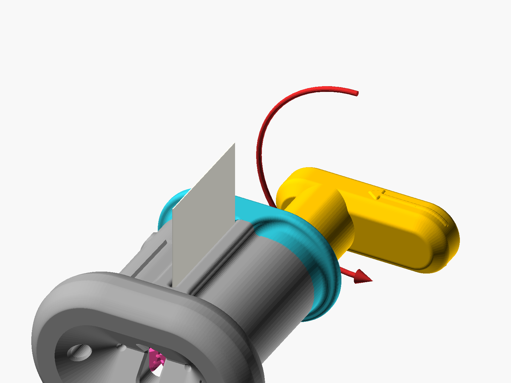

Half a turn: the cylinders have taken the card.

### Step 5: Roll the embosser over and keep turning

Roll the embosser over along its length so the window faces up, keeping the Handle at your right. Keep turning the Handle the same way: the card rises out of the window with its dots standing up as it comes.

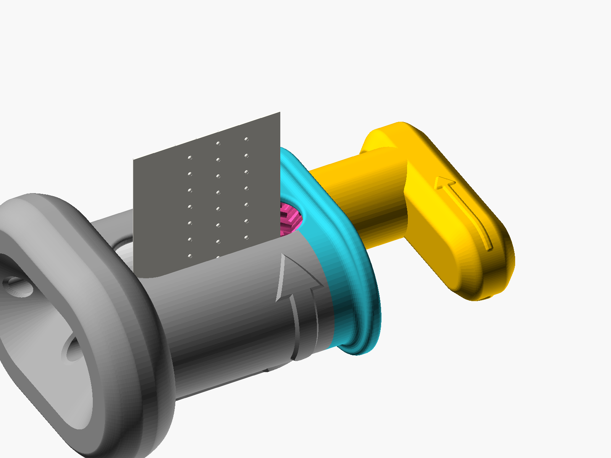

Window up: the card comes out of the window, dots first.

### Step 6: Roll back and forward between the first row and the last

Keep the card in the cylinders' grip for this step. Turn forward until the last row of dots has come out of the window and the card's trailing edge is still held between the cylinders. Then turn the other way until the first row has gone back inside, then forward again. Two or three passes press every dot fully. The card must not leave the cylinders during this: once it has come out, it cannot go back in the same place.

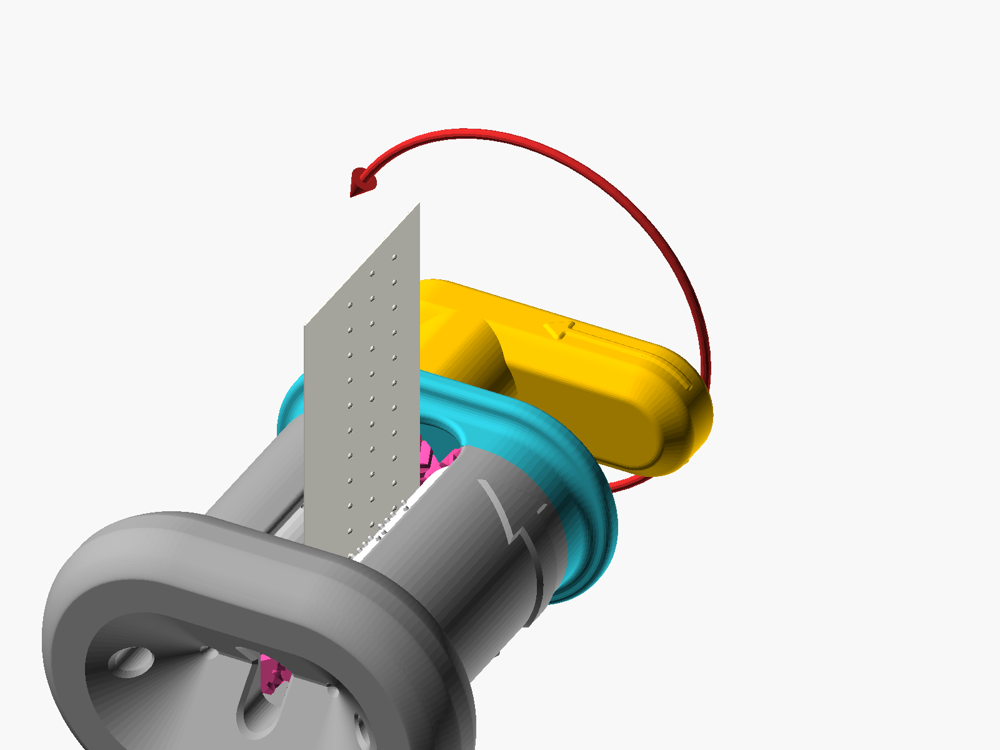

Back and forward over the rows, the card never leaving the cylinders.

### Step 7: Take the card out

Turn forward until the card is out, take it, and read it.

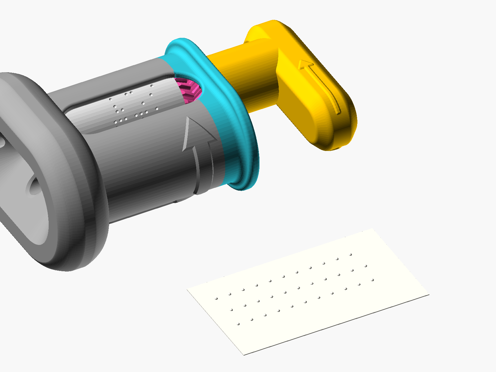

The finished card.

**Check:** Every dot is raised, firm and the same height.

**By touch:** Bring the Handle to home: grip level, pointing right. Lay the embosser down on its window side and feel for the slit along the face that is now on top; the foot is at your left and the Handle at your right. Hold the card upright by its top end, lower its bottom edge into the slit and let it settle on the cylinders. Turn the Handle until you feel the card gripped, about half a turn, then roll the embosser over along its length so the window faces up, the Handle still at your right. Keep turning: the card rises out of the window under your other hand, and you can feel the dots on it as it comes. When the last row is out and the card's trailing edge is still held in the cylinders, turn the other way until the first row is back inside, then forward again, twice more, the card never leaving the cylinders. Turn until the card is out, take it and read it.

## 5. Change the message

Generate and print the new pair as the Step 1 guide says: the Web Generator Guide for the web app, or the OpenSCAD Generator Guide for the offline file. The card thickness setting stays at 0.4 mm unless section 7 sends you to it.

Then take the old pair out in two steps. From there the work is the assembly again: the Maker Guide's Steps 2 to 11 (or the Assembly Guide By Touch's, for the hands) move the four gears to the new cylinders, pair the rollers, put the pair back with Cylinder A on the left, then the Knob, the Lid and the Handle.

### Step 1: Lift the Lid off

Lift the Lid by its edge on the left, under the Knob, straight up. The Knob and Handle come off with it, as one piece. Lift from that edge only, so the Lid is not strained.

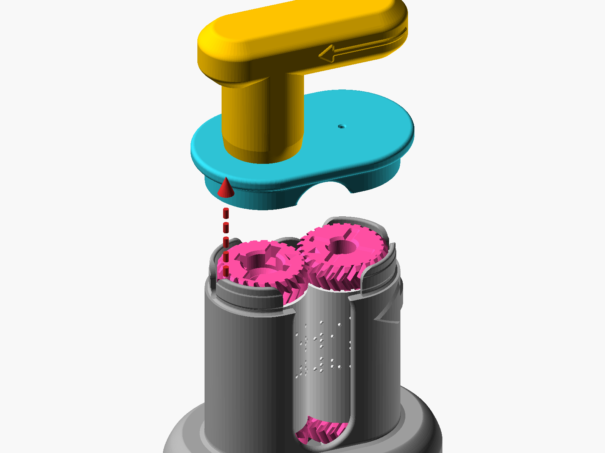

The Lid, Knob and Handle lifted off together, from the edge under the Knob.

### Step 2: Lift the rollers out

If you have the Push-out Plate, set the Base down onto it so the Plate's three pegs go up through the openings in the Base's floor; the rollers rise. Lift them out together. Without the Plate, grip both top gears and pull the pair straight up.

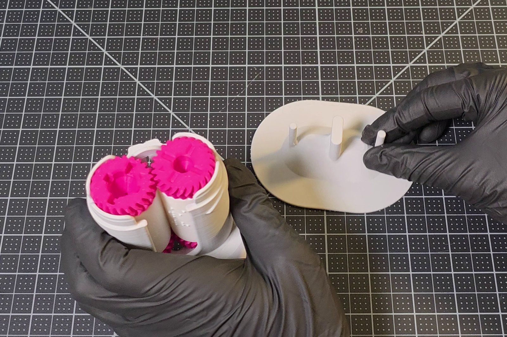

The Base lowered onto the Push-out Plate, its three pegs lined up with the openings in the floor.

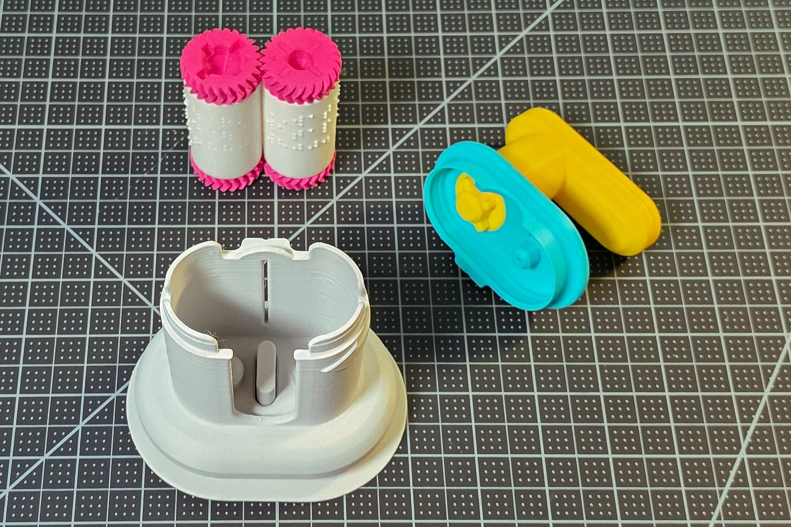

The rollers out, standing beside the empty Base.

**Careful:** the two cylinders of a pair are made together, at one card setting, and go in together.

## 6. Extra steps and recommendations

- Label each pair as soon as it is printed, if you do not read braille yourself: a permanent marker on the end of each cylinder, the same number on both, such as 3A and 3B. Cylinders from different pairs look alike, and a pair made double-sided carries dots that match only its own partner, so a mixed pair embosses nonsense.
- Keep each pair together, in the Base or in its own bag or box, and store the cylinders where nothing presses on the dots of Cylinder A.
- The column of triangles tells the two card settings apart by touch: a pair made at the 0.4 mm setting carries one triangle for each row of text, four on a standard card, and a pair made at 0.3 mm carries exactly three, evenly spaced, so a 0.3 mm cylinder will not nest with a 0.4 mm one. The triangles do not tell one message from another; that is what the labels are for.
- Never force a card through. If the Handle stops, turn back, take the card out and see section 7.

## 7. Troubleshooting

| What you see or feel | What it means | What to do |
|---|---|---|
| Dots faint or missing on part of the card | The card left the cylinders before every row was pressed | Emboss a fresh card, rolling back and forward with the card held in the cylinders (section 4, step 6) |
| Dots faint on every card | The dots on Cylinder A are not fully formed | Print the pair again at finer layers and a slower speed, or with a 0.2 mm nozzle if you have one |
| Dots rough, uneven or broken | A print at the edge of what a 0.4 mm nozzle can shape: printer tuning or a poor PLA | A well-tuned printer, a good PLA, finer layers and slower speed; a 0.2 mm nozzle helps most |
| Holes through the card instead of rounded dots | The card is thinner than the pair was made for | Generate the pair at 0.3 mm (web app, Expert Mode, Card thickness), or use thicker card |
| Dots crushed or flat | The card is thicker than the pair was made for | Use a thinner card, about 0.4 mm |
| The Handle is hard to turn, or stops, with no card in | The rollers bind: a tight print, or the pair in back to front | Lift the rollers out and pair them again (Maker Guide, Steps 7 and 8); if they still bind, reprint at finer layers |
| Braille sits crooked on the card | The card went in askew | Start again with a fresh card, the Handle at home and the card's edge square in the slit |
| Braille is upside down against the print | The card went in the wrong way round | Put the printed top edge toward the Handle |
| The card will not go in | The Handle is not at home | Bring the Handle to home, then drop the card in |
